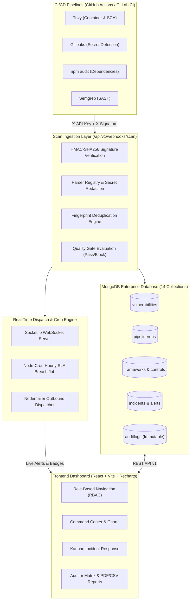
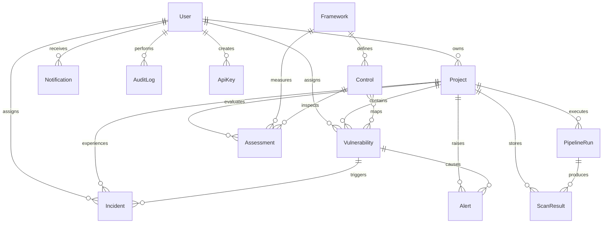

# DevSecOps Compliance and Security Monitoring Dashboard

A centralized enterprise DevSecOps monitoring and compliance platform built using the **MERN** stack (MongoDB, Express, React with Vite, Node.js). Ingests raw scan reports from CI/CD pipeline security tools (Trivy, Gitleaks, npm-audit, Semgrep), normalizes findings, enforces remediation SLAs, evaluates automated CI/CD pipeline deployment gates, maps vulnerabilities to industry compliance controls (OWASP Top 10, NIST CSF, CIS, ISO 27001, SOC 2, PCI-DSS), dispatches real-time alerts via WebSockets/Email, and maintains immutable, tamper-evident audit trails.

---

## 1. System Architecture



---

## 2. Entity-Relationship (ER) Diagram



---

## 3. Pre-Seeded User Accounts (RBAC Credentials)

The system enforces strict **Role-Based Access Control (RBAC)** on both backend routes (`authorize(...roles)`) and frontend navigation (`RoleRoute`).

| Role | Email | Password | Permissions & Scope |
| :--- | :--- | :--- | :--- |
| **Admin** | `admin@devsecops.local` | `Password123!` | Complete access: user provisioning, role promotion, API key management, system settings, audit trail. |
| **Security Analyst** | `analyst@devsecops.local` | `Password123!` | Triage vulnerabilities, declare incidents, conduct compliance assessments, upload manual scan reports. |
| **Developer** | `dev@devsecops.local` | `Password123!` | View assigned projects/vulnerabilities, update remediation status (Open -> In Progress -> Resolved), add comments. |
| **Auditor** | `auditor@devsecops.local` | `Password123!` | Read-only compliance posture, framework matrices, audit logs inspection, and executive report downloads. |

---

## 4. Quick Start & Setup Instructions

### Prerequisites
- **Node.js**: v18+ (Node 20 recommended)
- **MongoDB**: Local MongoDB instance running on `mongodb://127.0.0.1:27017` OR Docker

### Option A: Local Development Setup

1. **Start Local MongoDB Server**:
   ```powershell
   net start MongoDB
   ```

2. **Backend Server Setup**:
   ```bash
   cd server
   npm install
   npm run db:verify   # Proves the MongoDB connection, 13 checks, exit code 0
   npm run seed        # Seeds 14 collections with 228+ authentic records
   npm run db:summary  # Inspects MongoDB collection counts
   npm start           # Starts API at http://localhost:5000
   ```

3. **Frontend Client Setup**:
   ```bash
   cd client
   npm install
   npm run dev         # Starts Vite dev server at http://localhost:5173
   ```

### Option B: Docker Compose Setup

Run the entire platform (MongoDB + Backend + Frontend Nginx) in isolated containers:
```bash
docker-compose up --build
```
- Frontend UI: `http://localhost`
- Backend API: `http://localhost:5000`
- Swagger UI: `http://localhost:5000/api-docs`

---

## 5. Database Connection Verification & Inspection

### 5.1 Prove the connection (`npm run db:verify`)

Runs 13 checks against the live server and exits with code `0` only if all pass.
This is the command to run in front of an examiner.

```bash
cd server
npm run db:verify
```

```
2. CONNECTION
  [PASS] Mongoose connected - readyState=1 (1 = connected)
  [PASS] Host and port reachable - 127.0.0.1:27017
  [PASS] Database selected - devsecops_dashboard
3. SERVER RESPONSE
  [PASS] admin.ping() acknowledged - 7 ms
  [PASS] Server version reported - MongoDB 9.0.2
4. READ / WRITE ROUND TRIP
  [PASS] Document written
  [PASS] Document read back
  [PASS] Temporary collection removed
5. APPLICATION DATA
  [PASS] Collections present - 14 collections
  [PASS] Documents present - 290 documents
6. SCHEMA INVARIANT (deduplication)
  [PASS] Unique index on { fingerprint, project } - fingerprint_1_project_1
  RESULT: CONNECTION VERIFIED (13/13 checks passed)
```

The connection itself is created in `server/src/config/db.js` via
`mongoose.connect(process.env.MONGO_URI)` and is awaited before the HTTP
listener starts in `server/src/server.js`. If MongoDB is unreachable the
process logs the error and exits, so a healthy API is itself proof of a live
database.

### 5.2 Inspect the data (`npm run db:peek`)

```bash
npm run db:peek                    # all collections, document and index counts
npm run db:peek -- vulnerabilities # sample documents + indexes for one collection
npm run db:peek -- users 3         # up to 10 sample documents
```

Sensitive fields (`password`, `secret`, `token`, `hash`, `apiKey`) are redacted
before printing, so the output is safe to project.

### 5.3 Collection counts (`npm run db:summary`)

**Live Document Count Matrix (freshly seeded):**
```
===============================================================
       DEVSECOPS DASHBOARD - MONGODB DATABASE INSPECTION       
===============================================================
Database Name: devsecops_dashboard
Host:          127.0.0.1:27017
---------------------------------------------------------------
#    | Collection Name              | Document Count
---------------------------------------------------------------
1    | alerts                       |              4
2    | apikeys                      |              2
3    | assessments                  |             20
4    | auditlogs                    |              5
5    | controls                     |             27
6    | frameworks                   |              6
7    | incidents                    |              3
8    | notifications                |              4
9    | pipelineruns                 |             32
10   | projects                     |              6
11   | scanresults                  |              0
12   | settings                     |              1
13   | users                        |              4
14   | vulnerabilities              |            114
===============================================================
TOTAL | 14 Collections               |            228
===============================================================
```

> Counts grow as the application is used (logins add audit rows, scans add
> findings). Run `npm run seed` before a demonstration to restore this exact
> canonical dataset.

### 5.4 Switching to MongoDB Atlas (optional)

No code changes are required: set `MONGO_URI` in `server/.env` to the Atlas
connection string, add your IP to the cluster allowlist, and restart.

```
MONGO_URI=mongodb+srv://<user>:<password>@<cluster>.mongodb.net/devsecops_dashboard?retryWrites=true&w=majority
```

Then confirm with `npm run db:verify`. In production the same secret should come
from a secret manager, not a committed file.

---

## 6. College Viva / Evaluator Demonstration Script

Follow this step-by-step walkthrough during practical evaluation to demonstrate each module:

### Step 1: Authentication, Password Complexity & Lockout (Module 1)
1. Navigate to `http://localhost:5173/login`.
2. Enter `dev@devsecops.local` with an incorrect password **5 times consecutively**.
3. **Observe**: The UI displays: *"Account has been locked for 15 minutes due to 5 failed login attempts"*.
4. **Compass Inspection**: Open collection `users`. Observe `failedLoginAttempts: 5` and `lockUntil` timestamp set 15 minutes in the future.
5. Log in as `admin@devsecops.local` / `Password123!`. Navigate to **Admin -> User Directory**. Locate `dev@devsecops.local` showing the red `Locked` badge. Click the **Unlock** icon to instantly clear the lockout.

### Step 2: Executive Dashboard & Interactive Visualizations (Module 2 & 8)
1. On the **Command Center Dashboard** (`/dashboard`), observe:
   - Real-time KPI stat cards: Overall Security Posture score, Open Critical/High findings, CI Gate Pass Rate %, Active Incidents, and SLA Breaches.
   - **Severity Donut Chart**: Rendered with Recharts grouping Critical, High, Medium, and Low vulnerabilities.
   - **30-Day Discovery Trend**: Area chart showing scan ingestion velocity.
   - **Top 5 Riskiest Projects**: Horizontal bar chart highlighting projects with critical findings.
   - **Framework Compliance Ratings**: Bar chart displaying scores across OWASP, NIST CSF, CIS, ISO 27001, SOC 2, and PCI-DSS.

### Step 3: Vulnerabilities & SLA Remediation Lifecycle (Module 3)
1. Navigate to **Vulnerabilities** (`/vulnerabilities`).
2. Filter by `SLA Status -> Breached` or `Urgent (< 48h)`.
3. Click any vulnerability to open the **Vulnerability Drawer**:
   - Inspect CVE details, scanner source (`trivy`, `gitleaks`, `semgrep`, `npm-audit`), affected component, and remediation guidance.
   - Change status from `Open` to `In Progress` or `Resolved`. Provide a triage comment.
4. **Compass Inspection**: In the `vulnerabilities` collection, observe the updated `status` and the appended `activityTrail` record.

### Step 4: Automated CI/CD Webhook with Cryptographic Verification (Module 4)
1. In a terminal, send an authentic scan report using our HMAC test utility:
   ```bash
   cd server
   node scripts/send-sample-scan.js
   ```
2. **Observe Terminal Output**: Computes `crypto.createHmac('sha256', secret)`, sends headers `X-API-Key` and `X-Signature`, and receives `200 OK: Ingestion successful`.
3. Open **Pipelines** (`/pipelines`) in the browser: The new pipeline execution run appears with automated Gate Result (`Passed` or `Failed`), duration, and scanner breakdown.
4. If Gitleaks detected secrets: Observe that the secret is **strictly redacted** (`AKIA*****************`).

### Step 5: Compliance Frameworks & Assessment Scoring (Module 5)
1. Navigate to **Compliance** (`/compliance`).
2. Select **OWASP Top 10** or **PCI-DSS**.
3. Inspect mapped control rules (e.g. `A03: Injection`, `A06: Outdated Components`).
4. Click **Conduct Assessment** on a control: Update status from `Non-Compliant` to `Compliant`. Observe the framework score recompute in real-time.

### Step 6: Incident Response & Post-Mortem Workspace (Module 8)
1. Navigate to **Incidents** (`/incidents`).
2. Inspect active incidents across lifecycle stages: `Detected` -> `Triaged` -> `Contained` -> `Resolved` -> `Post-mortem`.
3. Click an incident to open the **Incident Drawer**:
   - Advance stage to `Contained`.
   - Fill in **Post-Mortem Root Cause Analysis** (Root Cause, Impact, Preventative Actions) and click **Save Post-Mortem**.

### Step 7: Executive Reports & Audit Trail Exports (Module 7 & 8)
1. Navigate to **Reports** (`/reports`):
   - Click **Download Executive PDF**: Streams a formal, styled multi-page security report generated via `pdfkit`.
   - Click **Export Vulnerabilities CSV**: Streams a complete CSV dataset generated via `json2csv`.
2. Navigate to **Admin -> Audit Logs** (`/admin/audit-logs`):
   - Review immutable log entries for all logins, role modifications, settings updates, and scan ingestions.
   - Click **Inspect** to see before/after state diffs.
   - Click **Export Audit CSV** to download the compliance log.

---

## 7. Interactive API Documentation (Swagger UI)

Interactive OpenAPI specification is available at:
```
http://localhost:5000/api-docs
```

Postman collection for import:
```
docs/DevSecOps_Platform.postman_collection.json
```

---

## 8. Automated Test Suite Execution

Run all 41 unit and integration test suites:

```bash
cd server
npm test
```

**Verified Test Suites:**
- `tests/auth.test.js`: Registration, login, lockout, token rotation, RBAC.
- `tests/projects_vulnerabilities.test.js`: Project CRUD, SLA calculations, compound indexes, comments.
- `tests/scan_ingestion.test.js`: Webhook HMAC signatures, Trivy/Gitleaks/npm parsers, deduplication.
- `tests/compliance.test.js`: Frameworks, controls, automated CWE mapping, score calculation.
- `tests/notifications.test.js`: WebSocket notifications, hourly cron SLA breach job.
- `tests/admin.test.js`: Admin metrics, user promotion, API key provisioning, settings audit.
- `tests/incidents_reports_dashboard.test.js`: Incident lifecycle, PDF streaming, CSV exports.

**Results: 7 passed, 7 total (41/41 tests passed).**

---

## 9. Deployment

Two supported targets:

### Vercel (UI) + Render (API) + MongoDB Atlas

Free-tier deployment where the SPA and the API are separate origins.
Full walkthrough: **[`docs/DEPLOYMENT_VERCEL.md`](docs/DEPLOYMENT_VERCEL.md)**

Required configuration at a glance:

| Where | Key | Value |
|---|---|---|
| Vercel | `VITE_API_URL` | `https://<api>.onrender.com` |
| Render | `MONGO_URI` | Atlas connection string |
| Render | `CLIENT_URL` | `https://<app>.vercel.app` |
| Render | `COOKIE_SAME_SITE` | `none` (cross-site refresh cookie) |
| Render | `TRUST_PROXY` | `1` |

A `render.yaml` Blueprint is included for the API service.

### Docker Compose (single origin)

The repository's `docker-compose.yml` + `nginx.conf` already proxy `/api` and
`/socket.io`, so the SPA and API share one origin and no CORS or absolute API
URL is needed. Add TLS (Caddy or Certbot) and point `MONGO_URI` at Atlas.

### Pre-deployment checks

```bash
cd server && npm test          # 41 tests
cd ../client && npm run build  # production bundle
cd ../server && npm run db:verify
```
