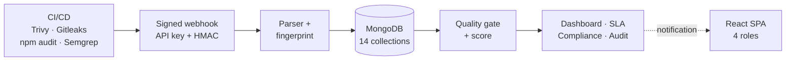

# Jury / Viva Explanation Guide

How to explain the DevSecOps Compliance and Security Monitoring Dashboard clearly, confidently and in the right order.

---

## 0. The goal

The jury is not asking you to recite the tech stack. They are asking three questions:

1. **Do you understand the problem?**
2. **Can you explain how your system solves it, end to end?**
3. **Do you know its limits and can you defend your decisions?**

A good answer is a **story about data moving through the system**, not a list of technologies.

---

## 1. Your one-sentence answer

> "It is the security control room between CI/CD pipelines and the people who fix, govern and audit security problems."

If you only get one sentence, use that one. Then stop and let them ask.

---

## 2. The 5-beat structure (7 minutes)

| Beat | Time | What you say | Why it works |
|---|---|---|---|
| 1. Hook | 30 s | "Four scanners find problems, but nobody can answer five questions: what is exposed, can we ship, are we fixing on time, are we compliant, can we prove it?" | Starts with a problem the jury can follow |
| 2. Promise | 30 s | "I built one platform that ingests all four scanners, normalises and deduplicates findings, decides the gate, tracks SLAs, maps compliance and keeps an audit trail." | One sentence, five capabilities |
| 3. Mechanism | 2 min | Draw the flow: CI → signed webhook → parser → fingerprint → MongoDB → gate → dashboard/SLA/compliance → audit. | Proves you understand the working |
| 4. Demo | 3 min | One scan story: import → gate fails → finding appears → triage → report. | The jury remembers what they see |
| 5. Proof + honesty | 1 min | "41 tests, 7 suites, 228 seeded documents, 14 collections. The main gaps are X and Y; here is how I'd fix them." | Confidence without overclaiming |

**Do not start with "My project is built using MERN stack."** Start with the problem. The stack is a tool, not the story.

---

## 3. The 60-second version (memorise this)

> "In a normal CI/CD pipeline, Trivy, Gitleaks, npm audit and Semgrep each produce a different report. Security teams reconcile them manually, so findings are duplicated, SLAs are missed and auditors cannot reconstruct what happened.
>
> My platform receives those reports through a signed webhook, converts them into one vulnerability model, and removes duplicates using a SHA-256 fingerprint. It then evaluates a per-project security gate and returns a pass or fail decision to the pipeline. Every finding gets a severity-based SLA, is mapped to compliance controls such as OWASP and PCI-DSS, and can be escalated into an incident. Four roles — Admin, Analyst, Developer and Auditor — see only what they are allowed to do, and administrative actions are recorded in an audit log.
>
> I validated it with 41 automated tests across seven suites, a production build and route-by-route browser checks. The honest limitations are that some configurable policies are not yet consumed at runtime and audit coverage is partial; both are documented with concrete fixes."

That is ~160 words. Practise until it is 55–65 seconds.

---

## 4. The whiteboard: draw six boxes, not the whole system



### 60-second narration while drawing

1. **"The pipeline produces raw JSON."** Four tools, four formats.
2. **"It calls one endpoint with two headers."** `X-API-Key` identifies the key; `X-Signature` proves the body was not modified.
3. **"The parser registry normalises the report."** One finding shape, five severities, secrets redacted.
4. **"The fingerprint decides new, repeat or reopened."** SHA-256 of project + tool + CVE/title + location.
5. **"MongoDB stores the truth."** Unique index on fingerprint + project prevents duplicates.
6. **"The gate and score turn findings into a decision."** Pass/fail goes back to CI; the dashboard shows the rest.

Then point down:

7. **"SLA cron runs hourly."** Overdue findings raise alerts and notifications.
8. **"Compliance maps CWEs to controls."** Assessments produce a weighted score.
9. **"Audit logs and reports provide evidence."**

That is the whole system in under two minutes.

---

## 5. The three lifecycle stories (your core explanation)

If the jury says **"explain the working"**, do not describe modules. Tell one of these three stories. Together they cover everything.

### Story 1 — "What happens when a scan arrives?"

Use a concrete example: **Trivy reports CVE-2024-3094 (Critical) in the `xz` package.**

1. CI sends the raw JSON to `POST /api/v1/webhooks/scan` with an API key and an HMAC signature.
2. The server looks up the key, decrypts the stored secret and recomputes the HMAC over the **raw body**. It uses a timing-safe comparison.
3. The parser registry selects the Trivy parser, which maps `CRITICAL → Critical`, extracts the CVE, package, versions, CWE and CVSS.
4. The project is resolved by key or name. A fingerprint is computed:
   `sha256(project + tool + cve + component)`.
5. If this is the first occurrence, a finding is created with a **2-day SLA** for Critical.
6. The gate sees `critical > 0`, marks the run **Failed**, and stores the reason.
7. A pipeline run, a scan-result summary and an alert are written; the project score is recomputed.
8. The API returns `gateResult.passed: false` to CI.

**Now the second scan arrives with the same finding:**

- The fingerprint matches.
- No duplicate is created. `occurrences` becomes 2 and `lastSeen` updates.

**The developer fixes it and marks it Resolved. A third scan still contains it:**

- The status is terminal, so the finding is **reopened**, resolution fields are cleared and a `REOPENED` timeline entry is added.

That single narrative demonstrates normalisation, security, deduplication, SLA, gate, scoring and lifecycle.

### Story 2 — "What happens when a developer fixes a finding?"

1. Developer opens the assigned finding and sees severity, CVE, component, versions, file/line and remediation guidance.
2. Moves it to **In Progress**; a timeline entry records who and when.
3. Adds a comment describing the fix.
4. Marks it **Resolved** with a mandatory reason. The server records `resolvedAt`, `resolvedBy` and the reason.
5. The hourly SLA job no longer targets it.
6. If it reappears in a later scan, ingestion reopens it automatically.

**Nuance to admit if asked:** the project security score is recomputed on the next ingestion, not instantly on status change. That is a design choice you would revisit.

### Story 3 — "What happens when an auditor asks for proof?"

1. Auditor signs in read-only and opens **Compliance**.
2. Selects a project and framework. Each control shows status, score and evidence notes.
3. The weighted compliance score is computed from Compliant = 100%, Partially = 50%, Non-Compliant = 0%, with N/A excluded.
4. Auditor exports the compliance matrix as CSV.
5. Auditor opens **Audit Logs**, filters by actor or action, and inspects before/after JSON.
6. Auditor downloads the executive PDF or the vulnerability CSV.

**Honesty point:** audit coverage currently includes administrative and incident actions, not logins or scan ingestion. If the jury asks "is that complete?", say no and give the fix.

---

## 6. Demo script (3–4 minutes)

Rehearse this exact order. Do not wander.

| Step | Click | Say | Why |
|---|---|---|---|
| 1 | Sign in as `analyst@devsecops.local` | "I'm a Security Analyst. The dashboard is the posture view." | Establishes role |
| 2 | Dashboard | "56 open findings, 11 critical, gate pass rate, posture score." | Numbers anchor credibility |
| 3 | Vulnerabilities → SLA = Breached | "These are past their remediation deadline." | Shows SLA is real |
| 4 | Open one finding | "CVE, CVSS, component, fixed version, and the Gitleaks secret is redacted." | Shows normalisation + secret safety |
| 5 | Timeline tab | "Every status change is attributable." | Shows lifecycle |
| 6 | Scan Import → project + Trivy → upload sample | "This is the same path CI uses, without the HMAC headers." | Shows ingestion |
| 7 | Summary card | "Gate failed because a Critical was found. New versus updated counts prove deduplication." | The key proof |
| 8 | Pipelines → newest run | "The gate reason and stage breakdown are persisted." | Shows decision record |
| 9 | Incidents → open one | "Five-stage lifecycle and a post-mortem." | Shows governance |
| 10 | Admin → Audit Logs → Inspect | "Before and after state, actor, IP, user agent." | Shows accountability |
| 11 | Sign out → sign in as Developer | "Import, compliance editing and user admin are gone." | Shows RBAC is real |
| 12 | Reports | "PDF for management, CSV for auditors." | Shows evidence |

### Demo rules

- **Reseed before the viva** so the numbers match your slides. Run `npm run seed`.
- **Keep a second terminal open** with the API and client already running.
- **Have screenshots or a short screen recording** in case the live demo fails.
- **Do not demo the automated CWE mapping** on seeded data: the seeded controls have no `mappedCwEs`, so nothing will change. Explain it verbally or create one control with a mapping beforehand.
- **Do not open the PDF's framework section** unless you have fixed the known field mismatch; it can show 0%. If the jury opens it, acknowledge the bug and explain the fix.
- **Do not show every page.** Six screens are enough.

### "Show me the database" — the 90-second routine

Have a second terminal open in `server/` before you start. Then:

| Step | Command | Say |
|---|---|---|
| 1 | `npm run db:peek` | "Fourteen collections, and the index count next to each one." |
| 2 | `npm run db:peek -- vulnerabilities 1` | "One finding: normalised fields from four different scanners." |
| 3 | point at the index block | "`fingerprint_1_project_1` is **UNIQUE**. That is what makes deduplication a database guarantee, not a hope." |
| 4 | `npm run db:peek -- auditlogs 1` | "Actor, action, before and after state — the evidence trail." |

Optional GUI: MongoDB Compass, URI `mongodb://127.0.0.1:27017/devsecops_dashboard`. Optional shell: `mongosh` with the same URI.

**Never** show `.env`, password hashes or API key secrets. `db:peek` redacts them automatically; say so, it looks deliberate.

If the database is empty or the service is down: "The environment lost its data; let me reseed the canonical dataset" → `cd server && npm run seed`. If that fails, fall back to screenshots.


---

## 7. Same answer at three depths

The jury may say "explain in two minutes" or "go deeper". Have three versions ready.

### 30 seconds — for a non-technical jury member

> "Four security tools produce four different reports. My system collects them in one place, removes duplicates, decides whether a build should pass, tracks whether fixes happen on time, checks compliance, and keeps proof for auditors. It has four roles so each team sees only their work."

### 2 minutes — for a technical jury

Add the data flow:

> "CI calls a signed webhook. The parser registry normalises the report. A SHA-256 fingerprint plus a unique database index deduplicates it. The gate checks Critical and High thresholds, writes a pipeline run, and returns pass/fail. A cron job checks SLAs hourly. Compliance maps CWEs to controls. React reads the results through 65 REST endpoints, and Socket.IO pushes notifications."

### 5 minutes — for a deep technical jury

Add decisions and trade-offs:

- Why MongoDB (heterogeneous scanner metadata) and what you lose (no foreign keys).
- Why a service layer (testable rules, thin controllers).
- Why JWT + rotating refresh cookie (stateless API, revocable session).
- Why the fingerprint is database-enforced (race safety).
- Why the gate is advisory (the CI job owns enforcement).
- What is not finished (settings consumption, audit coverage, report fields).
- How you would scale it (Redis adapter, queue, caching, replicas).

---

## 8. Formulas you must know cold

### Quality gate

```
Fail if failOnCritical AND critical > 0
Fail if high > maxHighAllowed
Pass only if no condition fires
```

Only Critical and High are enforced today. `maxMediumAllowed` and `blockOnFailedGate` exist but are not consumed. Say that if asked.

### Project security score

```
score = 100 − (Critical×15 + High×5 + Medium×1.5 + Low×0.5)
clamp to 0…100
```

Only **Open** and **In Progress** findings count.

### Fingerprint

```
sha256(projectId + ":" + tool + ":" + (cve || title) + ":" + (component || filePath + line))
```

Unique per project. Same issue in another project is a separate finding.

### SLA defaults

| Severity | Days |
|---|---|
| Critical | 2 |
| High | 7 |
| Medium | 30 |
| Low | 90 |
| Info | 180 |

Breach = deadline passed **and** status is Open/In Progress.

### Compliance score

```
applicable = total − notApplicable
score = round(((compliant×100 + partially×50) / (applicable×100)) × 100)
```

If `applicable = 0`, the score is 100.

---

## 9. Jury Q&A bank

Answer in **one direct sentence, one mechanism sentence, one evidence or limitation sentence**. Then stop.

### Project and problem

**Q: Explain your project in one minute.**
Use the 60-second version in §3.

**Q: What problem does it solve?**
Scanner output is fragmented and duplicated; teams cannot decide whether to ship, prove timely remediation or produce audit evidence. The platform unifies that lifecycle.

**Q: What is novel here?**
Most dashboards stop at visualisation. This closes the loop from ingestion to policy decision, SLA, compliance, incident and audit evidence.

**Q: Who is the user?**
Four personas: Admin (governance), Security Analyst (triage and response), Developer (remediation), Auditor (read-only evidence).

**Q: Why four roles?**
Separation of duties. The person who fixes a finding should not also be the only person who can declare compliance or change users.

### Architecture and technology

**Q: Why MERN?**
One language across tiers, JSON-native persistence for heterogeneous scanner output, and fast iteration. The trade-off is no enforced relational integrity, which I handle in services and indexes.

**Q: Why MongoDB over SQL?**
Each scanner emits different metadata; a document model avoids constant migrations. Embedded comments and timelines match the access pattern. The trade-off is that foreign keys and cascades are manual.

**Q: Why a service layer?**
Controllers stay thin and testable; business rules live in one place. It made the ingestion pipeline reusable for both webhook and manual upload.

**Q: How many endpoints / collections / tests?**
65 endpoints, 14 collections, 7 test suites with 41 tests.

**Q: What happens if MongoDB is down?**
The API fails to start and logs the error; there is no retry loop. That is a known operational limitation.

**Q: How would you scale it?**
Add a Redis adapter for Socket.IO, a queue for ingestion, caching for dashboard aggregations, read replicas, and a single scheduler or distributed lock. The current ingestion is sequential per finding.

### Ingestion and deduplication

**Q: How do you prevent duplicate findings?**
A deterministic SHA-256 fingerprint plus a unique compound index on `{fingerprint, project}`. Application logic handles occurrence counting; the database guarantees no duplicate.

**Q: What if two scans arrive at the same time?**
One insert wins; the other hits the unique index and returns 409. The run record is still created for each accepted call, so the endpoint is idempotent at finding level, not at run level.

**Q: What if a resolved finding reappears?**
Ingestion detects the terminal status, reopens it, clears resolution metadata and appends a `REOPENED` timeline entry. The history is preserved.

**Q: How do you handle a new project from CI?**
If the API key has `autoCreateProject`, the project is created from the identifier. Otherwise the webhook returns 404.

**Q: What if a report is malformed?**
The parser returns 422 with a tool-specific message. Unsupported tools also return 422 and list the available parsers.

### Gate and scoring

**Q: How does the gate work?**
It checks Critical and High against the project policy, records the reason and failed conditions on a pipeline run, and returns `gateResult.passed` to the caller.

**Q: Does it block the build?**
The platform is the decision service; the CI job enforces the result. The `blockOnFailedGate` flag exists but is not yet consumed server-side. That is an honest limitation, not a hidden one.

**Q: How is the score calculated?**
`100 − (Critical×15 + High×5 + Medium×1.5 + Low×0.5)`, clamped to 0–100, over active findings. It updates on the next ingestion.

**Q: Why those weights?**
They encode relative urgency: one Critical costs as much as three Highs or ten Mediums. They are configurable in principle but currently constants.

### Security

**Q: How is the webhook secured?**
An API key identifies the credential; its secret is encrypted at rest with AES-256-GCM. The client signs the raw body with HMAC-SHA256, and the server compares it in constant time. A rate limit bounds abuse.

**Q: Why HMAC and not just the API key?**
The key identifies who is calling; the HMAC proves the body was not modified in transit or by an attacker who only knows the key ID.

**Q: Is replay possible?**
Yes. The signature covers the body but not a timestamp or nonce. I would add both. It is documented.

**Q: How are passwords stored?**
bcrypt, cost 12. Passwords are `select: false` and never returned.

**Q: Why JWT plus a refresh cookie?**
Short-lived stateless access tokens for API calls, plus a revocable long-lived session. The refresh token is hashed in the database, rotated on every use, and stored in an `httpOnly` cookie scoped to the auth path.

**Q: What if a refresh token is stolen?**
It is single-use and rotated; reuse invalidates the session. The limitation is one active session per user and no reuse-detection alarm.

**Q: How is RBAC enforced?**
Server-side `authenticate` then `authorize(...roles)` on every mutating route. The UI hides controls, but the API never trusts the UI.

**Q: How are Gitleaks secrets handled?**
The parser redacts them before persistence: first four characters plus asterisks, or `****` for short values. The plaintext is never written. A test asserts the raw key is absent.

**Q: What about NoSQL injection?**
`express-mongo-sanitize`, explicit validation chains, Mongoose casting, and `hpp`. Regex search is still a potential ReDoS vector.

### Compliance and audit

**Q: How does compliance mapping work?**
Each control declares CWE mappings. The evaluation compares open findings' CWEs with those mappings. A match makes the control Non-Compliant with score 0 and stores the linked findings; when matches are resolved, it returns to Compliant.

**Q: Why do the seeded controls not change?**
They have no `mappedCwEs`. The mechanism is implemented and tested, but the seed data does not exercise it. That is a data gap, not an algorithm gap.

**Q: Is the audit log tamper-proof?**
It is append-only at the API level: no update or delete route is exposed, and only Admin/Auditor can read it. It is not cryptographically chained, and a direct database write could alter it. I describe it as tamper-evident by interface, not by storage.

**Q: What is not audited?**
Logins, logouts, scan ingestion and finding changes. That is the biggest audit gap and the first thing I would fix.

### Testing and quality

**Q: How did you test it?**
Seven Jest/Supertest suites with 41 tests against a real MongoDB, plus a production build and browser checks in both themes. The tests cover auth and lockout, ingestion and dedup, secret redaction, compliance, incidents, reports, notifications, SLA and admin.

**Q: What is not tested?**
Parser unit tests in isolation, frontend behaviour, sockets, email, load and penetration testing. I state that openly.

**Q: What was the hardest bug?**
The donut tooltip covering the centre label. The default tooltip follows the cursor, which put it over the total. I computed the position from the sector's mid-angle and outer radius, anchored it opposite the segment, and clamped it to the measured plot box. That preserved the design and fixed it at every width.

### Limitations and future work

**Q: What are the main limitations?**
Three: settings are stored but not consumed by SLA/gate logic; audit coverage is partial; and two report exports reference retired field names. There are also security hardening items: public registration can choose Analyst/Auditor, `allowedTools` is not enforced, and there is no CSRF token.

**Q: Is it production-ready?**
No. It is a working, tested pilot. Production needs secret management, TLS, database auth, CSRF, audit completion, report fixes, load testing and operational monitoring.

**Q: What would you do with one more month?**
Consume settings at runtime, complete audit coverage, fix the report mappings, enforce tool scopes and registration roles, add SARIF import, and add Playwright end-to-end tests.

**Q: What did you learn?**
Schema drift is silent in MongoDB; configuration that is not consumed creates false assurance; and invariants such as deduplication belong in the database, not only in application code.

**Q: Did you use AI tools?**
Answer honestly and briefly: "I used AI assistance for drafting and review, but I made the design decisions, ran the tests and can explain every part of the implementation." Then invite a question. Never claim work you cannot defend.

---

## 10. Jargon translator

| Term | Say this instead |
|---|---|
| HMAC | "A signature that proves the payload was not modified" |
| Idempotent | "Running it twice does not create duplicates" |
| Fingerprint | "A stable hash that identifies the same finding across scans" |
| RBAC | "Permissions based on the user's role" |
| JWT | "A signed short-lived access pass" |
| Refresh token | "A long-lived credential used to get a new access pass" |
| SLA | "The deadline by which a finding must be fixed" |
| Quality gate | "An automatic pass/fail rule for a build" |
| CWE | "The class of weakness, such as SQL injection" |
| CVE | "The public identifier for a specific vulnerability" |
| Normalisation | "Converting four report formats into one shape" |
| Socket.IO | "A live channel that pushes notifications to the browser" |
| Cron | "A scheduled job that runs every hour" |

Use the plain phrase first, then the term. Never the reverse.

---

## 11. Delivery mechanics

### Voice and posture

- Stand beside the diagram, not behind a laptop.
- Speak in **problem → action → result** sentences.
- Pause after the gate failure in the demo; let the jury read it.
- Keep answers to ~30 seconds, then ask "Would you like the implementation detail?"
- Say **"I chose"**, not "it was decided". Own the design.

### If you do not know

> "I haven't implemented that. My approach would be X, because Y."

That is a strong answer. Bluffing is the only fatal answer.

### If the jury challenges a choice

> "That's a fair trade-off. I chose X for Y reason; the cost is Z, which is in my limitations."

Do not argue. Acknowledge, explain, move on.

### Time management

| Slot | Content |
|---|---|
| 0:00–0:30 | Hook and problem |
| 0:30–1:00 | One-sentence solution |
| 1:00–3:00 | Whiteboard flow |
| 3:00–6:00 | Demo |
| 6:00–7:00 | Proof, limitations, close |

If you are running out of time, cut demo steps 9–10, never the gate proof.

---

## 12. What not to do

1. Do not start with the tech stack.
2. Do not read from the report or from code.
3. Do not demo every page.
4. Do not claim it is production-ready.
5. Do not hide the known bugs; frame them as engineering work.
6. Do not use "simple", "just" or "obviously".
7. Do not use an acronym without translating it once.
8. Do not blame teammates, tools or the deadline.
9. Do not show a feature you cannot explain.
10. Do not let the demo run without narration.

---

## 13. Rehearsal plan (four short sessions)

### Session 1 — The pitch (30 minutes)

- Record the 60-second version on your phone.
- Watch it. Cut every "basically", "actually" and "so yeah".
- Re-record until it is one clean minute.

### Session 2 — The whiteboard (30 minutes)

- Draw the six boxes from memory three times.
- Narrate while drawing. If you stop drawing to think, simplify the diagram.

### Session 3 — The demo (45 minutes)

- Run the exact 12-step sequence twice without notes.
- Break it once on purpose: stop the API, then show your screenshot fallback.
- Reseed and confirm the numbers.

### Session 4 — Mock viva (45 minutes)

- Ask a friend to pick 10 questions from §9 in random order.
- Answer each in under 30 seconds.
- Record it. Check for filler, eye contact and pacing.

---

## 14. Closing statement (memorise the shape, not the words)

> "To summarise: the platform takes four incompatible scanner reports, turns them into one trustworthy finding model, makes a policy decision, tracks the fix against a deadline, maps it to compliance, and keeps evidence for auditors. It is tested, it is documented, and I know exactly where the next engineering work is. Thank you — I'm happy to go deeper on any part."

---

## 15. Emergency fallbacks

| Failure | What to do |
|---|---|
| API will not start | Show the architecture diagram and screenshots; explain that the demo environment is down, not the system |
| Client will not load | Use the Swagger UI or a recorded video |
| Database empty | Run `npm run seed`; if that fails, show the seeded data screenshots |
| A page shows unexpected numbers | Say "this environment has live data; let me reseed and show the canonical dataset" |
| PDF shows 0% | Acknowledge the known field mismatch and describe the fix; do not pretend it is correct |
| You forget a formula | Derive it in words: "Critical costs fifteen points, High five, Medium one and a half, Low half a point" |
| You do not understand a question | "Could you clarify whether you mean the design or the implementation?" |

---

## 16. The three sentences to remember

1. **"It closes the loop from detection to decision to evidence."**
2. **"The fingerprint and the unique index are what make the numbers trustworthy."**
3. **"The gate is advisory; the CI job enforces it — and I know which parts are not finished."**

If you can say those three sentences naturally, you understand the project.
