# DevSecOps Compliance and Security Monitoring Dashboard

### A Centralised MERN-Stack Platform for Vulnerability Management, CI/CD Security Gates and Compliance Assurance

---

**Project Report submitted in partial fulfilment of the requirements for the award of the degree of**

**[Bachelor of Technology / Bachelor of Computer Applications / Master of Computer Applications]**

**Submitted by:** [Student Name] — [Roll Number]
**Under the guidance of:** [Guide Name, Designation]
**Department:** [Department Name]
**Institution:** [College / University Name]
**Academic Year:** 2025–2026

---

## Declaration

I hereby declare that the project report entitled **“DevSecOps Compliance and Security Monitoring Dashboard”** is a record of original work carried out by me under the supervision of [Guide Name]. The work presented in this report has not been submitted elsewhere for the award of any other degree or diploma. All sources of information and third-party libraries used have been duly acknowledged.

Place: [City]  
Date: [Date]  
Signature: ____________________

---

## Acknowledgement

I express my sincere gratitude to my project guide, [Guide Name], for continuous guidance, technical reviews and constructive feedback throughout the development of this project. I also thank the Head of the Department and the faculty members of [Department Name] for providing the necessary infrastructure and academic support. Finally, I thank my family and friends for their encouragement during the completion of this work.

---

## Abstract

Modern software delivery pipelines produce security findings faster than security teams can triage them. Container scanners, secret detectors, static analysers and dependency auditors each emit reports in different formats, use different severity vocabularies and are usually reviewed in isolation. The result is fragmented visibility: engineering teams cannot tell whether a build should be blocked, security analysts cannot prove that findings were remediated within policy deadlines, and auditors cannot reconstruct who changed what and when.

This project implements a **centralised DevSecOps compliance and security monitoring platform** using the **MERN stack** — MongoDB, Express.js, React (with Vite) and Node.js. The platform ingests raw scan output from **Trivy, Gitleaks, npm audit and Semgrep**, normalises it into a single vulnerability model, deduplicates repeat findings using SHA-256 fingerprints, evaluates a configurable **CI/CD quality gate**, computes risk-weighted project security scores, and dispatches alerts in real time through **Socket.IO** with optional **email** delivery.

A compliance module maps findings to industry frameworks (**OWASP Top 10, NIST CSF, CIS Controls, ISO/IEC 27001, SOC 2 and PCI-DSS**), supports per-control assessments with evidence notes, and performs automated CWE-based mapping between open vulnerabilities and control failures. A **Node-Cron** job runs hourly to detect remediation **SLA breaches** and near-breach warnings. Every administrative action is recorded in an audit log with actor identity, IP address, user agent and before/after state, while executive **PDF** and **CSV** reports provide audit-ready evidence.

The application implements strict **role-based access control** for four personas — Admin, Security Analyst, Developer and Auditor — using signed JWT access tokens, rotating refresh tokens stored in HTTP-only cookies, account lockout after repeated failed logins, bcrypt password hashing, hashed API keys and **HMAC-SHA256** verification of CI webhook payloads. Secrets detected by Gitleaks are redacted before persistence.

The system was validated with **41 automated backend tests** across seven suites, a production frontend build, and browser-based verification of every route in both light and dark themes. The seeded database contains **228 documents across 14 collections** and six compliance frameworks. The report documents the architecture, database design, module implementation, security controls, workflows, test results and known limitations, and outlines a roadmap for production hardening.

**Keywords:** DevSecOps, MERN, vulnerability management, CI/CD security gate, compliance automation, RBAC, JWT, HMAC, MongoDB, React, Socket.IO.

---

## Table of Contents

1. Introduction
2. Background and Related Concepts
3. Requirements Analysis
4. Feasibility Study and Methodology
5. System Architecture
6. Technology Stack
7. Database Design
8. Backend Design and API
9. Functional Modules
10. System Workflows
11. Security Design and Threat Mitigation
12. Frontend Architecture and Design System
13. Key Algorithms and Implementation Details
14. Testing and Validation
15. Deployment and Configuration
16. Results, Demonstration and Discussion
17. Limitations
18. Future Enhancements
19. Conclusion
20. References
21. Appendices

---

# 1. Introduction

## 1.1 Overview

The **DevSecOps Compliance and Security Monitoring Dashboard** is a full-stack web application that acts as a security command centre for engineering and compliance teams. It sits between CI/CD pipelines and the people responsible for remediation, converting raw scanner output into prioritised, deduplicated, SLA-tracked findings and audit-ready compliance evidence.

The platform is organised around five questions that a security programme must answer continuously:

1. **What is exposed right now?** — an inventory of open vulnerabilities by severity, project and scanner.
2. **Should this build be allowed to ship?** — an automated quality gate with project-specific thresholds.
3. **Are we fixing things on time?** — SLA deadlines, breach detection and escalation.
4. **Are we compliant?** — control-level assessments against six industry frameworks.
5. **Can we prove it?** - audit trails with before/after state and downloadable executive reports.

Unlike a single-purpose scanner dashboard, the system models the entire lifecycle: **ingestion → normalisation → deduplication → scoring → gate decision → triage → remediation → verification → reporting**.

## 1.2 Problem Statement

Security tooling in a typical CI/CD environment is fragmented:

- **Format heterogeneity.** Trivy emits a `Results[].Vulnerabilities[]` tree, Gitleaks emits a flat array of leaks, npm audit emits a dictionary keyed by package, and Semgrep emits a `results[]` array with nested metadata. Each must be interpreted separately.
- **Duplicate noise.** The same CVE is rediscovered on every build. Without fingerprinting, dashboards inflate and teams lose trust in the numbers.
- **No policy enforcement.** Scanners report findings but do not decide whether a pipeline should fail based on organisational risk appetite.
- **Manual SLA tracking.** Remediation deadlines are tracked in spreadsheets, so breaches are discovered late.
- **Compliance evidence gaps.** Auditors ask for control-level evidence and an activity trail; scanner output alone does not provide either.
- **Weak accountability.** Shared scanner accounts and unlogged status changes make it impossible to attribute actions.

The problem addressed by this project is therefore: **how to unify heterogeneous security telemetry into a single, policy-driven, auditable workflow that is usable by four different roles without exposing data or actions beyond their authority.**

## 1.3 Motivation

The project is motivated by three practical observations:

1. **Shift-left security only works if feedback is fast and centralised.** A developer should learn about a critical container vulnerability before merge, not in a quarterly audit.
2. **Compliance is continuous, not annual.** Frameworks such as PCI-DSS 4.0 and ISO/IEC 27001:2022 require evidence of ongoing monitoring; automated mapping reduces manual evidence collection.
3. **Accountability must be designed in.** Audit logs, role separation and cryptographically verified ingestion are not optional features in a security product — they are the product.

## 1.4 Objectives

The specific objectives of the project are:

| # | Objective |
|---|---|
| O1 | Provide secure authentication with JWT access tokens, rotating refresh tokens and role-based access control for four roles. |
| O2 | Ingest scan reports from four scanners through an authenticated, HMAC-signed webhook and a manual upload fallback. |
| O3 | Normalise all findings into one vulnerability schema with consistent severity levels and metadata. |
| O4 | Deduplicate findings using deterministic SHA-256 fingerprints and track occurrence counts and reopening. |
| O5 | Evaluate a per-project CI/CD quality gate and persist the outcome as a pipeline run. |
| O6 | Track remediation SLAs per severity, detect breaches hourly and notify responsible users. |
| O7 | Map vulnerabilities to compliance controls and compute framework-level compliance scores. |
| O8 | Provide an incident response workspace with a five-stage lifecycle and post-mortem capture. |
| O9 | Generate executive PDF and CSV exports for management and auditors. |
| O10 | Record an immutable-by-API audit trail with before/after state for administrative actions. |
| O11 | Deliver a responsive, accessible dashboard with light and dark themes and real-time notifications. |
| O12 | Validate the implementation with automated tests and a production build. |

## 1.5 Scope

**In scope**

- Web-based dashboard for desktop and tablet; responsive down to mobile widths for read-only review.
- REST API (`/api/v1`) with 60+ endpoints across 12 route groups.
- MongoDB persistence with 14 collections and compound indexes.
- Real-time server-to-client notifications over WebSocket.
- Scheduled SLA monitoring (hourly).
- PDF/CSV generation on the server.
- Docker Compose deployment (MongoDB + API + Nginx-served SPA).

**Out of scope**

- Direct integration with source-control APIs (GitHub/GitLab OAuth, PR comments).
- Automatic pull-request creation or code remediation.
- Multi-tenant organisation isolation.
- Mobile native applications.
- Machine-learning risk prediction.
- Third-party SIEM/ticketing connectors (Jira, ServiceNow, Splunk).

## 1.6 Report Organisation

Chapter 2 introduces DevSecOps and compliance concepts. Chapter 3 derives functional and non-functional requirements. Chapter 4 covers feasibility and methodology. Chapter 5 presents the architecture. Chapter 6 justifies the technology stack. Chapter 7 documents the database. Chapter 8 describes backend structure and the API. Chapter 9 explains each functional module. Chapter 10 walks through end-to-end workflows. Chapter 11 details security controls. Chapter 12 covers the frontend and design system. Chapter 13 explains algorithms. Chapter 14 reports testing. Chapter 15 covers deployment. Chapter 16 discusses results and the demonstration script. Chapters 17–19 cover limitations, future work and conclusions. Appendices provide credentials, payload samples, environment variables and a glossary.

---

# 2. Background and Related Concepts

## 2.1 From DevOps to DevSecOps

DevOps shortened the feedback loop between development and operations. DevSecOps extends that loop to security by making security checks part of the same automated pipeline. The guiding principle is **shift-left**: detect issues as early as possible, when remediation is cheapest.

A mature DevSecOps pipeline typically performs:

| Stage | Typical tool | What it detects |
|---|---|---|
| Secret scanning | Gitleaks | API keys, tokens, private keys committed to Git |
| Software composition analysis (SCA) | Trivy, npm audit | Vulnerable open-source dependencies and OS packages |
| Static application security testing (SAST) | Semgrep | Unsafe code patterns (injection, XSS, weak crypto) |
| Container scanning | Trivy | Vulnerable packages inside container images |
| Infrastructure-as-code scanning | Trivy / Checkov | Misconfigured IaC |
| Dynamic testing (DAST) | OWASP ZAP | Runtime vulnerabilities |

This project supports the first four directly and models container/IaC/DAST as scan types for extensibility.

## 2.2 The operational gap

A scanner answers “what did I find?”. A security programme needs four additional capabilities:

1. **Normalisation** — one schema so findings can be compared and aggregated.
2. **Deduplication** — one record per real-world issue, not one per build.
3. **Policy** — an explicit decision (pass/block) with a human-readable reason.
4. **Accountability** — who saw it, who changed it, when, and with what evidence.

The platform is designed around these four capabilities.

## 2.3 Compliance frameworks

The system seeds six frameworks and 27 controls:

| Framework | Code | Version | Controls seeded | Focus |
|---|---|---|---|---|
| OWASP Top 10 (2021) | `OWASP-2021` | 2021.1 | 10 (A01–A10) | Web application risks |
| NIST Cybersecurity Framework | `NIST-CSF` | 1.1 | 5 | Identify, Protect, Detect, Respond, Recover |
| CIS Critical Security Controls | `CIS-V8` | 8.0 | 6 | Technical hardening |
| ISO/IEC 27001:2022 | `ISO-27001` | 2022 | 0 (framework only) | Information security management |
| SOC 2 Type II | `SOC-2` | 2017 | 0 (framework only) | Trust services criteria |
| PCI-DSS 4.0 Subsets | `PCI-DSS-4` | 4.0 | 6 | Payment card data security |

Assessment statuses are **Compliant**, **Partially Compliant**, **Non-Compliant** and **Not Applicable**, each with a score from 0–100 and free-text evidence.

## 2.4 Related approaches

| Approach | Strength | Gap addressed here |
|---|---|---|
| Raw scanner dashboards | Accurate per-tool data | No cross-tool normalisation or SLA |
| Ticketing systems (Jira) | Workflow | No compliance mapping or cryptographic ingestion |
| SIEM platforms | Correlation at scale | Heavyweight; no developer-facing remediation UX |
| CSPM tools | Cloud posture | Limited application/CI context |
| This platform | Unified ingestion, policy, compliance, audit | Purpose-built for the project scope |

---

# 3. Requirements Analysis

## 3.1 Stakeholders and Personas

| Role | Primary goals | Restrictions |
|---|---|---|
| **Admin** | Operate the platform: users, roles, API keys, settings, audit review | Cannot delete own active account |
| **Security Analyst** | Triage findings, run assessments, declare incidents, import scans | Cannot manage users, keys or settings; cannot delete projects |
| **Developer** | Fix assigned findings; move status to In Progress/Resolved; comment; advance incident stages | Cannot assign findings, bulk-update, import scans or manage compliance |
| **Auditor** | Read-only verification of posture and audit logs; export evidence | Cannot mutate any security or administrative data |

## 3.2 Functional Requirements

### FR-1 Authentication and session management

- FR-1.1 Register a user with name, email, password and confirmation.
- FR-1.2 Enforce password complexity: ≥8 characters, upper, lower, digit and symbol.
- FR-1.3 Log in with email/password and receive a short-lived access token plus an HTTP-only refresh cookie.
- FR-1.4 Rotate the refresh token on every refresh; invalidate the previous token.
- FR-1.5 Lock an account for 15 minutes after 5 consecutive failed attempts (HTTP 423).
- FR-1.6 Support logout (current session) and logout-all (invalidate refresh token).
- FR-1.7 Support forgot-password and reset-password with a single-use, 15-minute token.
- FR-1.8 Allow profile updates and password changes; changing a password invalidates sessions.

### FR-2 Dashboard

- FR-2.1 Show security posture score, critical+high count, CI gate pass rate and active incidents.
- FR-2.2 Show open findings grouped by severity (donut).
- FR-2.3 Show 30-day discovery velocity (area chart).
- FR-2.4 Show the five riskiest projects (bar chart).
- FR-2.5 Show framework readiness and recent alerts.
- FR-2.6 Auto-refresh every 30 seconds with a “last updated” indicator.

### FR-3 Project management

- FR-3.1 List projects with search, criticality filter, pagination and per-project open counts.
- FR-3.2 Create a project with unique name and key, criticality, repository URL and description.
- FR-3.3 Update project metadata and gate policy.
- FR-3.4 Delete a project and cascade-delete its vulnerabilities (Admin only).
- FR-3.5 Display a risk-weighted security score per project.

### FR-4 Vulnerability management

- FR-4.1 List findings with pagination and filters: search, severity (including `Critical,High`), status, tool, SLA state and project.
- FR-4.2 Show CVE/CWE/CVSS, component/version, file/line, scanner and remediation guidance.
- FR-4.3 Update status with an optional reason; terminal statuses capture resolver and timestamp.
- FR-4.4 Assign or unassign a finding.
- FR-4.5 Add comments.
- FR-4.6 Bulk-update selected findings (Admin/Analyst).
- FR-4.7 Maintain a per-finding activity timeline.

### FR-5 Scan ingestion

- FR-5.1 Accept HMAC-signed webhook payloads from CI with `X-API-Key` and `X-Signature`.
- FR-5.2 Accept manual JSON uploads from Admin/Analyst (≤10 MB).
- FR-5.3 Parse Trivy, Gitleaks, npm audit and Semgrep formats.
- FR-5.4 Normalise severity to Critical/High/Medium/Low/Info.
- FR-5.5 Deduplicate by fingerprint and project; count occurrences; reopen resolved findings that reappear.
- FR-5.6 Optionally auto-create unknown projects.
- FR-5.7 Optionally auto-resolve findings missing from a full scan.
- FR-5.8 Evaluate the quality gate and persist a pipeline run, scan result and counts.
- FR-5.9 Redact detected secrets before storage.
- FR-5.10 Recompute the project security score.

### FR-6 Compliance

- FR-6.1 List frameworks with control counts.
- FR-6.2 Initialise assessments for each project/framework pair.
- FR-6.3 Update assessment status, score and evidence notes with auditor attribution.
- FR-6.4 Compute compliance score from statuses and weights.
- FR-6.5 Run automated CWE mapping to mark controls non-compliant when matching open findings exist.

### FR-7 Incidents

- FR-7.1 Declare an incident with title, description, severity, project and optional assignee.
- FR-7.2 Advance through Detected → Triaged → Contained → Resolved → Post-mortem.
- FR-7.3 Record timeline entries with performer and notes.
- FR-7.4 Assign a responder.
- FR-7.5 Capture a post-mortem (root cause, impact, preventative actions).
- FR-7.6 Notify the assignee of assignment and status changes.

### FR-8 Reports

- FR-8.1 Stream an executive PDF with metrics, severity breakdown, compliance scores and top critical findings.
- FR-8.2 Export vulnerabilities as CSV with project/severity filters.
- FR-8.3 Export the compliance control matrix as CSV.
- FR-8.4 Export filtered audit logs as CSV (Admin/Auditor).

### FR-9 Notifications and alerts

- FR-9.1 Persist in-app notifications per user.
- FR-9.2 Push new notifications over WebSocket to the user's room.
- FR-9.3 Optionally send email for critical/gate/SLA events.
- FR-9.4 Show an unread badge and dropdown in the top bar.
- FR-9.5 Mark one/all as read and delete notifications.
- FR-9.6 Maintain a security alert feed with acknowledgement.

### FR-10 Administration

- FR-10.1 User directory with search, role/status filters, pagination.
- FR-10.2 Create, edit, deactivate, delete users; change roles.
- FR-10.3 Unlock locked accounts and force logout.
- FR-10.4 Create and revoke API keys; show the secret once.
- FR-10.5 View and update SLA, gate, password and email settings.
- FR-10.6 View system health metrics (database status, uptime, memory).
- FR-10.7 Inspect audit logs with before/after state.

## 3.3 Non-Functional Requirements

| ID | Category | Requirement |
|---|---|---|
| NFR-1 | Security | Passwords hashed with bcrypt cost 12; secrets never logged; TLS assumed at the proxy |
| NFR-2 | Security | All mutating endpoints authenticated and authorised server-side (UI gating is not a control) |
| NFR-3 | Security | Webhook payloads verified with timing-safe HMAC comparison |
| NFR-4 | Performance | Dashboard aggregation completes within 1 s for the seeded dataset (~114 findings) |
| NFR-5 | Performance | List endpoints paginated with a hard limit of 100 rows |
| NFR-6 | Usability | Responsive layout; keyboard-operable navigation and command palette |
| NFR-7 | Accessibility | Labelled controls, ARIA dialogs, visible focus rings, Escape-to-close |
| NFR-8 | Reliability | Central error handler; audit failures never break a request |
| NFR-9 | Maintainability | Route → controller → service → model separation; parser registry for extension |
| NFR-10 | Portability | 12-factor configuration via environment variables; Docker Compose deployment |
| NFR-11 | Observability | Structured Winston logs, health endpoint, system metrics |
| NFR-12 | Data integrity | Unique compound indexes on fingerprints, assessments and control IDs |

## 3.4 Constraints and Assumptions

- A MongoDB instance (local or container) must be reachable; there is no embedded database.
- Test execution requires a live MongoDB because no in-memory server is used.
- Email delivery falls back to Ethereal test accounts or a console mock when SMTP credentials are absent.
- The frontend assumes same-origin deployment (`/api/v1`, `/socket.io`) behind Vite or Nginx.
- Only JSON scanner reports are supported; SARIF and XML are out of scope.

---

# 4. Feasibility Study and Methodology

## 4.1 Technical Feasibility

All chosen technologies are mature, open source and widely documented. Node.js provides non-blocking I/O suitable for webhook bursts. MongoDB's document model accommodates heterogeneous scanner metadata without frequent migrations. React with Vite offers fast iteration. Socket.IO provides fallback transports where WebSockets are blocked. PDFKit and json2csv run in-process, avoiding external report services.

## 4.2 Economic Feasibility

The entire stack is free and open source. Development requires only a workstation; deployment can run on a single small virtual machine using Docker Compose. There are no per-seat licence costs. Operational cost is dominated by MongoDB storage and compute, both modest for the target dataset.

## 4.3 Operational Feasibility

The interface uses familiar patterns (tables, filters, drawers, dashboards) and requires no training beyond role orientation. Role separation matches how security teams already work. CI integration is a single HTTP POST with two headers, which can be added to any pipeline in a few lines.

## 4.4 Development Methodology

An **incremental, module-oriented** approach was used:

| Phase | Activities | Output |
|---|---|---|
| 1. Requirements | Persona interviews, endpoint inventory, schema sketching | Requirement catalogue |
| 2. Foundation | Express bootstrap, MongoDB connection, auth, RBAC, error handling | Authenticated API skeleton |
| 3. Core domain | Projects, vulnerabilities, SLA utilities, pipelines | CRUD and lifecycle |
| 4. Ingestion | Parser registry, four parsers, fingerprinting, gate evaluation | Webhook + manual upload |
| 5. Governance | Compliance, incidents, notifications, cron, reports | Full domain model |
| 6. Frontend | Layout shell, pages, charts, drawers, admin screens | Usable product |
| 7. Hardening | Security review, UI redesign, tooltip/UX fixes, tests | Release candidate |
| 8. Validation | Jest/Supertest, production build, browser QA | Verified build |

Each phase ended with a working vertical slice, which reduced integration risk.

## 4.5 Tools Used

| Tool | Purpose |
|---|---|
| Visual Studio Code | Development |
| MongoDB Compass | Schema and document inspection |
| Postman | API exploration (collection provided in `docs/`) |
| Swagger UI | Interactive API documentation |
| Git | Version control (project delivered as a source tree) |
| Chrome DevTools | Layout, network and console verification |
| Jest + Supertest | Automated backend tests |
| Vite | Frontend dev server and bundler |

---

# 5. System Architecture

## 5.1 Architectural Style

The system follows a **three-tier, layered architecture** with an event-assisted real-time channel:

1. **Presentation tier** — React SPA served by Vite (development) or Nginx (production).
2. **Application tier** — Express REST API, ingestion pipeline, scheduled jobs and WebSocket server.
3. **Data tier** — MongoDB with 14 collections.

Cross-cutting concerns (authentication, validation, logging, error handling, rate limiting) are implemented as middleware, while business rules live in services so that controllers remain thin and testable.

## 5.2 High-Level Architecture

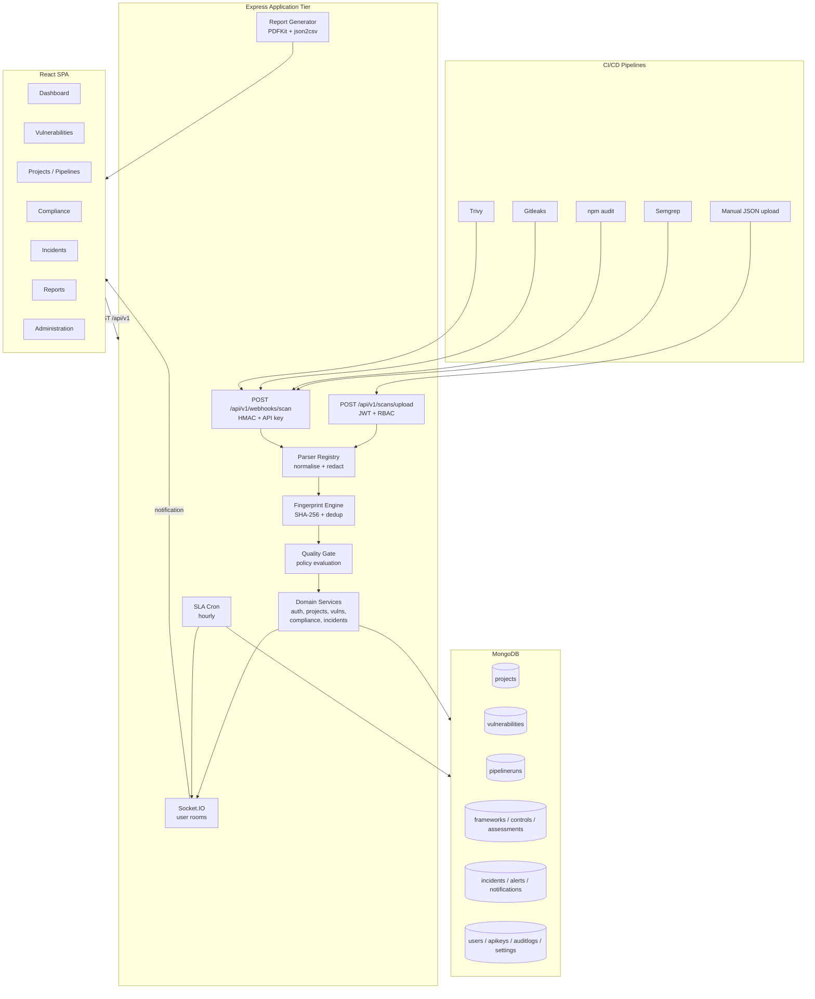

## 5.3 Logical Layers

| Layer | Responsibilities | Examples |
|---|---|---|
| Routes | Path definition, middleware composition | `vulnerability.routes.js` |
| Middleware | Authentication, authorisation, validation, rate limiting, webhook verification | `auth.js`, `webhookAuth.js`, `validate.js` |
| Controllers | HTTP concerns: parse request, call service, shape response | `vulnerability.controller.js` |
| Services | Business rules and persistence orchestration | `scanIngestion.service.js` |
| Models | Schema, validation, indexes, hooks | `Vulnerability.js` |
| Utilities | Cross-cutting helpers | `token.js`, `crypto.js`, `sla.js`, `auditLogger.js` |
| Jobs | Scheduled background work | `slaCron.js` |
| Sockets | Real-time fan-out | `socket.js` |

## 5.4 Request Lifecycle

A typical authenticated request passes through:

1. **Helmet** security headers.
2. **CORS** allow-list check.
3. **Body parsing** with a 15 MB limit; raw body retained for HMAC verification.
4. **Mongo-sanitize** and **HPP** guards.
5. **Morgan → Winston** request logging (disabled in tests).
6. **Global rate limiter** on `/api/` (300 requests / 15 min / IP).
7. **Route-specific limiter** for auth or webhooks.
8. **`authenticate`** — verifies the Bearer token, loads the active user, attaches `req.user`.
9. **`authorize(...roles)`** — role check.
10. **Validator chain + `validate`** — structured 400 on failure.
11. **Controller → service → Mongoose**.
12. **Response envelope** `{ success, message, data }`.
13. **Central error handler** for cast, duplicate-key, validation, JWT and generic errors.

## 5.5 Real-Time Architecture

Socket.IO runs on the same HTTP server as Express. On connection, the server verifies the JWT if present and joins the socket to:

- `user_<userId>` — personal notification room.
- `role_<role>` — role broadcast room.
- `security_feed` — global feed (also used by guests).

Notifications created by services are persisted first, then emitted to the user's room, guaranteeing that a client that reconnects can recover missed items through the REST list endpoint.

## 5.6 Scheduled Processing

`node-cron` schedules the SLA job at minute 0 of every hour (`0 * * * *`). The job is disabled when `NODE_ENV=test` so that tests can invoke `checkSlaBreachesNow()` deterministically.

## 5.7 Deployment Topology

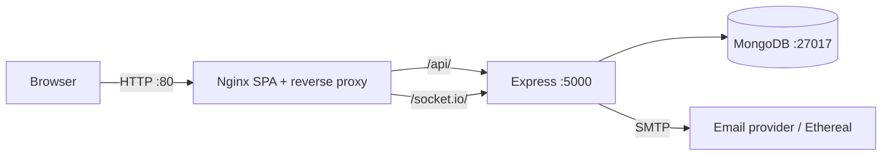

In development, Vite proxies `/api` and `/socket.io` to `localhost:5000`, so the SPA uses relative URLs in both environments.

## 5.8 Architectural Decisions and Trade-offs

| Decision | Rationale | Trade-off |
|---|---|---|
| REST rather than GraphQL | Simpler caching, clear RBAC per route, predictable payloads | Over-fetching on some screens |
| MongoDB | Flexible scanner metadata, fast aggregation pipelines | No enforced relational integrity |
| Service layer | Testable business logic, thin controllers | More files and indirection |
| Server-side PDF/CSV | Consistent output, no client dependency | Server CPU cost |
| JWT access + refresh cookie | Stateless API calls, revocable long-lived session | Two-token flow complexity |
| Socket.IO | Real-time notifications with fallback transports | Extra dependency and connection state |

---


# 6. Technology Stack

## 6.1 Stack at a Glance

The platform is a **MERN** application: MongoDB for persistence, Express.js for the HTTP API, React for the single-page interface and Node.js as the runtime for both the API and the build tooling. Around that core, a small set of focused libraries supplies authentication, validation, cryptography, real-time transport, charting and document generation.

| Tier | Technology | Version | Role in the system |
|---|---|---|---|
| Runtime | Node.js | 20 LTS (Docker image `node:20-alpine`) | Executes the Express API, cron job, Socket.IO server and build tooling |
| Language | JavaScript (ES modules) | ES2022, `"type": "module"` | Server and client source; no TypeScript |
| Web framework | Express.js | `^4.21.2` | Routing, middleware composition, error handling |
| Database | MongoDB | 7.0 (container image) | 14 document collections |
| ODM | Mongoose | `^8.13.0` | Schemas, validation, indexes, hooks, population |
| UI library | React | `^18.3.1` | Component-based SPA |
| Build tool | Vite | `^5.4.14` | Dev server with HMR, production bundler |
| Routing | React Router | `^6.30.0` | Client-side routes, guards, URL search params |
| Styling | Tailwind CSS | `^3.4.17` | Utility-first styling with custom design tokens |
| Server state | TanStack Query | `^5.67.1` | Caching, background refetch and mutations on query-driven pages |
| HTTP client | Axios | `^1.8.1` | REST calls, interceptors, refresh queue, blob downloads |
| Charts | Recharts | `^2.15.1` | Donut, area and bar visualisations |
| Icons | Lucide React | `^0.477.0` | Consistent icon set across the UI |
| Real time | Socket.IO | `^4.8.1` (server and client) | Server-push notifications |
| Auth | jsonwebtoken | `^9.0.3` | JWT access-token signing and verification |
| Hashing | bcryptjs | `^3.0.3` | Password hashing at cost factor 12 |
| Validation | express-validator | `^7.3.1` | Declarative request validation chains |
| Security middleware | helmet, cors, express-mongo-sanitize, hpp, express-rate-limit | see §6.3 | Headers, origin control, injection guards, throttling |
| File upload | Multer | `^1.4.5-lts.1` | In-memory multipart handling for manual scan uploads |
| Scheduling | node-cron | `^3.0.3` | Hourly SLA monitoring job |
| Email | Nodemailer | `^6.10.0` | SMTP delivery with Ethereal/console fallback |
| PDF | PDFKit | `^0.16.0` | Server-side executive report generation |
| CSV | json2csv | `^6.0.0-alpha.2` | Streaming tabular exports |
| Logging | Winston | `^3.17.0` | Structured application logs |
| HTTP logging | morgan | `^1.10.0` | Request logging piped into Winston |
| API docs | swagger-ui-express | `^5.0.1` | Interactive documentation at `/api-docs` |
| Testing | Jest + Supertest | `^29.7.0` / `^7.0.0` | Seven integration suites, 41 tests |
| Packaging | Docker + Docker Compose | multi-stage builds | MongoDB, API and Nginx-served SPA |
| Web server | Nginx | `nginx:alpine` | Static hosting, SPA fallback, reverse proxy, WebSocket upgrade |

## 6.2 Frontend Stack

### React 18 with Vite

React was chosen for its component model, mature ecosystem and predictable rendering. The application uses function components exclusively, with hooks (`useState`, `useEffect`, `useMemo`, `useCallback`, `useRef`, `useContext`) and context providers for cross-cutting state. `React.StrictMode` is enabled, so effects intentionally run twice in development to expose missing cleanup.

Vite provides instant hot module replacement during development and a Rollup production build. The development server proxies `/api` and `/socket.io` to `http://localhost:5000`, which means the client always uses same-origin relative URLs and no environment-specific API configuration is required. The production build produces a single JavaScript bundle of approximately **1.06 MB** (2,877 modules) and a CSS bundle of approximately **61 KB**; Vite emits its standard chunk-size warning because no manual chunking or lazy loading is configured.

### Routing and guards

React Router 6 supplies declarative routing. Two guard components wrap the authenticated area:

- `ProtectedRoute` blocks rendering while authentication is bootstrapping (showing a full-screen "Verifying security credentials…" state), redirects unauthenticated visitors to `/login` preserving the intended location, and otherwise renders a nested `<Outlet />`.
- `RoleRoute` additionally checks `allowedRoles.includes(user.role)` and redirects to `/unauthorized` on mismatch.

All pages are statically imported in `App.jsx`. There is no `React.lazy`, `Suspense`, route-level code splitting or error boundary.

### Styling

Tailwind CSS is configured with `darkMode: 'class'` and a custom token layer. Colours are declared as raw RGB CSS variables and exposed through a helper:

```js
const token = (name) => `rgb(var(${name}) / <alpha-value>)`;
```

This allows opacity modifiers such as `bg-dark-raised/60` while keeping a single source of truth for the palette. Custom fonts (Inter for UI, JetBrains Mono for identifiers), radii (`card: 14px`, `control: 9px`), shadows (`card`, `raised`, `glow`), background patterns (`grid-faint`, `hero-glow`) and keyframe animations (`fade-in`, `fade-up`, `scale-in`, `shimmer`) are registered in `tailwind.config.js`.

Light mode is implemented by remapping the `--dark-*` variables under `html.light` rather than by duplicating every utility. This keeps component markup theme-agnostic. Two components contain `light:*` utility classes, but Tailwind has no `light` variant registered, so those classes are inert; the variable remap is what actually produces the light theme.

### Data fetching

Two approaches coexist:

| Approach | Screens | Characteristics |
|---|---|---|
| TanStack Query | Dashboard, Reports, Incidents, Admin Users, API Keys, Audit Logs, Settings | Query keys, `staleTime` 30 s, `retry: 1`, `keepPreviousData` on paginated tables, declarative mutations with invalidation |
| Manual `useEffect` + local state | Vulnerabilities, Projects, Pipelines, Scan Import, Compliance, Notifications, Profile, auth bootstrap, socket bootstrap | Explicit loading/error flags, debounce timers of 200–300 ms where search is involved |

Only the Dashboard sets `refetchInterval: 30000`; other screens refresh on mount, on filter change, after a mutation, or through an explicit Refresh button.

### Charts and interaction

Recharts renders the three dashboard visualisations:

1. **Severity donut** — `PieChart`/`Pie` with inner radius 50, outer radius 74, 3 px padding and per-cell severity colours. The centre displays the total open count. A `ResizeObserver` tracks the plot box, and the tooltip is positioned from the hovered sector's mid-angle and outer radius so that it never covers the centre label or leaves the card.
2. **Discovery velocity** — `AreaChart` over the 30-day `trend` array, monotone cyan gradient, no dots, `MM-DD` tick labels.
3. **Highest-risk services** — vertical `BarChart` with paired Critical (rose) and High (amber) bars and a 76 px category axis.

Charts are client-rendered SVG; no chart data is computed on the client beyond mapping and filtering.

### Forms and feedback

`react-hook-form` is declared as a dependency but is not imported anywhere. All forms are controlled components with local state and explicit validation. `react-hot-toast` provides success and error notifications through a globally configured `<Toaster position="top-right">`. Downloads are handled by converting Axios blobs into object URLs and triggering a temporary anchor element.

## 6.3 Backend Stack

### Express application

Express 4 provides the HTTP layer. The application is organised as **routes → middleware → controllers → services → models**, with utilities for cross-cutting concerns. ES modules are used throughout, and `server.js` boots the HTTP server, Socket.IO, the database connection and the cron scheduler.

### Security middleware

| Middleware | Configuration | Purpose |
|---|---|---|
| `helmet` | `{ contentSecurityPolicy: false }` | Sets standard security headers; CSP is intentionally disabled so the SPA and Swagger UI load inline assets |
| `cors` | Allow-list: `CLIENT_URL` (default `http://localhost:5173`) and `http://127.0.0.1:5173`; `credentials: true`; methods `GET,POST,PUT,PATCH,DELETE,OPTIONS`; headers `Content-Type, Authorization, X-API-Key, X-Signature`; requests without an `Origin` header (CI, curl) are permitted | Cross-origin control for the browser client and CI dispatchers |
| `express-mongo-sanitize` | default | Strips `$` and `.` operators from user input to block NoSQL injection |
| `hpp` | default | Prevents HTTP parameter pollution |
| `express-rate-limit` | Global: 300 requests / 15 min / IP on `/api/`; Auth: 20 / 15 min; Webhook: 60 / min | Brute-force and flood mitigation |
| Body limits | JSON and URL-encoded: 15 MB; uploads: 10 MB | Bounds memory use |
| `morgan` | `combined`, piped to Winston | Access logging (skipped in tests) |

### Validation

`express-validator` chains are attached per route and a shared `validate` middleware converts failures into a uniform HTTP 400 response:

```json
{
  "success": false,
  "message": "Validation failed",
  "errors": [{ "field": "email", "message": "Valid email is required", "value": "..." }],
  "data": null
}
```

Validation chains cover registration, login, password reset, profile and password changes, project create/update, vulnerability status/assign/comment/bulk operations, user administration and incident bodies. Compliance routes validate inside the service instead, and list endpoints validate by clamping query parameters.

### Persistence

Mongoose 8 defines fourteen schemas with field-level constraints, enums, references, compound indexes and a small number of hooks. `autoIndex: true` is set in the connection options, so indexes are created at startup. The connection helper reads `MONGO_URI` and falls back to `mongodb://127.0.0.1:27017/devsecops_dashboard`; it logs the host and database name and terminates the process on failure outside tests.

### Authentication and cryptography

- **Access tokens** are JWTs signed with `JWT_SECRET`, carrying `{ id, email, role, name }` and expiring after `JWT_EXPIRES_IN` (default **15 minutes**). They are sent in the `Authorization: Bearer` header and never stored in a cookie.
- **Refresh tokens** are 40 random bytes rendered as hex, stored only as a **SHA-256 hash** on the user document, delivered in an `httpOnly` cookie scoped to `/api/v1/auth`, valid for **7 days** (hard-coded), with `SameSite=strict` and `Secure` in production. Every refresh rotates the token and invalidates the previous one.
- **Passwords** are hashed with bcrypt at cost factor **12** in a `pre('save')` hook.
- **API secrets** are encrypted at rest with **AES-256-GCM** (`iv:authTag:ciphertext`, 16-byte IV), using a key derived as `sha256(JWT_SECRET || 'devsecops_master_encryption_key_2026')`. Webhook signatures are verified with **HMAC-SHA256** over the raw request body using `crypto.timingSafeEqual`.

### Asynchronous work

- **Socket.IO** shares the HTTP server, authenticates the handshake JWT when present, and joins sockets to `user_<id>`, `role_<Role>` and `security_feed`.
- **node-cron** runs `checkSlaBreachesNow()` at minute 0 of every hour; the job is disabled when `NODE_ENV=test`.
- **Nodemailer** uses configured SMTP credentials, otherwise creates an Ethereal test account, otherwise falls back to a console mock that logs the message and preview URL.

### Reporting and exports

PDFKit composes the executive report directly onto the HTTP response stream (`Content-Type: application/pdf`), avoiding temporary files. `json2csv` converts vulnerability and audit-log arrays into attachments with timestamped filenames. Both run in-process and require no external service.

## 6.4 Database Stack

MongoDB 7.0 is deployed as a single container with a named volume (`mongo_data:/data/db`) in Docker Compose, or as a local service on port 27017 during development. The document model was selected because scanner payloads differ substantially between tools and because aggregation pipelines express the dashboard's severity, trend and top-project queries concisely. Mongoose supplies schema-level validation and reference population on top of the schemaless store.

The database is accessed only by the API container; it is not exposed to the browser. In Compose it is reachable at `mongodb://mongodb:27017/devsecops_dashboard`.

## 6.5 Testing and Tooling

| Tool | Purpose |
|---|---|
| Jest 29 (`node --experimental-vm-modules`) | ESM-compatible test runner |
| Supertest 7 | In-process HTTP assertions against the Express app |
| MongoDB test database (`devsecops_test_db`) | Real database for integration tests; no in-memory substitute |
| Vite build | Production bundle verification |
| Swagger UI | Interactive API exploration |
| Postman collection (`docs/DevSecOps_Platform.postman_collection.json`) | Manual API workflows |
| Docker Compose | Reproducible three-service deployment |

## 6.6 Version and Compatibility Matrix

| Component | Declared range | Notes |
|---|---|---|
| Node.js | 20 (Docker) | Required for native ESM and modern `crypto` APIs |
| Express | 4.21 | Express 5 not used |
| Mongoose | 8.13 | Requires MongoDB 4.4+; tested against 7.0 |
| React | 18.3 | Concurrent features available but not explicitly used |
| Vite | 5.4 | Requires Node 18+ |
| Tailwind | 3.4 | PostCSS 8 pipeline |
| Socket.IO | 4.8 | Protocol-compatible client/server pair |
| JWT | 9.0 | HS256 signing |
| bcryptjs | 3.0 | Pure JavaScript, no native build step |

## 6.7 Why These Technologies

| Decision | Alternatives considered | Justification |
|---|---|---|
| MERN | Django + PostgreSQL, Spring Boot + Angular | Single language across tiers, rapid iteration, JSON-native persistence for heterogeneous scanner output, large ecosystem |
| MongoDB | Relational schema with normalised finding tables | Scanner metadata varies by tool; embedded comments/timeline subdocuments map naturally; aggregation framework supports dashboard queries |
| Express | Fastify, NestJS | Minimal, explicit middleware ordering, easy to demonstrate each security control |
| React + Vite | Next.js, Angular | SPA with no SEO requirement; Vite's fast HMR and simple proxy suit a separate API |
| JWT + rotating refresh cookie | Server sessions only | Stateless authorisation for API calls while retaining revocable long-lived sessions |
| Socket.IO | Raw WebSocket, SSE | Automatic reconnection, transport fallback, room abstraction |
| Recharts | Chart.js, D3 | Declarative React components, responsive containers, sufficient chart types |
| PDFKit | Puppeteer HTML-to-PDF | No headless browser, low memory footprint, deterministic layout |
| Docker Compose | Kubernetes | Appropriate for a single-node academic deployment; simple to reproduce |

---

# 7. Database Design

## 7.1 Design Approach

The data model is organised around five domains:

1. **Identity and access** — `users`, `apikeys`.
2. **Assets and findings** — `projects`, `vulnerabilities`.
3. **Delivery telemetry** — `pipelineruns`, `scanresults`.
4. **Governance** — `frameworks`, `controls`, `assessments`, `incidents`, `alerts`.
5. **Operations** — `notifications`, `auditlogs`, `settings`.

Every collection uses Mongoose's default pluralised name and automatic `createdAt`/`updatedAt` timestamps. References are stored as `ObjectId` with `ref` metadata and resolved with `populate()` where the API needs embedded display data.

## 7.2 Collection Overview

| # | Collection | Purpose | Approx. seeded docs | Primary access pattern |
|---|---|---|---|---|
| 1 | `users` | Accounts, roles, lockout state, notification preferences | 4 | Login, assignee lookup, administration |
| 2 | `projects` | Monitored services, gate policy, security score | 6 | Dashboards, filtering, ingestion project resolution |
| 3 | `vulnerabilities` | Normalised findings with SLA and remediation state | 114 | Triage lists, scoring, compliance mapping |
| 4 | `pipelineruns` | One record per gate evaluation | 32 | Pipeline history, pass-rate metrics |
| 5 | `scanresults` | Ingestion audit summary per scan | 0 | Scan history |
| 6 | `frameworks` | Compliance frameworks | 6 | Compliance navigation |
| 7 | `controls` | Individual controls belonging to a framework | 27 | Assessment matrix |
| 8 | `assessments` | Per-project, per-control evaluation | 20 | Compliance scoring |
| 9 | `incidents` | Response cases with lifecycle and post-mortem | 3 | Incident workspace |
| 10 | `alerts` | Security alert feed | 4 | Dashboard and notification surface |
| 11 | `notifications` | Per-user inbox items | 4 | Top-bar bell and inbox |
| 12 | `auditlogs` | Administrative activity trail | 5 | Audit review and export |
| 13 | `apikeys` | CI credentials with encrypted secrets | 2 | Webhook verification |
| 14 | `settings` | Singleton system configuration | 1 | Admin settings screen |

## 7.3 Entity-Relationship Diagram

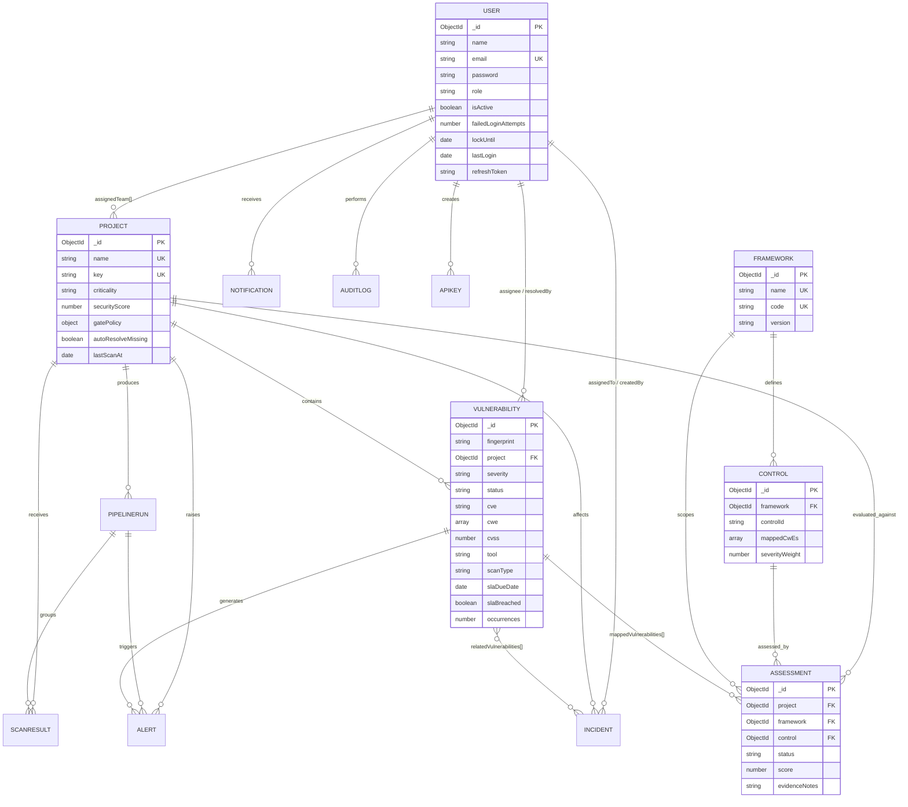

## 7.4 Collection Schemas

### 7.4.1 `users`

| Field | Type | Constraints / default |
|---|---|---|
| `_id` | ObjectId | Primary key |
| `name` | String | Required, trimmed, max 100 |
| `email` | String | Required, **unique**, lowercase, trimmed, email regex |
| `password` | String | Required, min 8, `select: false` |
| `role` | String | Enum `Admin`, `Security Analyst`, `Developer`, `Auditor`; default `Developer` |
| `isActive` | Boolean | Default `true` |
| `failedLoginAttempts` | Number | Default `0` |
| `lockUntil` | Date | Default `null` |
| `lastLogin` | Date | Default `null` |
| `refreshToken` | String | SHA-256 hash, `select: false` |
| `passwordResetToken` | String | SHA-256 hash, `select: false` |
| `passwordResetExpires` | Date | `select: false` |
| `notificationPreferences.email` | Boolean | Default `true` |
| `notificationPreferences.inApp` | Boolean | Default `true` |
| `createdAt` / `updatedAt` | Date | Automatic |

Indexes: unique `email`; single `{ role: 1 }`.

Behaviour: `pre('save')` hashes a modified password with bcrypt (12 rounds). Instance methods implement `comparePassword`, `isLocked`, `incrementFailedAttempts(5, 15)` and `resetLockout`.

### 7.4.2 `projects`

| Field | Type | Constraints / default |
|---|---|---|
| `name` | String | Required, **unique**, trimmed, max 120 |
| `key` | String | Required, **unique**, uppercase, pattern `^[A-Z0-9_-]{2,20}$` |
| `description` | String | Default `''`, max 500 |
| `repositoryUrl` | String | Default `''` |
| `criticality` | String | Enum `Critical`, `High`, `Medium`, `Low`; default `Medium` |
| `securityScore` | Number | 0–100, default `100` |
| `assignedTeam` | ObjectId[] | Ref `User` |
| `gatePolicy.failOnCritical` | Boolean | Default `true` |
| `gatePolicy.maxHighAllowed` | Number | Default `5` |
| `gatePolicy.maxMediumAllowed` | Number | Default `20` |
| `gatePolicy.blockOnFailedGate` | Boolean | Default `true` |
| `autoResolveMissing` | Boolean | Default `false` |
| `lastScanAt` | Date | Default `null` |

Indexes: `{ criticality: 1 }`, `{ securityScore: 1 }`.

### 7.4.3 `vulnerabilities`

| Field | Type | Constraints / default |
|---|---|---|
| `fingerprint` | String | Required, indexed |
| `project` | ObjectId | Ref `Project`, required, indexed |
| `title` | String | Required, trimmed |
| `description` | String | Default `''` |
| `severity` | String | Enum `Critical`, `High`, `Medium`, `Low`, `Info`; required, indexed |
| `status` | String | Enum `Open`, `In Progress`, `Resolved`, `False Positive`, `Accepted Risk`; default `Open`, indexed |
| `cve` | String | Indexed, default `null` |
| `cwe` | String[] | Trimmed |
| `cvss` | Number | 0–10, default `null` |
| `tool` | String | Enum `trivy`, `gitleaks`, `npm-audit`, `semgrep`, `manual`; required |
| `scanType` | String | Enum `SAST`, `SCA`, `Secret`, `Container`, `IaC`, `DAST`; required |
| `component` | String | Default `''` |
| `version` | String | Installed version, default `''` |
| `fixedVersion` | String | Default `''` |
| `filePath` | String | Default `''` |
| `line` | Number | Default `null` |
| `remediationGuidance` | String | Default `''` |
| `assignee` | ObjectId | Ref `User`, default `null` |
| `slaDueDate` | Date | **Required**, indexed |
| `slaBreached` | Boolean | Default `false`, indexed |
| `firstSeen` / `lastSeen` | Date | Default now |
| `occurrences` | Number | Default `1` |
| `resolvedAt` | Date | Default `null` |
| `resolvedBy` | ObjectId | Ref `User` |
| `resolutionReason` | String | Default `''` |
| `comments[]` | Subdocument | `{ author, content, createdAt }` |
| `activityTimeline[]` | Subdocument | `{ action, performedBy, details, timestamp }` |

Indexes:

- **Unique compound** `{ fingerprint: 1, project: 1 }` — the core deduplication guarantee.
- Compound query index `{ project: 1, status: 1, severity: 1 }`.
- Single-field indexes on `fingerprint`, `project`, `severity`, `status`, `cve`, `tool`, `scanType`, `slaDueDate`, `slaBreached`.

Hook: `pre('save')` recalculates `slaBreached` from `slaDueDate` and `status`, so the flag cannot drift when a finding is resolved.

### 7.4.4 `pipelineruns`

| Field | Type | Constraints / default |
|---|---|---|
| `project` | ObjectId | Ref `Project`, required, indexed |
| `provider` | String | Default `github-actions` |
| `runId` | String | Required, indexed |
| `runUrl` | String | Default `''` |
| `branch` | String | Default `main`, indexed |
| `commit` | String | Default `''` |
| `triggeredBy` | String | Default `system` |
| `status` | String | Enum `Passed`, `Failed`, `Warning`; required, indexed |
| `gateSummary.passed` | Boolean | Required |
| `gateSummary.reason` | String | Default `''` |
| `gateSummary.failedConditions` | String[] | Default `[]` |
| `counts.{critical,high,medium,low,info,total}` | Number | Default `0` |
| `stages[]` | Subdocument | `{ name, tool, status, findingsCount, durationMs }` |
| `durationSeconds` | Number | Default `0` |
| `completedAt` | Date | Default now |

Index: `{ project: 1, createdAt: -1 }` for project-scoped reverse-chronological history.

### 7.4.5 `scanresults`

| Field | Type | Default |
|---|---|---|
| `project` | ObjectId ref `Project` | required |
| `pipelineRun` | ObjectId ref `PipelineRun` | `null` |
| `tool` | String | required |
| `scanType` | String | required |
| `rawReportSummary` | Mixed | `{}` |
| `findingsCount` | Number | `0` |
| `newFindings` | Number | `0` |
| `updatedFindings` | Number | `0` |
| `reopenedFindings` | Number | `0` |
| `uploadedBy` | ObjectId ref `User` | `null` |
| `ingestionMethod` | String enum `webhook`, `manual` | `webhook` |

This collection deliberately stores only a summary, never the raw report, so large scanner payloads are not persisted.

### 7.4.6 `frameworks`

| Field | Type | Constraints |
|---|---|---|
| `name` | String | Required, **unique** |
| `code` | String | Required, **unique**, uppercase |
| `version` | String | Default `1.0` |
| `description` | String | Default `''` |
| `category` | String | Default `Application Security` |
| `isActive` | Boolean | Default `true` |

Virtual: `controlsCount` via `ref: 'Control'`, `localField: '_id'`, `foreignField: 'framework'`, `count: true`.

### 7.4.7 `controls`

| Field | Type | Constraints |
|---|---|---|
| `framework` | ObjectId ref `Framework` | Required, indexed |
| `controlId` | String | Required, trimmed (e.g. `A01:2021`, `CIS-03`) |
| `title` | String | Required |
| `description` | String | Default `''` |
| `domain` | String | Default `General Security` |
| `mappedCwEs` | String[] | Default `[]` (note the casing used in the schema) |
| `severityWeight` | Number | 1–5, default `1` |

Index: **unique** `{ framework: 1, controlId: 1 }`.

### 7.4.8 `assessments`

| Field | Type | Constraints |
|---|---|---|
| `project` | ObjectId ref `Project` | Required, indexed |
| `framework` | ObjectId ref `Framework` | Required, indexed |
| `control` | ObjectId ref `Control` | Required, indexed |
| `status` | String | Enum `Compliant`, `Non-Compliant`, `Partially Compliant`, `Not Applicable`; default `Non-Compliant` |
| `score` | Number | 0–100, default `0` |
| `evidenceNotes` | String | Default `''` |
| `evidenceUrls` | String[] | Default `[]` |
| `lastEvaluatedAt` | Date | Default now |
| `evaluatedBy` | ObjectId ref `User` | `null` |
| `mappedVulnerabilities` | ObjectId[] ref `Vulnerability` | `[]` |

Indexes: **unique** `{ project: 1, control: 1 }`; query index `{ project: 1, framework: 1 }`.

### 7.4.9 `incidents`

| Field | Type | Constraints |
|---|---|---|
| `incidentId` | String | Required, **unique** (format `INC-<last4 timestamp><4 random digits>`) |
| `title` | String | Required |
| `description` | String | Required |
| `severity` | String | Enum `Critical`, `High`, `Medium`, `Low`; default `High` |
| `status` | String | Enum `Detected`, `Triaged`, `Contained`, `Resolved`, `Post-mortem`; default `Detected` |
| `project` | ObjectId ref `Project` | Required |
| `assignedTo` | ObjectId ref `User` | `null` |
| `relatedVulnerabilities` | ObjectId[] ref `Vulnerability` | `[]` |
| `timeline[]` | Subdocument | `{ action, notes, performedBy, performedByName, timestamp }` |
| `postMortem.rootCause` | String | Default `''` |
| `postMortem.impactSummary` | String | Default `''` |
| `postMortem.preventativeActions` | String | Default `''` |
| `postMortem.completedAt` | Date | `null` |
| `resolvedAt` | Date | `null` |
| `createdBy` | ObjectId ref `User` | Required |

Indexes: `{ project: 1, status: 1 }`, `{ severity: 1, status: 1 }`.

### 7.4.10 `alerts`

| Field | Type | Constraints |
|---|---|---|
| `title` | String | Required |
| `message` | String | Required |
| `severity` | String | Enum `Critical`, `High`, `Medium`, `Low`, `Info`; required |
| `category` | String | Enum `Pipeline Gate Failure`, `Critical Finding`, `SLA Breach`, `Compliance Drop`, `Account Security`, `System` |
| `project` | ObjectId ref `Project` | `null` |
| `vulnerability` | ObjectId ref `Vulnerability` | `null` |
| `pipelineRun` | ObjectId ref `PipelineRun` | `null` |
| `isAcknowledged` | Boolean | Default `false` |
| `acknowledgedBy` | ObjectId ref `User` | `null` |
| `acknowledgedAt` | Date | `null` |

### 7.4.11 `notifications`

| Field | Type | Constraints |
|---|---|---|
| `user` | ObjectId ref `User` | Required, indexed |
| `type` | String | Required (e.g. `SLA_BREACH`, `INCIDENT_ASSIGNED`) |
| `title` | String | Required |
| `message` | String | Required |
| `severity` | String | Enum `Critical`, `High`, `Medium`, `Low`, `Info`; default `Info` |
| `link` | String | Default `''` |
| `isRead` | Boolean | Default `false`, indexed |

Index: `{ user: 1, isRead: 1, createdAt: -1 }` — exactly matches the inbox query.

### 7.4.12 `auditlogs`

| Field | Type | Default |
|---|---|---|
| `action` | String | required, indexed |
| `performedBy` | ObjectId ref `User` | `null` |
| `performedByName` | String | `System` |
| `performedByEmail` | String | `''` |
| `role` | String | `System` |
| `targetResource` | String | `''` |
| `targetId` | String | `''` |
| `details` | Mixed | `{}` |
| `beforeState` | Mixed | `null` |
| `afterState` | Mixed | `null` |
| `ipAddress` | String | `127.0.0.1` |
| `userAgent` | String | `Unknown` |

Index: `{ createdAt: -1 }`. The API exposes no update or delete route for this collection; immutability is therefore enforced at the interface level rather than by a database rule.

### 7.4.13 `apikeys`

| Field | Type | Default / constraint |
|---|---|---|
| `name` | String | required, max 100 |
| `keyId` | String | required, **unique**, indexed |
| `encryptedSecret` | String | required, `select: false` |
| `hashedSecret` | String | required, `select: false` |
| `allowedTools` | String[] | `['trivy','gitleaks','npm-audit','semgrep']` |
| `autoCreateProject` | Boolean | `false` |
| `createdBy` | ObjectId ref `User` | required |
| `lastUsedAt` | Date | `null` |
| `revoked` | Boolean | `false`, indexed |
| `revokedAt` | Date | `null` |

### 7.4.14 `settings`

| Field | Type | Default |
|---|---|---|
| `key` | String | `system_config`, **unique** |
| `slaDays.critical / high / medium / low` | Number | 2 / 7 / 30 / 90 |
| `gatePolicyDefaults.failOnCritical` | Boolean | `true` |
| `gatePolicyDefaults.maxHigh` / `maxMedium` | Number | 5 / 20 |
| `passwordPolicy.minLength` | Number | 8 |
| `passwordPolicy.requireUppercase/Lowercase/Numbers/Symbols` | Boolean | all `true` |
| `passwordPolicy.lockoutThreshold` / `lockoutMinutes` | Number | 5 / 15 |
| `emailNotifications.enabled` | Boolean | `true` |
| `emailNotifications.alertOnCritical` | Boolean | `true` |
| `emailNotifications.alertOnGateFail` | Boolean | `true` |

The settings document is an upserted singleton, read and written only by Admin routes.

## 7.5 Indexing and Query Strategy

| Query | Index used |
|---|---|
| Login by email | Unique `users.email` |
| Vulnerability list filtered by project/status/severity | `{ project: 1, status: 1, severity: 1 }` |
| Deduplication lookup | Unique `{ fingerprint: 1, project: 1 }` |
| SLA breach sweep | `vulnerabilities.slaDueDate` + `status` |
| Trend aggregation (30 days) | `vulnerabilities.createdAt` (via `$dateToString` grouping) |
| Pipeline history for a project | `{ project: 1, createdAt: -1 }` |
| Control lookup by framework | Unique `{ framework: 1, controlId: 1 }` |
| Assessment matrix | Unique `{ project: 1, control: 1 }` and `{ project: 1, framework: 1 }` |
| Inbox | `{ user: 1, isRead: 1, createdAt: -1 }` |
| Audit review | `{ createdAt: -1 }` plus regex scans for free-text search |

Pagination clamps `limit` to a maximum of 100 on every list service, preventing accidental full-collection reads.

## 7.6 Referential Integrity and Cascades

MongoDB does not enforce foreign keys, so integrity is maintained in the service layer:

- **Project deletion** explicitly runs `Vulnerability.deleteMany({ project: id })` before removing the project (Admin only). Assessments, incidents and pipeline runs referencing the project are not cascaded.
- **User deletion** is a hard delete; historical `assignee`, `resolvedBy`, `createdBy` and audit references remain as dangling ObjectIds. `populate()` then yields `null`, and the UI falls back to labels such as "Unassigned" or "System".
- **Incident and assessment creation** validate that the referenced project, framework and control exist and return 404 otherwise.
- **Duplicate keys** (project name/key, framework name/code, control per framework, email, incident ID, fingerprint per project) are caught either by pre-checks returning **409** or by MongoDB error code 11000 mapped to 409 by the error handler.

## 7.7 Seed Dataset

`server/seed/seed.js` clears all fourteen collections and rebuilds a coherent demo environment of **228 documents**:

| Entity | Count | Highlights |
|---|---|---|
| Users | 4 | One per role, shared password `Password123!` |
| Projects | 6 | `PAY-SRV`, `AUTH-SRV`, `WEB-APP`, `API-GW`, `DATA-ENG`, `NOTIF-WRK` |
| Vulnerabilities | 114 | 19 per project: one CVE, one deliberately breached secret, one SAST finding, sixteen mixed findings |
| Pipeline runs | 32 | `run-1040`–`run-1071`; 8 failed / 24 passed; four stages each |
| Assessments | 20 | Two projects × ten OWASP controls; A03 and A06 non-compliant |
| Frameworks | 6 | OWASP, NIST CSF, CIS v8, ISO 27001, SOC 2, PCI-DSS 4.0 |
| Controls | 27 | 10 OWASP, 5 NIST, 6 CIS, 6 PCI-DSS |
| Incidents | 3 | Critical secret exposure, xz backdoor, SQL injection |
| Alerts | 4 | Critical finding, gate failure, SLA breach, SAST IDOR |
| Notifications | 4 | Assignment, gate failure, role change |
| Audit logs | 5 | Login, key creation, scan ingestion, settings update, incident creation |
| API keys | 2 | GitHub Actions (all tools) and GitLab staging (two tools) |
| Settings | 1 | System defaults |
| Scan results | 0 | Cleared; populated only by live ingestion |

The dataset is intentionally shaped to exercise every screen: breached SLAs appear in the vulnerability table and dashboard, failed pipelines lower the gate pass rate, and non-compliant controls produce a compliance score below 100.

## 7.8 Data Lifecycle

| Stage | Collection effect |
|---|---|
| Scan received | `scanresults` insert, `pipelineruns` insert, `vulnerabilities` insert/update, `projects.securityScore` update, optional `alerts` insert |
| Triage | `vulnerabilities.status`, `resolvedAt`, `resolvedBy`, `resolutionReason`, timeline push |
| Compliance review | `assessments` insert/update, optional `mappedVulnerabilities` |
| Incident response | `incidents` insert, timeline push, post-mortem fields, `notifications` |
| SLA sweep | `vulnerabilities.slaBreached`, timeline push, `alerts`, `notifications` |
| Administration | `auditlogs` insert, `settings` upsert, `apikeys` insert/revoke, `users` CRUD |

No automatic archival or TTL policy is configured; retention is manual. Audit logs are capped at 1,000 rows only during CSV export, not in storage.

## 7.9 Design Trade-offs

| Choice | Benefit | Cost |
|---|---|---|
| Embedded `comments` and `activityTimeline` | Single read returns the full finding context; no joins | Document growth for heavily discussed findings; 16 MB document ceiling |
| Fingerprint uniqueness per project | Strong deduplication guarantee at the database level | Cannot store the same logical finding twice (e.g. two branches) |
| No raw report persistence | Bounded storage; secrets never written | Cannot replay a scan exactly |
| Denormalised `gateSummary` and `counts` on pipeline runs | Fast historical reporting without re-aggregation | Values frozen at ingestion time |
| Stored `securityScore` on project | Cheap dashboard queries | Must be recomputed after every ingest; can drift if data is edited outside the service |
| Singleton settings document | Simple read/update | No per-project or per-tenant overrides |
| Hard deletes | Simple semantics | Dangling references in historical records |

---

# 8. Backend Design and API

## 8.1 Source Layout

```
server/
├── src/
│   ├── server.js              # HTTP server, socket init, DB connect, cron start
│   ├── app.js                 # Express app, middleware order, route mounts
│   ├── config/db.js           # Mongoose connection helper
│   ├── routes/                # 12 route modules
│   ├── controllers/           # HTTP adapters
│   ├── services/              # Business logic (10 services)
│   │   └── parsers/           # trivy, gitleaks, npm-audit, semgrep + registry
│   ├── models/                # 14 Mongoose schemas
│   ├── middleware/            # auth, RBAC, validation, errors, webhook auth, upload
│   ├── utils/                 # token, cookies, crypto, sla, auditLogger, logger, email
│   ├── jobs/slaCron.js        # Hourly SLA monitor
│   ├── sockets/socket.js      # Socket.IO server and room helpers
│   └── docs/swagger.json      # OpenAPI-style specification
├── seed/                      # seed.js, db-summary.js
├── tests/                     # 7 Jest/Supertest suites
├── scripts/send-sample-scan.js
└── Dockerfile
```

The dependency direction is strictly downward: routes import middleware and controllers; controllers import services; services import models and utilities. Models never import services, and no service imports Express.

## 8.2 Startup Sequence

1. `dotenv.config()` loads environment variables.
2. `http.createServer(app)` creates the HTTP server.
3. `initSocket(server)` attaches Socket.IO with CORS settings.
4. `connectDB()` establishes the Mongoose connection with `autoIndex: true`.
5. When `NODE_ENV !== 'test'`, `startSlaCronJob()` registers the hourly schedule.
6. `server.listen(PORT)` begins accepting traffic (default **5000**).
7. A Winston line records the environment and port.
8. `unhandledRejection` and `uncaughtException` handlers log and terminate the process; a startup failure exits with code 1.

## 8.3 Middleware Pipeline

| Order | Middleware | Scope | Effect |
|---|---|---|---|
| 1 | `helmet` | All | Security headers; CSP disabled |
| 2 | `cors` | All | Origin allow-list with credentials |
| 3 | `express.json({ limit: '15mb', verify })` | All | Parses JSON and retains `req.rawBody` for HMAC |
| 4 | `express.urlencoded` | All | Form-encoded bodies |
| 5 | `express-mongo-sanitize` | All | Removes `$`/`.` operator keys |
| 6 | `hpp` | All | Collapses duplicate query parameters |
| 7 | `morgan` → Winston | All (not tests) | Access log |
| 8 | Global rate limiter | `/api/` | 300 requests / 15 min / IP |
| 9 | `GET /api/v1/health` | Public | Liveness payload |
| 10 | `/api-docs` | Public | Swagger UI |
| 11 | Module routers | `/api/v1/...` | See §8.5 |
| 12 | Catch-all 404 | All unmatched | `{ success:false, message:'Endpoint not found: <METHOD> <url>', data:null }` |
| 13 | Central error handler | All | Normalised error envelope |

## 8.4 Response Conventions

Every JSON response uses the same envelope:

```json
{
  "success": true,
  "message": "Human-readable result",
  "data": { }
}
```

Errors add `errors` when validation fails and always set `data: null`. The central error handler maps conditions as follows:

| Condition | Status | Message |
|---|---|---|
| `CastError` | 404 | `Resource not found with id: <value>` |
| Duplicate key (`11000`) | 409 | `Duplicate value entered for <field>. Please use another value.` |
| Mongoose `ValidationError` | 400 | `Validation Error` + field messages |
| `JsonWebTokenError` | 401 | `Invalid authorization token` |
| `TokenExpiredError` | 401 | `Authorization token expired` (`code: TOKEN_EXPIRED`) |
| Explicit `err.statusCode` | As set | Service message |
| Anything else | 500 | Generic message; stack only in development |

All errors are logged with method, URL, message and stack before the response is written.

## 8.5 API Surface

The API exposes **65 endpoints** across twelve groups, all prefixed `/api/v1`.

### Authentication (10)

| Method | Path | Access | Purpose |
|---|---|---|---|
| POST | `/auth/register` | Public (rate-limited) | Create account; Admin role is coerced to Developer |
| POST | `/auth/login` | Public (rate-limited) | Issue access token + refresh cookie |
| POST | `/auth/refresh` | Public (cookie/body token) | Rotate refresh token, issue new access token |
| POST | `/auth/forgot-password` | Public (rate-limited) | Send 15-minute reset link |
| POST | `/auth/reset-password/:token` | Public (rate-limited) | Set new password, revoke sessions |
| POST | `/auth/logout` | Authenticated | Clear refresh token and cookie |
| POST | `/auth/logout-all` | Authenticated | Revoke the stored refresh token |
| GET | `/auth/me` | Authenticated | Current user profile |
| PUT | `/auth/update-profile` | Authenticated | Name and notification preferences |
| PUT | `/auth/change-password` | Authenticated | Verify current password, set new one, revoke sessions |

### Projects (5)

| Method | Path | Access |
|---|---|---|
| GET | `/projects` | All authenticated |
| GET | `/projects/:id` | All authenticated |
| POST | `/projects` | Admin, Security Analyst |
| PUT | `/projects/:id` | Admin, Security Analyst |
| DELETE | `/projects/:id` | Admin |

### Vulnerabilities (6)

| Method | Path | Access |
|---|---|---|
| GET | `/vulnerabilities` | All authenticated |
| GET | `/vulnerabilities/:id` | All authenticated |
| PATCH | `/vulnerabilities/:id/status` | Admin, Security Analyst, Developer |
| PATCH | `/vulnerabilities/:id/assign` | Admin, Security Analyst |
| POST | `/vulnerabilities/:id/comments` | All authenticated |
| PATCH | `/vulnerabilities/bulk` | Admin, Security Analyst |

### Pipelines (2)

| Method | Path | Access |
|---|---|---|
| GET | `/pipelines` | All authenticated |
| GET | `/pipelines/:id` | All authenticated |

### Scans and Webhooks (3)

| Method | Path | Access |
|---|---|---|
| POST | `/scans/upload` | Admin, Security Analyst (multipart, ≤10 MB, JSON only) |
| GET | `/scans/history` | All authenticated |
| POST | `/webhooks/scan` | `X-API-Key` + `X-Signature` (HMAC), 60/min |

### Compliance (7)

| Method | Path | Access |
|---|---|---|
| GET | `/frameworks` | All authenticated |
| GET | `/frameworks/:id` | All authenticated |
| POST | `/frameworks` | Admin |
| POST | `/frameworks/:id/controls` | Admin |
| GET | `/assessments` | All authenticated |
| PATCH | `/assessments/:id` | Admin, Security Analyst |
| POST | `/assessments/evaluate/:projectId` | Admin, Security Analyst |

### Incidents (6)

| Method | Path | Access |
|---|---|---|
| GET | `/incidents` | All authenticated |
| GET | `/incidents/:id` | All authenticated |
| POST | `/incidents` | Admin, Security Analyst |
| PATCH | `/incidents/:id/status` | Admin, Security Analyst, Developer |
| PATCH | `/incidents/:id/assign` | Admin, Security Analyst |
| PATCH | `/incidents/:id/post-mortem` | Admin, Security Analyst |

### Reports (3)

| Method | Path | Access | Output |
|---|---|---|---|
| GET | `/reports/executive-summary/pdf` | All authenticated | `application/pdf` stream |
| GET | `/reports/vulnerabilities/csv` | All authenticated | CSV attachment |
| GET | `/reports/compliance/csv` | All authenticated | CSV attachment |

### Notifications and Alerts (6)

| Method | Path | Access |
|---|---|---|
| GET | `/notifications` | Authenticated (own records only) |
| PATCH | `/notifications/read-all` | Authenticated |
| PATCH | `/notifications/:id/read` | Authenticated (own record) |
| DELETE | `/notifications/:id` | Authenticated (own record) |
| GET | `/alerts` | All authenticated |
| PATCH | `/alerts/:id/ack` | All authenticated |

### Dashboard (1)

| Method | Path | Access |
|---|---|---|
| GET | `/dashboard/stats` | All authenticated |

### Administration, Audit and Health (16)

| Method | Path | Access |
|---|---|---|
| GET | `/audit-logs` | Admin, Auditor |
| GET | `/audit-logs/export` | Admin, Auditor |
| GET | `/users/assignees` | Admin, Security Analyst, Developer |
| GET | `/admin/stats` | Admin |
| GET | `/admin/users` | Admin |
| POST | `/admin/users` | Admin |
| PUT | `/admin/users/:id` | Admin |
| DELETE | `/admin/users/:id` | Admin |
| POST | `/admin/users/:id/unlock` | Admin |
| POST | `/admin/users/:id/force-logout` | Admin |
| GET | `/admin/api-keys` | Admin |
| POST | `/admin/api-keys` | Admin |
| POST | `/admin/api-keys/:id/revoke` | Admin |
| GET | `/admin/settings` | Admin |
| PUT | `/admin/settings` | Admin |
| GET | `/health` | Public |

## 8.6 Pagination, Filtering and Sorting

List endpoints share a consistent contract:

| Parameter | Default | Rules |
|---|---|---|
| `page` | 1 (varies 10–20 per module) | Clamped to ≥ 1 |
| `limit` | 10–20 by module | Clamped to 1–100 |
| `search` | — | Case-insensitive regex over documented fields |
| Domain filters | — | Exact match; severity/status accept comma-separated lists via `$in` |
| `sortBy` / `sortOrder` | Module-specific | `desc`/`asc` |

Responses normally include:

```json
"pagination": { "total": 114, "page": 1, "limit": 15, "pages": 8 }
```

Vulnerabilities additionally accept `slaState=breached|near`, `assignee=unassigned`, `tool`, `scanType` and `project`. Projects accept `criticality`. Pipelines accept `project`, `status` and `branch`. Incidents accept `status`, `severity`, `project` and `search`. Audit logs accept `action`, `role` and `search`.

## 8.7 Webhook Contract

CI pipelines submit a JSON body with two headers:

```
POST /api/v1/webhooks/scan
X-API-Key: dso_live_...
X-Signature: sha256=<hex hmac of the raw body>
Content-Type: application/json
```

Payload:

```json
{
  "project": "PAY-SRV",
  "tool": "trivy",
  "scanType": "SCA",
  "pipeline": {
    "provider": "github-actions",
    "runId": "987654321",
    "runUrl": "https://github.com/org/repo/actions/runs/987654321",
    "branch": "main",
    "commit": "a1b2c3d4e5f6",
    "triggeredBy": "developer-name"
  },
  "report": { "...raw scanner JSON..." }
}
```

Processing:

1. Rate limit (60/min/IP).
2. Require both headers, otherwise **401**.
3. Look up the non-revoked API key by `keyId`, otherwise **401**.
4. Decrypt the stored secret with AES-256-GCM; decryption failure is **500**.
5. Recompute HMAC-SHA256 over `req.rawBody` and compare with `crypto.timingSafeEqual`.
6. Validate `project`, `tool` and `report` fields (**400**).
7. Resolve the parser (unknown tool → **422**).
8. Parse, deduplicate, evaluate the gate, persist, recompute the score.
9. Respond **200** with `{ project, pipelineRun, scanResult, gateResult, counts, summary }`.

Idempotency applies to individual findings (fingerprint + project), not to runs: each accepted call creates a new pipeline run and scan result even when every finding is a duplicate.

## 8.8 Service Layer Responsibilities

| Service | Responsibilities |
|---|---|
| `auth.service.js` | Registration, login, lockout, refresh rotation, password reset, profile updates |
| `project.service.js` | CRUD, uniqueness, pagination, per-project severity aggregation, cascade delete |
| `vulnerability.service.js` | Filtered listing, detail population, status transitions, assignment, comments, bulk updates |
| `scanIngestion.service.js` | Parser dispatch, project resolution, fingerprinting, dedup/reopen, auto-resolve, gate evaluation, pipeline/scan persistence, score recomputation, gate alert |
| `compliance.service.js` | Frameworks, controls, assessment initialisation, compliance scoring, CWE-based evaluation |
| `incident.service.js` | Incident creation, lifecycle transitions, assignment, post-mortem, audit and notification side effects |
| `notification.service.js` | Per-user notification persistence, socket emit, email dispatch, inbox operations, alert acknowledgement |
| `dashboard.service.js` | Twelve parallel aggregations producing the executive payload |
| `report.service.js` | PDF generation and CSV exports |
| `admin.service.js` | User administration, API keys, audit query/export, settings, system health |
| `scanUpload.controller.js` | Manual upload validation and synthetic pipeline metadata |

## 8.9 Error Handling Strategy

Three layers cooperate:

1. **Validation middleware** rejects malformed input early with field-level detail (400).
2. **Services** throw `Error` objects with an attached `statusCode` and a precise human-readable message (401/403/404/409/422/423).
3. **Central handler** recognises Mongoose, JWT and duplicate-key errors, logs them, and emits the standard envelope without leaking internals outside development.

Controllers contain almost no `try/catch`; they rely on Express 4's synchronous throw handling and pass asynchronous errors to `next()` through the router wrapper pattern used in the project.

## 8.10 Logging and Observability

- **Winston** writes to the console with level `debug` in development and `info` otherwise. The format is `YYYY-MM-DD HH:mm:ss [level]: message` with colourised output in development and JSON in production.
- **morgan** records method, path, status, response time and size for every request except in tests.
- **`GET /api/v1/health`** returns uptime, timestamp and environment.
- **`GET /api/v1/admin/stats`** adds database ready-state, host, database name, Node version, platform, heap and RSS memory, plus user counts and recent logins.
- There is no file transport, no log aggregation and no distributed tracing.

## 8.11 Real-Time Channel

Socket.IO exposes one namespace (`/`) with three room types. On connection the server reads a JWT from `socket.handshake.auth.token` or the `Authorization` header and, if valid, loads the user and joins `user_<id>`, `role_<Role>` and `security_feed`. Invalid or missing tokens do not reject the connection; the socket simply becomes a guest in `security_feed`.

Only one server-to-client event is emitted by production code: `notification`, sent to `user_<id>` by `notification.service.createNotification`. The module also exposes `emitToRole`, `broadcastSecurityAlert` and `broadcastEvent`, but these have no callers. Clients reconnect up to five times with a two-second delay and recover missed notifications through the REST inbox on mount.

## 8.12 API Documentation

Swagger UI is served at `/api-docs` from `src/docs/swagger.json`. The specification documents 17 representative paths across authentication, projects, vulnerabilities, scans, compliance, incidents, reports and administration, and declares three security schemes: `BearerAuth`, `ApiKeyAuth` (`X-API-Key`) and `HmacSignature` (`X-Signature`). It is a curated subset, not a complete 66-endpoint contract.

---

# 9. Functional Modules

## 9.1 Module Map

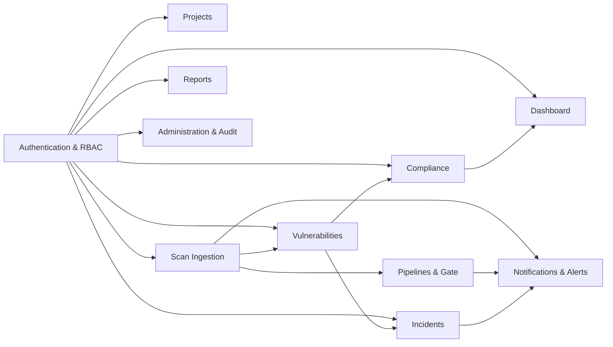

## 9.2 Authentication and Identity Module

**Purpose:** establish identity, maintain sessions securely and enforce role boundaries.

**Registration.** A visitor supplies name, email, password and confirmation. The server checks password complexity (≥8 characters, upper, lower, digit, symbol), rejects duplicate emails with **409**, hashes the password with bcrypt (cost 12), and issues an access token plus refresh cookie. A requested `Admin` role is silently coerced to `Developer`; other requested roles are accepted.

**Login.** The service loads the password and lockout fields explicitly, rejects unknown emails and wrong passwords with the same **401** message (no account enumeration), returns **403** for deactivated accounts, and returns **423** with the remaining lock time when the account is locked. Failed attempts increment a counter; the fifth failure sets `lockUntil` for 15 minutes. Attempts three, two and one before lockout produce a warning that reveals the remaining count. Success resets the counter, records `lastLogin` and issues a fresh token pair.

**Refresh.** The raw refresh token arrives in the `httpOnly` cookie (or request body). The server hashes it with SHA-256, finds the matching user, rejects inactive users, issues a new access token, generates a new refresh token, stores its hash and returns the new raw token. The previous token is now invalid. The cookie is scoped to `/api/v1/auth`, so it is not sent to any other endpoint.

**Password recovery.** `forgot-password` always returns a neutral message. For known addresses it generates 32 random bytes, stores only the SHA-256 hash with a 15-minute expiry, and emails a link to `${CLIENT_URL}/reset-password/<raw>`. Reset looks up the hash and expiry, updates the password (triggering the bcrypt hook), clears the reset fields and nulls the refresh token, forcing re-authentication on every device.

**Profile and password change.** Profile updates allow name and the two notification preferences. Password change verifies the current password, validates the new one, updates the hash and revokes the refresh token. `logout` and `logout-all` both clear the single stored refresh token, reflecting the one-active-session-per-user design.

**Client session bootstrap.** On load, `AuthContext` first tries `GET /auth/me` with a stored access token. If that fails or no token exists but a `dso_has_session` hint is present, it calls `/auth/refresh`. The Axios interceptor transparently refreshes on any 401 outside the auth endpoints, queues concurrent requests, replays them with the new token, and redirects to `/login?sessionExpired=true` if refresh fails.

## 9.3 Dashboard Module

**Purpose:** give every role a single-screen view of posture, delivery safety and workload.

The page issues one request, `GET /dashboard/stats`, which the service fulfils with twelve parallel queries:

1. Open/In Progress counts grouped by severity.
2. All-status counts.
3. Total projects.
4. Total pipeline runs.
5. Pipeline runs grouped by status.
6. Top five risky projects (aggregation sorted by critical, then high, then total, with a `$lookup` for project metadata).
7. Active frameworks.
8. Assessment roll-up per framework.
9. Latest five alerts.
10. Active incidents (`Detected`, `Triaged`, `Contained`).
11. Count of breached or overdue open findings.
12. Thirty-day creation trend grouped by `YYYY-MM-DD`.

Derived values include the gate pass rate (`passed / (passed + failed)`, 100 when no runs exist), per-framework compliance scores and a mean assessed score.

The interface presents:

| Element | Content |
|---|---|
| Greeting header | Time-of-day greeting, freshness pill (`Updated HH:MM` or `Syncing…`), Import Scan and Reports actions |
| Four KPI cards | Security posture, Critical + High open, CI gate pass rate, Active incidents |
| Compliance posture card | SVG ring, grade A–D, narrative label, controls passed, SLA breaches, projects tracked |
| Severity donut | Open findings by severity with centre total and a custom tooltip |
| Discovery velocity | 30-day area chart |
| Highest-risk services | Horizontal bars for Critical and High per project |
| Framework readiness | Up to five assessed frameworks with score and control ratio |
| Recent alerts | Five most recent alerts, linked to the related project's findings |

The query refetches every 30 seconds. Loading shows skeletons; failure shows a retry card.

## 9.4 Project Module

**Purpose:** model the services under protection and hold their security policy.

Projects have a unique human name and a short unique key (`PAY-SRV`), a criticality tier, an optional repository URL and description, a computed security score, an assigned team and a gate policy. The list endpoint supports search across name, key and description, an exact criticality filter, pagination and a per-project severity aggregation over open and in-progress findings.

Creation is restricted to Admin and Security Analyst. Duplicate names and keys return **409**. If no team is supplied, the creator becomes the sole member. Deletion is Admin-only and cascades to that project's vulnerabilities.

The UI offers card and table views, a severity mini-bar per card, a score colour scale (≥85 green, ≥65 amber, else red), a last-scan timestamp and a deep link into the filtered vulnerability list. The create modal auto-generates an eight-character uppercase key when the field is left empty.

## 9.5 Vulnerability Module

**Purpose:** provide the working queue for triage and remediation.

Each record carries a normalised severity, lifecycle status, CVE, CWE list, CVSS, scanner, scan type, affected component and versions, file and line, remediation guidance, assignee, SLA deadline and breach flag, occurrence count, comments and an activity timeline.

**Listing.** Filters cover free text (CVE, title, component, file path), multi-select severity and status, tool, scan type, project, assignee (including unassigned) and SLA state. Default sorting is by `slaDueDate` ascending, which surfaces the most urgent work first. Every row receives a computed `isBreached` value.

**Status lifecycle.**

```
Open ──► In Progress ──► Resolved
  │           │
  ├──────────►False Positive
  └──────────►Accepted Risk
        (any terminal state can be reopened)
```

Terminal statuses (`Resolved`, `False Positive`, `Accepted Risk`) require a reason, set `resolvedAt` and `resolvedBy`, and are reflected in the timeline as `STATUS_CHANGE`. Moving back to a non-terminal status clears those fields. The schema hook recalculates `slaBreached` on every save.

**Collaboration.** Any authenticated user can comment; comments and timeline entries are embedded and returned in the detail response. Assignment is limited to Admin and Analyst, with a timeline entry naming the new assignee. Bulk updates apply one status and optional reason to many findings in a single `updateMany` with a `BULK_UPDATE` timeline push.

**Interface.** The table shows severity, CVE/title, project, component or file, tool, SLA countdown ("BREACHED", "Nd left" or "Done"), status and assignee. A drawer exposes technical identification, description, guidance, comments and the full activity history, with role-aware status and assignment controls.

## 9.6 Scan Ingestion Module

**Purpose:** convert heterogeneous scanner output into a single trustworthy dataset.

### Parser registry

The registry maps tool names to parser modules and supports runtime registration:

| Tool | Parser | Scan type | Accepted input |
|---|---|---|---|
| `trivy` | `trivy.parser.js` | SCA / Container | `Results[].Vulnerabilities[]` |
| `gitleaks` | `gitleaks.parser.js` | Secret | Array of leaks or `{ leaks: [] }` |
| `npm-audit` | `npm-audit.parser.js` | SCA | v7+ `vulnerabilities` dictionary, legacy `advisories` |
| `semgrep` | `semgrep.parser.js` | SAST | `results[]` with nested metadata |

Unknown tools return **422** and list the available parsers. Malformed reports return **422** with a tool-specific message.

### Normalisation

Every parser emits the same shape:

```js
{
  title, description, severity, cve, cwe[], cvss,
  tool, scanType, component, version, fixedVersion,
  filePath, line, remediationGuidance
}
```

Severity is mapped to the canonical five levels:

| Parser | Critical | High | Medium | Low | Info |
|---|---|---|---|---|---|
| Trivy | `CRITICAL` | `HIGH` | `MEDIUM` | `LOW` | anything else |
| npm audit | `critical` | `high` | `moderate` | `low` | missing |
| Semgrep | — | `ERROR` | `WARNING` / default | `INFO` | — |
| Gitleaks | always | — | — | — | — |

Gitleaks findings are treated as Critical without exception because a leaked credential is immediately exploitable. Each Gitleaks description embeds a redacted preview (`first four characters + asterisks`, or `****` for very short values); the plaintext secret is never persisted.

### Deduplication and lifecycle

The fingerprint is:

```js
sha256(`${project._id}:${tool}:${cve || title}:${component || (filePath + (line || ''))}`)
```

The unique compound index `{ fingerprint, project }` guarantees at most one record per logical issue per project. For each parsed finding the service:

1. Looks up an existing record by fingerprint and project.
2. If found and terminal, reopens it, clears resolution metadata and appends a `REOPENED` timeline entry.
3. If found and active, increments `occurrences`, updates `lastSeen`, `version` and `fixedVersion`.
4. If absent, creates it with status `Open`, a severity-based SLA deadline, `occurrences: 1` and a `DISCOVERED` timeline entry.

When a project has `autoResolveMissing` enabled, open findings from the same tool that are absent from the current fingerprint set are marked resolved with the reason `Auto-resolved: Missing from latest full CI scan`.

### Gate evaluation

The project's gate policy is applied to the counts from this scan:

| Condition | Failure message |
|---|---|
| `failOnCritical` and critical > 0 | `Critical findings detected: N (Policy: 0 allowed)` |
| high > `maxHighAllowed` | `High findings: N (Exceeded limit of M)` |

The gate passes when no condition fires. The service persists a `PipelineRun` with status `Passed` or `Failed`, a human-readable reason, the failed conditions, severity counts, one stage entry and timing metadata; a `ScanResult` with ingestion counts; and an `Alert` when the gate fails.

`maxMediumAllowed` and `blockOnFailedGate` exist on the schema but are not consulted by the current gate implementation.

### Score recomputation

After ingestion the project score is recalculated:

```js
score = 100 − (Critical × 15 + High × 5 + Medium × 1.5 + Low × 0.5)
```

The result is rounded and clamped to 0–100. `Info` findings carry no penalty. `lastScanAt` is updated in the same step.

### Ingestion channels

| Channel | Authentication | Limits | Behaviour |
|---|---|---|---|
| Webhook | API key + HMAC-SHA256 | 60 req/min/IP | CI-driven, optional auto-create project |
| Manual upload | JWT + Admin/Analyst role | 10 MB, JSON only | Synthetic pipeline metadata (`manual-upload`, branch `workspace`) |

## 9.7 Pipelines and Quality Gate Module

Every accepted scan produces a `PipelineRun` record containing provider, run ID, URL, branch, commit, trigger, status, gate summary, severity counts, stage breakdown, duration and completion time.

The UI lists runs with project and status filters, shows gate status, run ID, project, branch and short commit, trigger, counts and execution time, and opens a stage-breakdown modal. The modal maps the six canonical stages (`Secret`, `SAST`, `SCA`, `Container`, `IaC`, `DAST`) to the recorded stages, marks each as Not Run, Passed or Failed with finding counts, displays the policy reason and failed conditions, and links to the external CI run when a URL exists.

Gate pass rate is computed on the dashboard and reports as `passed / (passed + failed) × 100`, defaulting to 100 when no runs exist.

## 9.8 Compliance Module

**Purpose:** translate technical findings into control-level assurance.

Six frameworks are seeded. Each active framework exposes its controls through a virtual count. Assessments are per project, per control, and are initialised lazily on first access with a baseline status of `Compliant`, score 100 and the note "Baseline compliant. Pending audit verification." The unique index on `{ project, control }` prevents duplicates.

**Manual assessment.** Admin and Analyst can set status, numeric score and evidence notes. The UI pre-fills the score from the status (Compliant 100, Partially Compliant 50, Non-Compliant 0, Not Applicable 0) but permits an override. The evaluator and timestamp are recorded.

**Compliance score.**

```js
applicable = total − notApplicable
score = round(((compliant × 100 + partiallyCompliant × 50) / (applicable × 100)) × 100)
```

When nothing is applicable the score is 100.

**Automated CWE mapping.** `POST /assessments/evaluate/:projectId` loads all open and in-progress vulnerabilities and every assessment whose control declares `mappedCwEs`. A control becomes `Non-Compliant` with score 0 and a `mappedVulnerabilities` list when any active finding carries a matching CWE; when the match disappears it returns to `Compliant` with score 100 and clears the mapping. Controls without `mappedCwEs` are skipped, and the seeded controls contain none, so the seeded dataset demonstrates the mechanism but does not change automatically.

**Interface.** Framework tabs, a project selector, a summary ring with status counts and a controls table showing control ID, title, domain, mapped findings, status and evidence, with an edit modal restricted to Admin and Analyst.

## 9.9 Incident Response Module

**Purpose:** manage security events that require coordinated response beyond a single finding.

An incident records a generated identifier (`INC-` + last four timestamp digits + four random digits), title, description, severity, project, responder, related vulnerabilities, a timeline and a post-mortem.

Lifecycle:

```
Detected ──► Triaged ──► Contained ──► Resolved ──► Post-mortem
```

Admin and Analyst can declare, assign and save post-mortems; Developers can advance the lifecycle but not declare, assign or edit the post-mortem; Auditors are read-only. Every transition appends a timeline entry with performer and optional notes. Resolving sets `resolvedAt` once. Saving a post-mortem records root cause, impact summary, preventative actions and a completion timestamp.

Side effects: creation, status change and assignment write audit entries (`INCIDENT_CREATED`, `INCIDENT_STATUS_CHANGE`, `INCIDENT_ASSIGNED`, `INCIDENT_POSTMORTEM_SAVED`) and create notifications for the assignee, delivered over Socket.IO and optionally email.

The UI presents five stage tiles with counts, stage and severity filters, search, incident cards, a right-hand detail drawer with lifecycle controls and post-mortem fields, a declaration modal and a transition modal.

## 9.10 Notifications and Alerts Module

**Notifications** are per-user inbox records with type, title, message, severity, link and read state. Creation persists first, then emits `notification` to `user_<id>` so that a reconnecting client can recover missed items through REST. Email is sent when explicitly requested, when severity is Critical, or when the type is `PIPELINE_GATE_FAILED` / `SLA_BREACH`, subject to the recipient's email preference.

The UI exposes an unread badge in the top bar, a dropdown with the six latest items, a full inbox grouped by Today/Yesterday/Earlier, mark-one/mark-all read, delete with confirmation, and deep links carried in each notification. Socket toasts are severity-aware (Critical error toast for 6 s, High default for 5 s, others success for 4 s).

**Alerts** are a global security feed with category, severity and acknowledgement state. They are produced by gate failures and SLA breaches. The dashboard lists the five most recent; the API supports filtering and acknowledgement. `broadcastSecurityAlert` exists but is not called, so alerts do not currently push to sockets.

## 9.11 Reporting Module

| Report | Format | Scope | Contents |
|---|---|---|---|
| Executive summary | PDF (A4) | Whole platform | Project count, severity aggregation, top 10 open criticals, frameworks, last 10 pipelines, SLA breaches, sign-off |
| Vulnerabilities | CSV | Optional project and severity | 19 flat columns including fingerprint, CVE/CWE/CVSS, tool, component, versions, file/line, assignee, SLA |
| Compliance matrix | CSV | All frameworks | Framework, code, control code, title, category, status, mapped count |
| Audit logs | CSV | Filters (action, role, search) | Timestamp, action, actor, role, resource, target, IP; capped at 1,000 rows |

PDF generation is streamed directly to the client with a timestamped filename. CSV exports are generated in memory and sent as attachments. The Reports page presents four snapshot cards and three export cards with busy states, plus project/severity scoping for the vulnerability export.

## 9.12 Administration and Audit Module

| Screen | Capabilities |
|---|---|
| Users | Search, role and status filters, pagination, create, edit role/status, delete, unlock, force logout, statistics (total, active, locked, role distribution) |
| API Keys | List with tool allow-list, status, creator and last use; create with one-time secret reveal; revoke |
| Settings | SLA days, gate defaults, password policy and lockout, email alert toggles; dirty-state tracking and discard |
| Audit Logs | Search actor/resource/IP, filter by 16 action values and actor role, inspect before/after JSON, export CSV |

Audit entries are written by `logAudit`, which captures action, actor identity and role, target resource and ID, details, before/after state, IP (preferring the first `X-Forwarded-For` value), user agent and timestamp. Failures in audit writing are caught and logged so they can never break the primary request.

The Admin statistics endpoint also exposes system health: database ready state (Connected/Connecting/Disconnected), host and database name, process uptime, Node version, platform, and heap/RSS memory.

## 9.13 Module-to-Role Matrix

| Module | Admin | Security Analyst | Developer | Auditor |
|---|---|---|---|---|
| Dashboard | Full | Full | Full | Full |
| Projects | Create, edit, delete | Create, edit | View | View |
| Vulnerabilities | Full | Full | Status + comments | View + comments |
| Scan ingestion | Upload + webhook keys | Upload | — | — |
| Pipelines | View | View | View | View |
| Compliance | Framework/control admin, assess, evaluate | Assess, evaluate | View | View |
| Incidents | Declare, assign, transition, post-mortem | Declare, assign, transition, post-mortem | Transition | View |
| Reports | All exports | All exports | All exports | All exports |
| Notifications | Own inbox | Own inbox | Own inbox | Own inbox |
| Users | Full | Assignee lookup | Assignee lookup | — |
| API keys | Full | — | — | — |
| Settings | Full | — | — | — |
| Audit logs | View + export | — | — | View + export |

---


# 10. System Workflows

This chapter traces the platform's behaviour end to end. Each workflow lists the actors, the sequence of calls, the data written and the failure paths. Together they show how the modules described in Chapter 9 cooperate.

## 10.1 First-Run and Onboarding Workflow

| Step | Actor | Action | System response |
|---|---|---|---|
| 1 | Operator | Start MongoDB, API and client | API connects, creates indexes, registers the hourly cron, listens on 5000 |
| 2 | Operator | Run `npm run seed` | Fourteen collections cleared and repopulated with 228 documents |
| 3 | User | Open `http://localhost:5173` | SPA loads, detects no session and redirects to `/login` |
| 4 | Admin | Sign in with seeded credentials | Access token in memory, refresh cookie set, `/dashboard` rendered |
| 5 | Admin | Create an API key for CI | Key ID and one-time secret displayed |
| 6 | Admin/Analyst | Register the first real project | Project appears with score 100 and no findings |
| 7 | CI engineer | Add the webhook call to the pipeline | First scan ingested, gate evaluated, findings created |
| 8 | Analyst | Triage findings and assign owners | Statuses, assignees and comments recorded |
| 9 | Analyst | Initialise compliance assessments | Baseline assessments created on first access |
| 10 | Auditor | Review audit logs and export evidence | CSV downloaded |

### Project creation sequence

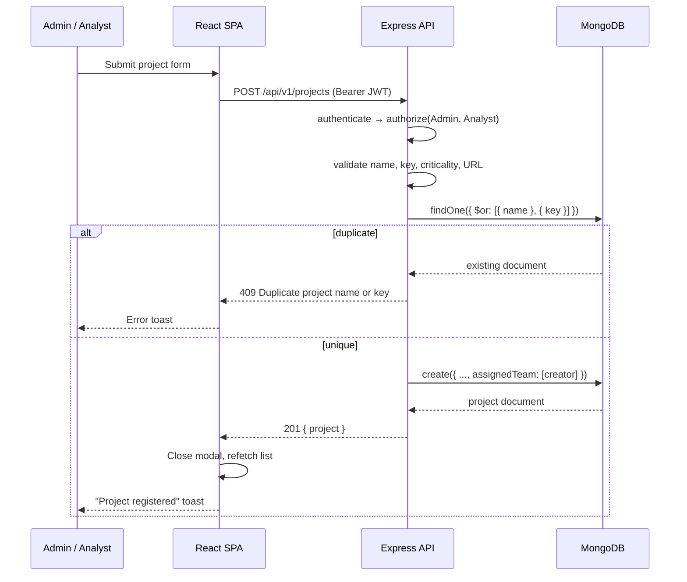

## 10.2 Authentication Workflows

### 10.2.1 Registration

1. The client validates password confirmation and complexity locally and shows a strength meter.
2. `POST /auth/register` passes through the auth rate limiter (20 requests / 15 min / IP) and the validation chain.
3. The service checks for an existing email and returns **409** if found.
4. `Admin` is downgraded to `Developer`; any other requested role is retained.
5. The password is hashed by the schema hook (bcrypt, cost 12).
6. A 15-minute access token and a 7-day refresh token are issued; only the SHA-256 hash of the refresh token is stored.
7. The response sets the `refreshToken` cookie and returns the sanitised user plus the access token.
8. The client stores the token in `localStorage` (`dso_token`) and sets `dso_has_session`.
9. The user is navigated to `/dashboard`.

### 10.2.2 Login and lockout

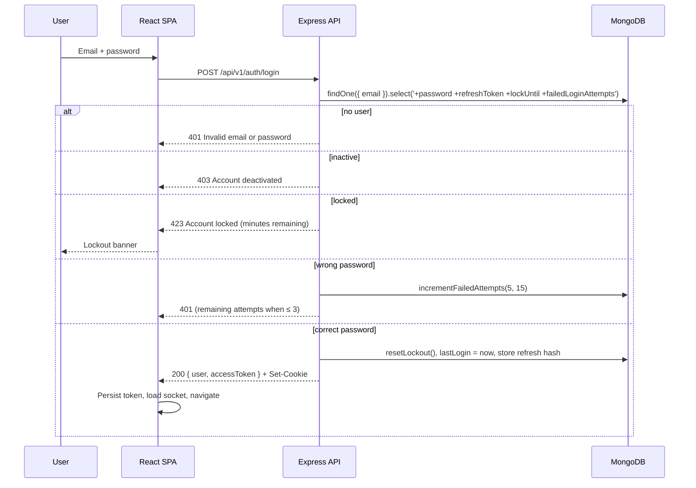

### 10.2.3 Silent refresh and request replay

The Axios response interceptor implements a single-flight refresh queue:

1. A request receives **401** and lacks `_retry`.
2. Auth endpoints are excluded so a bad password cannot trigger a refresh loop.
3. If no refresh is in progress, the interceptor sets `isRefreshing`, marks the request `_retry`, and calls `/api/v1/auth/refresh` directly (bypassing the instance to avoid recursion).
4. Concurrent 401s are pushed into `failedQueue` instead of starting more refreshes.
5. On success, the new access token is persisted, every queued request is replayed with the new header, and the original request is retried.
6. On failure, queued requests are rejected, the stored token and session hint are cleared, and the browser is redirected to `/login?sessionExpired=true&redirect=<pathname>`.
7. Query strings and hashes are not preserved in the redirect parameter.

### 10.2.4 Password reset

1. `POST /auth/forgot-password` always returns the same message, whether or not the email exists.
2. For a known account, 32 random bytes are generated; the SHA-256 hash is stored with a 15-minute expiry.
3. An HTML and text email is sent with `${CLIENT_URL}/reset-password/<raw-token>`.
4. If email delivery fails, the token fields are cleared and the request fails rather than leaving an unusable token.
5. The reset page posts the token and new password to `/auth/reset-password/:token`.
6. The service looks up the hash and checks expiry, updates the password, clears the reset fields and nulls the refresh token.
7. All existing sessions become invalid; the user signs in again.

## 10.3 Scan Ingestion Workflow

### 10.3.1 CI webhook end to end

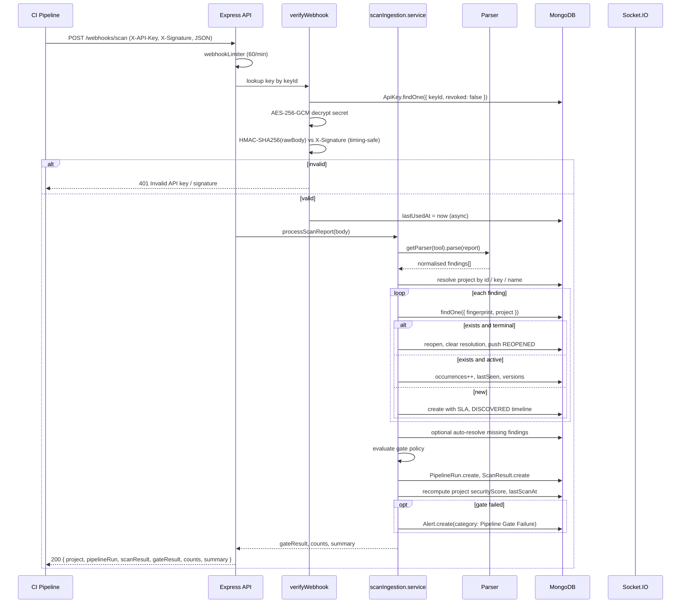

### 10.3.2 Manual upload

1. Admin or Analyst opens `/scans/import`, selects a project and tool, and drops a `.json` file.
2. The client checks the extension/MIME type and displays the filename and size.
3. `FormData` is posted to `/scans/upload` with `project`, `tool`, `scanType` and `file`.
4. Multer accepts the file into memory (10 MB cap, JSON only) and rejects anything else.
5. The controller checks for a file or `report` body, then a project and tool.
6. Invalid JSON returns **422**.
7. A synthetic pipeline context is built: provider `manual-upload`, run ID `manual-<timestamp>`, branch `workspace`, commit `local`, trigger = the user's name.
8. Ingestion proceeds exactly as for a webhook, with `ingestionMethod: 'manual'` and `uploadedBy` set.
9. The page renders a summary card with gate status, total/new/updated/reopened counts, the policy reason and a link to the project's findings.

### 10.3.3 Finding lifecycle state machine

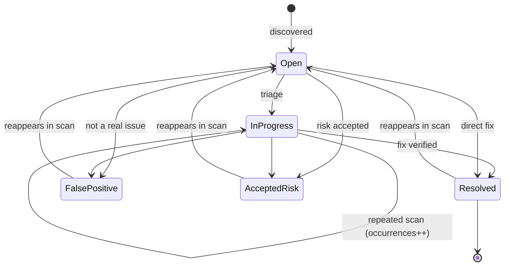

Reopening is driven by ingestion, not by the user: a terminal finding whose fingerprint appears again is reset to `Open`, its resolution metadata is cleared and a `REOPENED` timeline entry is appended. This preserves history while restoring the finding to the active queue.

## 10.4 Quality Gate Workflow

For each accepted scan:

1. Count findings by canonical severity.
2. Load the project gate policy; if absent, use `{ failOnCritical: true, maxHighAllowed: 5, maxMediumAllowed: 20 }`.
3. Fire the Critical condition when enabled and any Critical finding exists.
4. Fire the High condition when the count exceeds the allowed maximum.
5. The gate passes only when no condition fired.
6. Persist the run with status, reason, failed conditions, counts and a stage entry.
7. Create an alert if the gate failed, with severity Critical when Critical findings exist, otherwise High.
8. Recompute the project score and update `lastScanAt`.

```
checkGate(counts, policy):
    failures = []
    if policy.failOnCritical and counts.critical > 0:
        failures.push("Critical findings detected: N (Policy: 0 allowed)")
    if counts.high > policy.maxHighAllowed:
        failures.push("High findings: N (Exceeded limit of M)")
    passed = failures.length == 0
    return { passed, status: passed ? "Passed" : "Failed",
             reason: passed ? "All security gate thresholds satisfied."
                            : failures.join("; "),
             failedConditions: failures }
```

## 10.5 Remediation and SLA Workflow

### 10.5.1 SLA assignment

When a finding is created, its deadline is derived from severity using the default table:

| Severity | SLA window |
|---|---|
| Critical | 2 days |
| High | 7 days |
| Medium | 30 days |
| Low | 90 days |
| Info | 180 days |

`isSlaBreached(dueDate, status)` returns true when the deadline is in the past and the status is `Open` or `In Progress`. The value is recalculated by the schema hook on every save. The vulnerability list adds a computed `isBreached` field so the UI can render a live countdown without trusting a stale stored flag.

### 10.5.2 Hourly SLA job

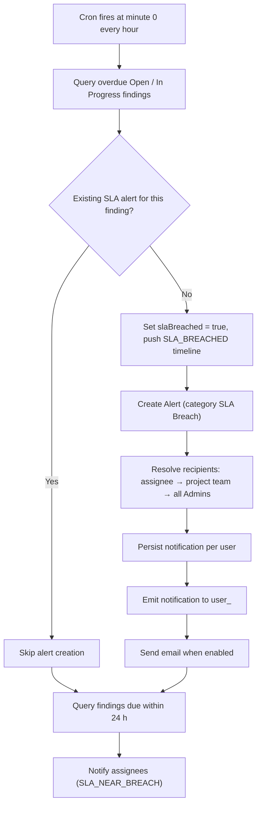

Breach alerts are de-duplicated by checking for an existing alert with the same vulnerability and category, so a finding produces at most one breach alert. Near-breach notifications have no de-duplication and repeat hourly during the final 24 hours. The job is disabled under `NODE_ENV=test`, where the exported `checkSlaBreachesNow()` is invoked directly by tests.

### 10.5.3 Analyst triage flow

1. Open `/vulnerabilities` and sort by SLA (the default).
2. Filter by severity, status, tool or SLA state, or arrive through a deep link from the dashboard or a project card.
3. Open a row to see technical detail and guidance.
4. Change status to `In Progress`; optionally assign an owner.
5. Add a comment describing the remediation plan.
6. When fixed, set `Resolved` with a reason; the resolver and timestamp are recorded.
7. If the next scan still contains the issue, ingestion reopens it and the cycle restarts.

## 10.6 Compliance Workflow

1. An Analyst selects a project and framework on `/compliance`.
2. `GET /assessments?project&framework` validates both identifiers.
3. Missing assessments are auto-created as `Compliant` with score 100 and a baseline note.
4. The summary computes counts per status and the weighted compliance score.
5. The Analyst reviews each control, edits status, score and evidence notes, and saves.
6. Optionally, the Analyst runs **Automated Mapping Check**:
   - Active vulnerabilities are compared with each control's `mappedCwEs`.
   - Matches mark the control `Non-Compliant`, score 0, and store the matching vulnerability IDs.
   - Controls whose matches have all been resolved return to `Compliant`, score 100.
7. The dashboard reflects the new framework score and average posture.
8. The Auditor exports the compliance matrix as CSV as evidence.

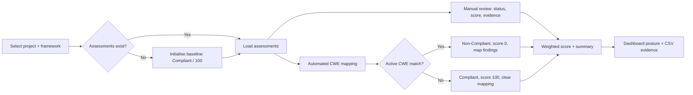

## 10.7 Incident Response Workflow

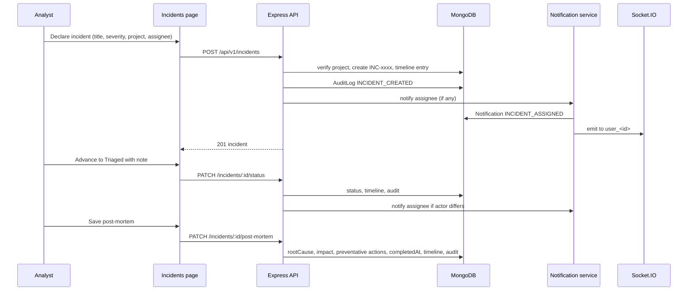

Role boundaries are enforced server-side: a Developer calling the status endpoint succeeds; the same user calling create, assign or post-mortem receives **403**.

## 10.8 Notification Delivery Workflow

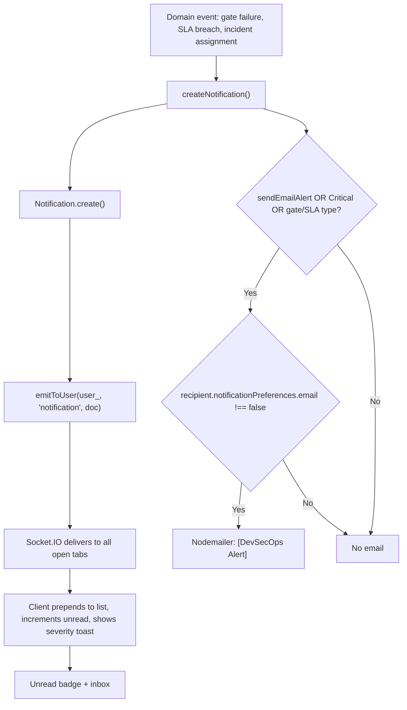

Persistence always precedes emission, so the REST inbox remains the source of truth. A client that was offline during an event sees the notification on its next list fetch or page load.

## 10.9 Reporting Workflow

1. Any authenticated user opens `/reports`.
2. Dashboard statistics and the project list populate the snapshot and export controls.
3. Clicking an export sets a single `downloadingType`, disabling every export button.
4. The API streams the PDF or generates a CSV attachment.
5. The client converts the blob to an object URL, creates a temporary anchor with a timestamped filename, clicks it, removes the element and revokes the URL.
6. Success or failure is shown as a toast.

## 10.10 Administration Workflows

### 10.10.1 API key provisioning

1. Admin opens `/admin/api-keys` and clicks Generate key.
2. The form requires a name, at least one allowed scanner and an auto-create preference.
3. The server generates `keyId = dso_live_<32 hex>` and `secret = dso_sec_<64 hex>`.
4. The secret is encrypted with AES-256-GCM and also hashed with SHA-256 before storage.
5. The plaintext secret is returned once and displayed in a modal that has no dismiss path other than explicit acknowledgement.
6. The admin copies both values into the CI secret store.
7. Revocation sets `revoked: true` and `revokedAt`, after which every webhook using that key receives **401**.

### 10.10.2 User administration

| Operation | Effect | Audit action |
|---|---|---|
| Create | New account with selected role | `USER_CREATED` |
| Edit profile/role | Updates fields; role change captured separately | `USER_UPDATED` / `ROLE_CHANGE` |
| Deactivate | `isActive = false`; login returns 403 | `USER_UPDATED` |
| Delete | Hard delete; self-delete blocked with 400 | `USER_DELETED` |
| Unlock | Clears failed attempts and lock deadline | `ACCOUNT_UNLOCKED` |
| Force logout | Nulls the refresh token | `FORCE_LOGOUT` |

### 10.10.3 Settings update

The settings screen hydrates from the server, tracks dirtiness by JSON comparison, and saves the whole document. The service performs an upsert on `key: 'system_config'`, shallow-merges each section, and writes an audit record containing full before and after states plus the list of changed sections. Discard restores the hydrated baseline.

## 10.11 Cross-Cutting Workflow: Authorisation on Every Request

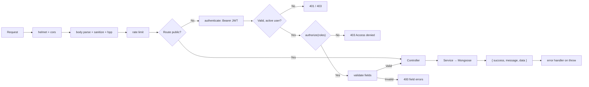

The client mirrors these rules by hiding controls, but the server never relies on that: every mutating route repeats the role check.

---

# 11. Security Design and Threat Mitigation

## 11.1 Security Objectives

The platform is designed to protect four assets:

1. **Credentials** — user passwords, refresh tokens, API secrets and detected secrets.
2. **Findings data** — vulnerability details that could aid an attacker if disclosed.
3. **Integrity of decisions** — gate results, compliance assessments and incident records must not be silently altered.
4. **Accountability** — every administrative action must be attributable.

## 11.2 Threat Model (STRIDE)

| Threat | Example | Mitigation in this system | Residual risk |
|---|---|---|---|
| **Spoofing** | Attacker submits fake scan results | API key + HMAC-SHA256 over the raw body; key revocation | Stolen key + secret allows forgery until revoked |
| **Tampering** | Modified scan payload in transit | HMAC verification with timing-safe comparison | TLS termination is the deployment's responsibility |
| **Repudiation** | Admin denies changing a role | Audit log with actor, IP, user agent and before/after state | Auth events and some domain changes are not audited |
| **Information disclosure** | Secret leaked in a scan report | Gitleaks values redacted before persistence; API secrets encrypted | Raw reports are not stored, but descriptions may quote other sensitive text |
| **Denial of service** | Flood of webhooks or login attempts | Global, auth and webhook rate limits; 15 MB body cap; 10 MB upload cap | No WAF or upstream quota in the demo deployment |
| **Elevation of privilege** | Developer edits compliance | Server-side `authorize()` on every mutating route | Public registration can self-assign Analyst or Auditor |
| **Injection** | NoSQL operator injection in filters | `express-mongo-sanitize`, explicit field validation, typed casts | Regex search remains a potential ReDoS vector |
| **XSS** | Stored script in a finding title | React escapes rendered text by default; CSP disabled | No explicit sanitisation layer for rich text (none is accepted) |
| **CSRF** | Cross-site refresh or mutation | `SameSite=strict` refresh cookie in production; Bearer token required for mutations | No CSRF tokens; development uses `SameSite=lax` |
| **Session theft** | Refresh cookie exfiltration | `httpOnly`, scoped path, rotation, hashed storage | Access token lives in `localStorage` and is readable by XSS |

## 11.3 Authentication Controls

### Password storage

- bcrypt with cost factor **12**, applied in a schema hook only when the password changes.
- Password field is `select: false`, so it is never returned by ordinary queries.
- Minimum length 8 enforced at the schema; complexity enforced by validators on every password-setting route.
- Password change and reset both null the refresh token, invalidating existing sessions.

### Lockout and rate limiting

| Control | Value |
|---|---|
| Failed-attempt threshold | 5 |
| Lock duration | 15 minutes |
| Locked response | HTTP **423** with minutes remaining |
| Progressive warning | Shown when 3, 2 or 1 attempts remain |
| Auth rate limit | 20 requests / 15 minutes / IP |
| Global API limit | 300 requests / 15 minutes / IP |
| Webhook limit | 60 requests / minute / IP |

A successful login resets both the counter and the lock deadline. Administrators can unlock an account explicitly through the admin API.

### Token design

| Property | Access token | Refresh token |
|---|---|---|
| Format | JWT (HS256) | 40 random bytes, hex |
| Lifetime | 15 minutes (configurable) | 7 days (hard-coded cookie) |
| Storage (client) | `localStorage` + in-memory context | `httpOnly` cookie |
| Storage (server) | Not stored | SHA-256 hash on the user document |
| Transport | `Authorization: Bearer` | Cookie scoped to `/api/v1/auth` |
| Revocation | Expiry only | Rotation on every use; nulled on logout/reset |
| Claims / payload | `{ id, email, role, name }` | None |

The refresh cookie uses `httpOnly: true`, `sameSite: 'strict'` in production (`lax` in development), `secure` when `COOKIE_SECURE=true` or in production, and `path: '/api/v1/auth'`. Because a single hash is stored per user, the system supports one active session per account; logging in elsewhere replaces the previous session.

### Password reset

- 32 random bytes, stored only as a SHA-256 hash.
- 15-minute expiry.
- Single use: the fields are cleared immediately on success.
- Uniform response for unknown emails prevents account enumeration.
- Email failure clears the token so a dead link is never issued.

## 11.4 Authorisation Model

Role-based access control is enforced by a single `authorize(...roles)` middleware after `authenticate`. The complete matrix is:

| Capability | Admin | Security Analyst | Developer | Auditor |
|---|---|---|---|---|
| Read projects, findings, pipelines, scans, dashboard | ✔ | ✔ | ✔ | ✔ |
| Create/update project | ✔ | ✔ | ✘ | ✘ |
| Delete project | ✔ | ✘ | ✘ | ✘ |
| Update finding status | ✔ | ✔ | ✔ | ✘ |
| Assign / bulk-update findings | ✔ | ✔ | ✘ | ✘ |
| Comment on findings | ✔ | ✔ | ✔ | ✔ |
| Manual scan upload | ✔ | ✔ | ✘ | ✘ |
| Incident create / assign / post-mortem | ✔ | ✔ | ✘ | ✘ |
| Incident lifecycle transition | ✔ | ✔ | ✔ | ✘ |
| Framework / control administration | ✔ | ✘ | ✘ | ✘ |
| Assessment update / evaluate | ✔ | ✔ | ✘ | ✘ |
| Reports and exports | ✔ | ✔ | ✔ | ✔ |
| Alerts and own notifications | ✔ | ✔ | ✔ | ✔ |
| Audit logs and export | ✔ | ✘ | ✘ | ✔ |
| Assignee directory | ✔ | ✔ | ✔ | ✘ |
| Users, API keys, settings, system stats | ✔ | ✘ | ✘ | ✘ |

Client-side gating mirrors this matrix by removing actions from the DOM, but the server check is authoritative. Hidden UI is treated as a usability feature, not a security boundary.

## 11.5 API Key and Webhook Security

### Key format and storage

```
keyId  = "dso_live_" + 32 hex characters
secret = "dso_sec_"  + 64 hex characters
```

- `keyId` is stored in plaintext for lookup.
- `secret` is encrypted with **AES-256-GCM**: a random 16-byte IV, an authentication tag and the ciphertext, serialised as `iv:authTag:ciphertext` in hex.
- The encryption key is `sha256(JWT_SECRET || 'devsecops_master_encryption_key_2026')`.
- A SHA-256 hash of the secret is also stored but is not used in the verification path.
- The plaintext secret is returned exactly once, at creation.

### Signature verification

```js
expected = HMAC-SHA256(rawBody, decryptedSecret).hex
provided = header.startsWith('sha256=') ? header.slice(7) : header
valid = lengthsEqual && crypto.timingSafeEqual(Buffer.from(expected), Buffer.from(provided))
```

The raw body is captured by the `express.json` `verify` callback, so re-serialising the JSON cannot change the signed bytes. Only hexadecimal signatures are accepted. Missing headers, unknown keys, revoked keys and mismatched signatures all return **401** with deliberately non-specific messages; decryption failure returns **500** without exposing the reason.

### Replay characteristics

- The HMAC covers the body but not a timestamp or nonce, so a captured request could be replayed.
- Replay would create another pipeline run and bump occurrence counts, but it cannot create duplicate findings because of the fingerprint index.
- There is no `Idempotency-Key` support.

## 11.6 Secret Handling

Gitleaks findings are the highest-risk data the system touches. The parser:

1. Extracts the raw secret only to compute a redacted preview.
2. Replaces values longer than four characters with the first four characters followed by up to twenty asterisks.
3. Replaces shorter values with `****`.
4. Writes only the redacted form into the finding description.
5. Never writes the raw value to any collection.

The automated test suite asserts that a known AWS key does not appear anywhere in the stored document and that the description contains the redacted form.

API secrets follow the opposite requirement: they must remain usable for HMAC verification, so they are encrypted rather than hashed. The encryption key is derived from `JWT_SECRET`; rotating that secret therefore makes every existing API key undecryptable.

## 11.7 Injection and Input Hardening

| Vector | Control |
|---|---|
| NoSQL operator injection | `express-mongo-sanitize` strips `$` and `.` keys; validators restrict expected types |
| HTTP parameter pollution | `hpp` collapses repeated parameters |
| Path/ID tampering | Mongoose casts to ObjectId; `CastError` becomes 404 |
| Oversized payloads | 15 MB JSON cap, 10 MB upload cap |
| Unsupported upload types | MIME and extension filter (`application/json`, `text/plain`, `.json`) |
| Malformed scanner JSON | Caught and returned as **422** with a tool-specific message |
| Regex search abuse | User input passes through `RegExp` escaping helpers in list services; queries are bounded by pagination |
| Mass assignment | Services copy only known fields; schemas ignore unknown paths in strict mode |
| Prototype pollution | Body parsers create plain objects; `mongo-sanitize` removes operator keys |

## 11.8 Transport and Browser Hardening

| Control | State |
|---|---|
| Helmet security headers | Enabled |
| Content Security Policy | Disabled (`contentSecurityPolicy: false`) |
| CORS | Explicit allow-list with credentials; no-origin requests allowed for CI |
| HSTS | Provided by Helmet defaults in production over HTTPS |
| Cookie flags | `httpOnly`, `SameSite`, `Secure` in production |
| Clickjacking | Helmet `X-Frame-Options` default |
| MIME sniffing | Helmet `X-Content-Type-Options: nosniff` |
| CSRF tokens | Not implemented |
| `trust proxy` | Not configured |
| TLS | Terminated outside the app (Nginx/reverse proxy) |

## 11.9 Audit Trail

`logAudit` records:

| Field | Source |
|---|---|
| `action` | Caller-supplied constant |
| `performedBy`, `performedByName`, `performedByEmail`, `role` | Authenticated user context, or `System` |
| `targetResource`, `targetId` | Domain identifiers |
| `details` | Arbitrary JSON (e.g. previous/new role, updated sections) |
| `beforeState`, `afterState` | Snapshots for administrative changes |
| `ipAddress` | First `X-Forwarded-For` value → `req.ip` → socket address → `127.0.0.1` |
| `userAgent` | Request header or `Unknown` |

Actions currently written by application code:

`USER_CREATED`, `USER_UPDATED`, `ROLE_CHANGE`, `ACCOUNT_UNLOCKED`, `FORCE_LOGOUT`, `USER_DELETED`, `API_KEY_CREATED`, `API_KEY_REVOKED`, `SETTINGS_UPDATE`, `INCIDENT_CREATED`, `INCIDENT_STATUS_CHANGE`, `INCIDENT_ASSIGNED`, `INCIDENT_POSTMORTEM_SAVED`.

The audit writer never throws: a failure is logged and the originating request still succeeds. The API exposes only list and export operations, and only to Admin and Auditor. There is no schema-level hook preventing a direct database update, so immutability is an interface guarantee rather than a database guarantee.

## 11.10 Data Protection and Privacy

- Passwords, refresh tokens and reset tokens are excluded from queries unless explicitly selected.
- API secrets and their hashes are `select: false`.
- User responses omit password and token fields before serialisation.
- Uploaded reports are held in memory and never written to disk; only a summary is persisted.
- List responses are paginated to limit bulk extraction.
- Email addresses are visible to Admin, Analyst and Developer roles through the assignee directory; Auditors cannot list users.
- No PII beyond name, email, role and audit metadata is collected.
- There is no encryption at rest for the database volume beyond the platform's own disk encryption; only API secrets receive application-level encryption.

## 11.11 Security Gaps and Hardening Recommendations

The following gaps are present in the current implementation and are stated here for completeness:

1. **Public registration role selection.** `/auth/register` accepts any role except `Admin`, so a self-registrant can become `Security Analyst` or `Auditor`. Recommended: force `Developer` and require Admin approval for elevation.
2. **No CSRF protection.** Mutations rely on the Bearer token, which is not automatically attached by browsers, but the refresh endpoint uses a cookie. Recommended: add a CSRF token or require a custom header on refresh.
3. **`allowedTools` is not enforced.** A key scoped to two scanners can submit any supported tool. Recommended: compare `req.body.tool` with `req.apiKey.allowedTools`.
4. **Socket authentication never rejects.** Guests join `security_feed`. Currently no alert is broadcast, so exposure is limited, but enabling broadcasts without fixing this would leak data. Recommended: reject unauthenticated handshakes or restrict rooms.
5. **Incomplete audit coverage.** Logins, logouts, scan ingestion, project changes, finding status changes and compliance edits are not audited. Recommended: emit audit actions at these boundaries or derive them from domain timelines.
6. **No server-side `trust proxy`.** Audit IPs depend on the `X-Forwarded-For` header, which a direct client can spoof unless a proxy overwrites it.
7. **CSP disabled.** Needed for Swagger UI and inline styles; a production deployment should enable a restrictive policy and serve Swagger separately.
8. **Refresh token in `localStorage` for access token.** Any XSS can read the access token for its 15-minute lifetime. Recommended: move the access token to memory only, or adopt a BFF pattern.
9. **No key rotation.** Rotating `JWT_SECRET` breaks all API secrets. Recommended: separate the encryption key into its own environment variable and support key versions.
10. **No account-level MFA.** Recommended for Admin and Analyst roles.
11. **No IP allow-listing for webhooks.** Recommended in addition to HMAC for internet-facing deployments.
12. **No dependency scanning in CI for this project itself.** Recommended: add `npm audit` and container scanning to its own pipeline.

---

# 12. Frontend Architecture and Design System

## 12.1 Application Bootstrap

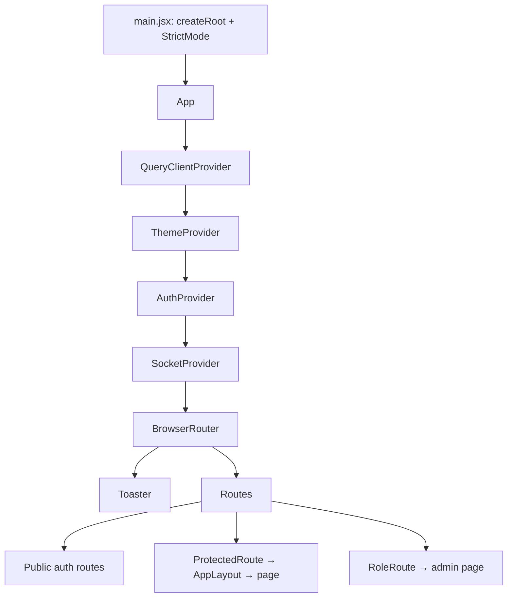

Provider order is deliberate:

1. **QueryClient** must wrap everything that uses queries.
2. **Theme** is independent and only touches `document.documentElement`.
3. **Auth** supplies `user` and `accessToken` to the socket provider.
4. **Socket** depends on auth and therefore sits inside it.
5. **Router** sits inside the socket provider; the socket code does not use router hooks, so this ordering is safe.

`QueryClient` defaults are `refetchOnWindowFocus: false`, `retry: 1` and `staleTime: 30000`. There are no mutation defaults and no global error handler.

## 12.2 Route Inventory

| Path | Page | Guard | Roles |
|---|---|---|---|
| `/login` | Login | Public; authenticated users redirected | — |
| `/register` | Register | Public | — |
| `/forgot-password` | Forgot Password | Public | — |
| `/reset-password/:token` | Reset Password | Public | — |
| `/` | Redirect to `/dashboard` | Protected + layout | Any |
| `/dashboard` | Dashboard | Protected + layout | Any |
| `/projects` | Projects | Protected + layout | Any |
| `/vulnerabilities` | Vulnerabilities | Protected + layout | Any |
| `/pipelines` | Pipelines | Protected + layout | Any |
| `/compliance` | Compliance | Protected + layout | Any |
| `/incidents` | Incidents | Protected + layout | Any |
| `/reports` | Reports | Protected + layout | Any |
| `/notifications` | Notifications | Protected + layout | Any |
| `/profile` | Profile | Protected + layout | Any |
| `/scans/import` | Scan Import | Protected + RoleRoute | Admin, Analyst |
| `/admin/users` | Admin Users | Protected + RoleRoute | Admin |
| `/admin/api-keys` | API Keys | Protected + RoleRoute | Admin |
| `/admin/settings` | Settings | Protected + RoleRoute | Admin |
| `/admin/audit-logs` | Audit Logs | Protected + RoleRoute | Admin, Auditor |
| `/unauthorized` | 403 page | Standalone | — |
| `*` | 404 page | Standalone | — |

`/unauthorized` and `*` sit outside the layout, so they render without navigation chrome. `RoleRoute` redirects unauthorised users out of the shell rather than rendering a forbidden panel inside it.

## 12.3 Layout Shell

### Sidebar

- Fixed left, width **76 px** collapsed or **256 px** expanded, translated off-canvas on mobile with a backdrop.
- Brand tile ("SentryOps / Security Platform") links to the dashboard.
- Navigation groups: **Overview**, **Security Operations**, **Governance**, **Administration**.
- Items are filtered by `getNavigationForRole(role)`; empty groups disappear.
- Active state uses exact match, or prefix match for nested paths, with a left accent bar.
- A telemetry footer shows "Live telemetry connected" (green, pulsing) or "Telemetry offline" (red) from `SocketContext.isConnected`.
- A profile row opens `/profile`; a sign-out action calls `logout()`.
- Collapse state persists in `localStorage['dso_sidebar_collapsed']`.

### Top bar

- Breadcrumb section and page title derived from `getPageMeta(location.pathname)`.
- Mobile menu button, command-palette trigger ("Search or jump to… ⌘K"), theme toggle.
- Notification bell with unread count (capped display at `9+`) and a dropdown showing the latest six items, mark-all-read and a link to the inbox.
- Profile dropdown with name, email, role badge, profile, security section, alert inbox and sign-out.
- Dropdowns close on outside click, Escape and route change.

### Command palette

- Opened with `Ctrl/Cmd + K`; closes on Escape.
- Lists role-visible navigation destinations, plus "Import scan report" for Admin/Analyst, "Export a report", "Toggle theme" and a dynamic "Search vulnerabilities for '<term>'".
- Arrow keys wrap, Enter runs the active command, the active row is scrolled into view.
- Implemented as an accessible dialog (`role="dialog"`, `aria-modal`, labelled input, key hints).

## 12.4 Design System

### Colour tokens

| Token group | Dark value (RGB) | Light override |
|---|---|---|
| `--dark-bg` | `7 11 20` | `244 246 251` |
| `--dark-surface` | `13 20 34` | `255 255 255` |
| `--dark-raised` | `21 30 48` | `238 242 249` |
| `--dark-border` | `34 45 68` | `221 228 239` |
| `--dark-text` | `231 237 247` | `11 20 36` |
| `--dark-muted` | `139 154 181` | `90 107 133` |
| `--accent` | `34 211 238` (cyan) | unchanged |
| `--accent-strong` | `8 145 178` | unchanged |
| `--success` | `34 197 94` | unchanged |
| `--danger` | `244 63 94` | unchanged |

Semantic palettes are fixed across themes:

| Group | Values |
|---|---|
| Severity | Critical `#F43F5E`, High `#F59E0B`, Medium `#3B82F6`, Low `#64748B`, Info `#94A3B8` |
| Status | Open `#FB7185`, In Progress `#FBBF24`, Resolved `#34D399`, False Positive `#9CA3AF`, Accepted Risk `#C084FC` |

### Typography and shape

- UI font: **Inter**, weights 300–700.
- Monospace: **JetBrains Mono**, used for CVE IDs, keys, commit hashes and code.
- Card radius **14 px**, control radius **9 px**.
- Shadows: `card`, `raised`, `glow`, `glow-sm`.
- Background patterns: 32 px grid (`bg-grid-faint`) and two radial gradients (`bg-hero-glow`).

### Component classes

| Class | Purpose |
|---|---|
| `.app-shell`, `.page` | Page container and vertical rhythm |
| `.card`, `.card-hover`, `.card-header`, `.card-body`, `.card-title`, `.card-subtitle` | Surface system |
| `.btn`, `.btn-primary`, `.btn-secondary`, `.btn-ghost`, `.btn-danger`, `.btn-icon`, `.btn-sm` | Buttons with disabled states |
| `.label`, `.input`, `.select`, `.textarea`, `.checkbox` | Form controls with focus rings |
| `.table-wrap`, `.data-table` | Table typography, hover and borders |
| `.badge`, `.badge-*` | Status chips |
| `.skeleton`, `.empty-state`, `.divider` | Feedback and layout |
| `.eyebrow`, `.page-title`, `.page-subtitle`, `.kpi-value` | Typography scale |
| `.scroll-thin`, `.no-scrollbar`, `.text-balance` | Utilities |

### Theme implementation

`ThemeContext` reads `localStorage['dso_theme']` (default `dark`), toggles `dark`/`light` on `<html>`, sets `color-scheme`, and persists changes. Light mode works because every `bg-dark-*`, `text-dark-*` and `border-dark-*` utility resolves through the remapped CSS variables. `dark:` variants stop applying when the `dark` class is removed. Two components contain `light:*` classes that produce no CSS because no such Tailwind variant exists; they are cosmetic leftovers and do not affect the rendered theme.

### Shared components

| Component | Behaviour |
|---|---|
| `StatCard` | KPI tile with icon, value, subtitle, optional trend and click target; five accent variants |
| `SeverityBadge` | Normalises severity, maps colour and icon, unknown → Info |
| `StatusBadge` | Maps lifecycle status to colour and icon, unknown → Open |
| `Avatar` | Initials, role-coloured ring, three sizes |
| `ThemeToggle` | Sun/moon with accessible label describing the target mode |
| `PasswordStrengthMeter` | Five checks, score 0–5, Weak/Moderate/Strong label and checklist |

There is intentionally no generic modal, drawer or table component; each screen owns its markup. This keeps page-specific behaviour explicit at the cost of some duplication.

## 12.5 Page-by-Page Summary

| Page | Data source | Notable UI |
|---|---|---|
| Login | `authApi.login` | Demo account selector, lockout banner, session-expired notice |
| Register | `authApi.register` | Strength meter, confirm-password validation |
| Forgot / Reset | `authApi` | Neutral confirmation, token route param, expiry messaging |
| Dashboard | `['dashboard-stats']`, 30 s refetch | Four KPIs, posture ring, donut, area, bars, framework readiness, alerts |
| Projects | Manual fetch, 300 ms debounce | Card/table toggle, severity mini-bar, create modal |
| Vulnerabilities | Manual fetch, 300 ms debounce | Multi-select filters, URL sync, bulk actions, SLA countdown, drawer |
| Pipelines | Manual fetch, 200 ms debounce | Gate status, counts, stage-breakdown modal |
| Scan Import | Projects + history | Dropzone, summary card, scanner command reference |
| Compliance | Projects + frameworks + assessments | Framework tabs, score ring, controls table, edit modal, mapping check |
| Incidents | TanStack Query | Stage tiles, filters, cards, detail drawer, post-mortem form |
| Reports | `['dashboard-stats']` + projects | Snapshot cards, three export cards, scoping selects |
| Notifications | Manual fetch | Date grouping, unread toggle, keyboard rows, delete confirm |
| Profile | `useAuth` | Profile form, password form, sign-out-all modal, `#security` deep link |
| Admin Users | TanStack Query | Stats, filters, CRUD modals, unlock/force-logout |
| API Keys | TanStack Query | Tool allow-list, one-time secret modal, revoke confirm |
| Settings | TanStack Query | Four policy sections, dirty tracking, sticky save bar |
| Audit Logs | TanStack Query | Filters, inspect modal with before/after JSON, CSV export |

## 12.6 Dashboard Chart Implementation

The severity donut is the most interaction-sensitive component. Its implementation:

1. **Geometry** — inner radius 50, outer radius 74, 3 px padding between segments.
2. **Data** — only severities with a value greater than zero are passed to the chart and its legend.
3. **Centre label** — an absolutely positioned block showing the total open findings, independent of Recharts.
4. **Plot measurement** — a `ResizeObserver` watches the chart container and records width and height; the SVG `viewBox` is also read on hover so a resize between renders cannot stale the calculation.
5. **Tooltip position** — computed from the hovered sector's `midAngle` and `outerRadius`. The tooltip is anchored in the quadrant opposite the segment, offset by a configured gap, then clamped to the measured plot bounds with an inset.
6. **Centre clearance** — the anchor geometry keeps the tooltip outside the inner radius, so the centre label is never covered even at narrow widths.
7. **Animation** — the chart entrance animation stays enabled; only the tooltip's own animation is disabled, because a sliding tooltip would sweep across the centre during the transition.
8. **Content** — one compact row per hovered segment, showing the severity name and count, matching the legend exactly.

This behaviour was verified at plot widths of 719 px and 236 px for all four segments, with a minimum centre clearance of 55 px against an inner radius of 50.

## 12.7 Responsive Behaviour

| Breakpoint | Behaviour |
|---|---|
| `< 640 px` | Single-column cards, stacked filters, tables scroll horizontally, sidebar off-canvas |
| `640–1024 px` | Two-column KPI grids, condensed spacing, sidebar still off-canvas |
| `≥ 1024 px` | Persistent sidebar (collapsible), multi-column dashboards, full tables |
| `≥ 1600 px` | Main content capped at 1600 px and centred |

The dashboard grid reflows from four KPI columns to two and then one. Charts use `ResponsiveContainer`-style measurement (via the wrapper and `ResizeObserver`) so they never overflow their cards. Drawers use `max-w-2xl` and occupy the full viewport height.

## 12.8 Accessibility

Present:

- Labels on form controls and `aria-label` on icon-only buttons.
- `role="dialog"`, `aria-modal` and labelled headings on most modals and drawers.
- `aria-current="page"` on active navigation, `aria-pressed` on toggles, `aria-expanded` on menus.
- Escape closes menus, modals, drawers and the palette; arrow keys and Enter operate the palette; notification rows and the dropzone respond to Enter/Space.
- Visible `:focus-visible` ring (2 px cyan, 2 px offset).
- Screen-reader-only posture grade.
- Table select-all exposes a label and indeterminate state.

Absent:

- Focus trap and focus restoration in modals.
- Skip-to-content link.
- Formal colour-contrast verification.
- Reduced-motion handling beyond Tailwind defaults.

## 12.9 State Management Summary

| Concern | Mechanism |
|---|---|
| Session | `AuthContext` + `localStorage` token + refresh cookie |
| Theme | `ThemeContext` + `localStorage` |
| Real time | `SocketContext` + `socket.io-client` |
| Server cache | TanStack Query on seven screens |
| Page state | Local `useState` per page |
| URL state | Search params on Vulnerabilities, Incidents, Audit Logs, Admin Users |
| Persistence | Sidebar collapse, theme and token only |

There is no Redux, Zustand or other global store. Context is used only for genuinely cross-cutting concerns.

## 12.10 Build and Performance Characteristics

| Metric | Value |
|---|---|
| JavaScript bundle | ≈ 1,061,999 bytes |
| CSS bundle | ≈ 61,487 bytes |
| Modules transformed | 2,877 |
| Build time | ≈ 19 s |
| Warning | Chunk larger than 500 kB |
| Code splitting | None |
| Error boundary | None |
| Image optimisation | Not applicable (SVG icons and a favicon only) |

The largest contributors are Recharts, React Router, TanStack Query, Socket.IO client and Lucide icons. Introducing route-level `React.lazy` and manual vendor chunks would be the first optimisation step.

## 12.11 UX Conventions

- **Loading** — skeleton cards or in-table spinner rows, never a full-page blocker except during auth bootstrap.
- **Empty** — contextual copy that distinguishes "no data" from "no matches", often with a reset-filters action.
- **Errors** — inline retry cards on query-driven pages; toasts for mutations.
- **Destructive actions** — always behind a confirmation modal naming the target.
- **Deep links** — dashboard KPIs, project cards, alerts and notifications link into filtered views.
- **Feedback** — success toasts state what changed, not merely "Success".
- **Role awareness** — unavailable actions are removed, and read-only contexts explain why.

---

# 13. Key Algorithms and Implementation Details

This chapter documents the algorithms that determine system behaviour. Each is presented with its inputs, logic and complexity.

## 13.1 Finding Fingerprinting

**Purpose:** identify the same real-world issue across repeated scans.

```js
function fingerprint(projectId, tool, item) {
  const subject = item.cve || item.title;
  const location = item.component || ((item.filePath || '') + (item.line || ''));
  return sha256(`${projectId}:${tool}:${subject}:${location}`);
}
```

| Property | Value |
|---|---|
| Hash | SHA-256, hexadecimal |
| Inputs | Project, tool, CVE or title, component or file+line |
| Uniqueness scope | Per project (compound unique index) |
| Stability | Changes if the project, tool, CVE/title or location changes |

**Design consequence:** a finding that moves to a different file or package is treated as new. A finding whose title is edited upstream also becomes new. This is a deliberate trade-off favouring precision over continuity.

**Complexity:** O(1) per finding; one indexed lookup per finding during ingestion.

## 13.2 Deduplication and Occurrence Counting

```
for each parsed finding:
    fp = fingerprint(project, tool, finding)
    existing = Vulnerability.findOne({ fingerprint: fp, project: project._id })

    if existing is null:
        create({ status: "Open", occurrences: 1, firstSeen: now, lastSeen: now,
                 slaDueDate: calculateSlaDueDate(severity) })
        newFindings += 1

    else if existing.status in ["Resolved", "False Positive", "Accepted Risk"]:
        existing.status = "Open"
        existing.resolvedAt = null
        existing.resolvedBy = null
        existing.resolutionReason = ""
        existing.occurrences += 1
        existing.lastSeen = now
        push timeline("REOPENED")
        save()
        reopenedFindings += 1

    else:
        existing.occurrences += 1
        existing.lastSeen = now
        existing.version = finding.version
        existing.fixedVersion = finding.fixedVersion
        save()
        updatedFindings += 1
```

The compound unique index is the final guard: a race between two concurrent webhooks for the same finding causes a duplicate-key error, which the error handler maps to **409**.

**Complexity:** O(n) queries for n findings, each indexed. A bulk-write optimisation using `bulkWrite` would reduce round trips but is not implemented.

## 13.3 Auto-Resolve Missing Findings

```
if project.autoResolveMissing and currentFingerprints is not empty:
    updateMany(
      { project, tool, status: { $in: ["Open", "In Progress"] },
        fingerprint: { $nin: currentFingerprints } },
      { status: "Resolved",
        resolutionReason: "Auto-resolved: Missing from latest full CI scan",
        resolvedAt: now,
        $push: { activityTimeline: { action: "AUTO_RESOLVED", ... } } }
    )
```

The guard on a non-empty fingerprint set prevents a malformed or empty report from resolving an entire project's backlog.

**Scope:** only findings from the same tool, so a Trivy scan cannot resolve Semgrep findings.

## 13.4 Quality Gate Evaluation

```
function evaluateGate(counts, policy):
    failed = []

    if policy.failOnCritical and counts.critical > 0:
        failed.push(`Critical findings detected: ${counts.critical} (Policy: 0 allowed)`)

    if counts.high > (policy.maxHighAllowed ?? 5):
        failed.push(`High findings: ${counts.high} (Exceeded limit of ${policy.maxHighAllowed ?? 5})`)

    return {
        passed: failed.length === 0,
        status: failed.length === 0 ? "Passed" : "Failed",
        reason: failed.length === 0
            ? "All security gate thresholds satisfied."
            : failed.join("; "),
        failedConditions: failed
    }
```

| Input | Source |
|---|---|
| `counts` | Severity tally of the current scan |
| `policy.failOnCritical` | Project gate policy, default true |
| `policy.maxHighAllowed` | Project gate policy, default 5 |
| `policy.maxMediumAllowed` | Defined but not evaluated |
| `policy.blockOnFailedGate` | Defined but not evaluated |

The gate is **advisory**: the API returns the result to the CI caller, but the platform does not itself stop a pipeline. Enforcement happens in the CI job, which inspects `gateResult.passed` and exits non-zero when required.

**Complexity:** O(1).

## 13.5 Project Security Score

```
raw = 100 − (critical × 15 + high × 5 + medium × 1.5 + low × 0.5)
score = clamp(round(raw), 0, 100)
```

| Severity | Weight |
|---|---|
| Critical | 15 |
| High | 5 |
| Medium | 1.5 |
| Low | 0.5 |
| Info | 0 |

The score is recomputed after every ingestion and stored on the project so dashboards and project cards can read it without aggregation. Because the penalties are linear, a project with seven Critical findings reaches 0; this is intentional, since a score of zero should represent an untenable posture. The score counts all non-terminal findings, not only those discovered in the latest scan.

## 13.6 SLA Calculation and Breach Detection

```
DEFAULT_SLA_DAYS = { Critical: 2, High: 7, Medium: 30, Low: 90, Info: 180 }

calculateSlaDueDate(severity):
    days = DEFAULT_SLA_DAYS[severity] ?? 30
    return now + days × 24 × 60 × 60 × 1000

isSlaBreached(dueDate, status):
    if status not in ["Open", "In Progress"]: return false
    return dueDate < now
```

`isSlaBreached` is invoked by the vulnerability schema hook, by the list service (for computed `isBreached`) and by the cron job. The distinction between stored and computed values matters: a finding can be overdue before the hourly job has run, so the UI computes the live value while the job persists the flag and raises alerts.

**Near-breach definitions:**

| Context | Window |
|---|---|
| Vulnerability list filter `slaState=near` | 48 hours |
| Hourly cron warning | 24 hours |

## 13.7 Compliance Score

```
applicable = totalControls − notApplicable
if applicable === 0: return 100

weighted = compliant × 100 + partiallyCompliant × 50
score = round((weighted / (applicable × 100)) × 100)
```

| Status | Contribution |
|---|---|
| Compliant | 100% |
| Partially Compliant | 50% |
| Non-Compliant | 0% |
| Not Applicable | Excluded from the denominator |

The same formula is used for per-framework scores in the dashboard, the compliance page summary and the executive report data set.

## 13.8 Automated CWE Mapping

```
activeVulns = Vulnerability.find({ status: { $in: ["Open", "In Progress"] } })

for assessment in assessments with populated control:
    cwes = control.mappedCwEs
    if cwes is empty: continue

    matches = activeVulns.filter(v =>
        v.cwe.some(c => cwes.includes(c))
    )

    if matches.length > 0:
        assessment.status = "Non-Compliant"
        assessment.score = 0
        assessment.mappedVulnerabilities = matches.map(m => m._id)
        assessment.evidenceNotes = "Automated check: " + matches.map(m => m.cve || m.title).join(", ")
    else if assessment.mappedVulnerabilities.length > 0:
        assessment.status = "Compliant"
        assessment.score = 100
        assessment.mappedVulnerabilities = []
        assessment.evidenceNotes = "Automated check: All matching vulnerability findings resolved."

    assessment.lastEvaluatedAt = now
    assessment.save()
```

**Limitation:** the seeded controls have no `mappedCwEs`, so the algorithm is only exercised by controls created with mappings or by the test suite.

**Complexity:** O(a × v × c) in the naive form, where `a` is assessments, `v` active findings and `c` CWEs per control. At the seeded scale this is trivial; at larger scale, indexing CWEs and pre-grouping findings would be advisable.

## 13.9 Dashboard Aggregation

The dashboard service issues twelve queries in parallel:

| # | Query | Output |
|---|---|---|
| 1 | `$match` active, `$group` by severity | `severityBreakdown` |
| 2 | `$group` by status (all statuses) | `statusBreakdown` |
| 3 | `Project.countDocuments()` | `overview.totalProjects` |
| 4 | `PipelineRun.countDocuments()` | `overview.totalPipelines` |
| 5 | `$group` pipelines by status | `passedPipelines`, `failedPipelines`, `gatePassRate` |
| 6 | Top-5 aggregation with `$lookup` projects | `topVulnerableProjects` |
| 7 | `Framework.find({}).select('name code')` | Framework list |
| 8 | Assessment roll-up per framework | `complianceScores` |
| 9 | Latest 5 alerts | `recentAlerts` |
| 10 | Active incident count | `overview.activeIncidentsCount` |
| 11 | SLA breach count | `overview.slaBreachesCount` |
| 12 | 30-day trend by date | `trend[]` |

Derived values:

```
gatePassRate = passed + failed === 0
    ? 100
    : round(passed / (passed + failed) × 100)

frameworkScore = applicable === 0
    ? 0
    : round((compliant × 100 + partially × 50) / (applicable × 100) × 100)

averageScore = mean(assessed framework scores) or 0
```

The response omits `Info` from `severityBreakdown` and omits `Accepted Risk` from `statusBreakdown`, matching the dashboard's four-severity presentation.

## 13.10 Top-Risk Project Ranking

The aggregation:

1. Matches vulnerabilities with status `Open` or `In Progress`.
2. Groups by project, counting `total`, `critical` and `high`.
3. Sorts by `critical` descending, then `high` descending, then `total` descending.
4. Limits to five.
5. Looks up project metadata (`name`, `key`, `criticality`) and unwinds it.

This produces a deterministic ranking that prioritises the presence of Critical findings over sheer volume, which matches how security teams triage.

## 13.11 Parser Severity Normalisation

```
Trivy:      CRITICAL → Critical, HIGH → High, MEDIUM → Medium, LOW → Low, else Info
npm audit:  critical → Critical, high → High, moderate → Medium, low → Low, else Info
Semgrep:    ERROR → High, WARNING → Medium, INFO → Low, else Medium
Gitleaks:   every finding → Critical
```

The asymmetry is intentional: Gitleaks reports only credential exposure, which is always urgent; Semgrep never emits Critical because static rule severity is capped at error; Trivy and npm audit degrade unknown levels to Info rather than inventing risk.

## 13.12 Refresh Token Queue Algorithm

```
let isRefreshing = false
let failedQueue = []

onResponseError(error):
    if error.status !== 401 or request._retry: reject
    if url is an auth endpoint: reject

    if isRefreshing:
        return new Promise((resolve, reject) =>
            failedQueue.push({ resolve, reject, config: request })
        )

    request._retry = true
    isRefreshing = true

    try:
        response = await axios.post('/api/v1/auth/refresh', {}, { withCredentials: true })
        token = response.data.data.accessToken
        persist(token)
        replay(request with Authorization: Bearer token)
        failedQueue.forEach(entry => {
            entry.config.headers.Authorization = `Bearer ${token}`
            entry.resolve(api(entry.config))
        })
        failedQueue = []
        return replayResult
    catch:
        failedQueue.forEach(entry => entry.reject(error))
        failedQueue = []
        clearStoredToken()
        redirect('/login?sessionExpired=true&redirect=' + pathname)
        reject
    finally:
        isRefreshing = false
```

This is a classic single-flight refresh pattern: one refresh for any number of concurrent 401s, with deterministic replay or rejection.

## 13.13 Server-Side Pagination Clamping

Every list service applies:

```
page = max(1, parseInt(page) || 1)
limit = min(100, max(1, parseInt(limit) || defaultLimit))
skip = (page - 1) × limit
```

The hard cap of 100 bounds response size and query cost regardless of client input. The response always reports `total`, `page`, `limit` and `pages`, where `pages = ceil(total / limit)`.

## 13.14 Search Construction

Free-text search builds a case-insensitive `$or` across documented fields:

```
Vulnerabilities: cve, title, component, filePath
Projects:        name, key, description
Incidents:       title, description, incidentId
Audit logs:      performedByName, performedByEmail, action, targetResource
Users:           name, email
```

Multi-value filters (`severity=Critical,High`) split on commas and use `$in`. `assignee=unassigned` maps to `assignee: null`. The SLA filter has a known interaction: assigning `query.$or` for the breach condition overwrites a search `$or`, so combining free-text search with `slaState=breached` narrows the search unexpectedly.

## 13.15 Manual Upload Validation

```
if no file and no body.report:      400
if no body.project:                 400
if no body.tool:                    400
if body.report is string:
    try JSON.parse else 422
if file:
    parse buffer as JSON else 422
```

The controller then constructs a synthetic pipeline context and reuses the webhook ingestion path, which guarantees that manual and automated scans follow identical normalisation, deduplication and gate logic.

## 13.16 Incident Identifier Generation

```
incidentId = "INC-" + String(Date.now()).slice(-4) + String(randomInt(1000, 9999))
```

This yields identifiers such as `INC-48239174`. Uniqueness is enforced by a unique index; a collision returns **409**. The format is human-readable but not globally sortable by time beyond the four-digit timestamp suffix.

## 13.17 Score and Threshold Presentation

The UI uses consistent thresholds so that colour communicates the same meaning everywhere:

| Metric | Green | Amber | Red |
|---|---|---|---|
| Project security score | ≥ 85 | ≥ 65 | < 65 |
| Framework compliance score (PDF) | ≥ 80 | ≥ 60 | < 60 |
| Dashboard posture grade | ≥ 85 (A) | ≥ 70 (B), ≥ 55 (C) | < 55 (D) |

Grade letters are derived from the posture score and paired with narrative labels: "Audit ready", "On track", "Needs remediation" and "At risk".

## 13.18 Complexity Summary

| Operation | Time complexity | Notes |
|---|---|---|
| Parse a report | O(n) findings | Tool-specific traversal |
| Ingest a report | O(n) indexed lookups + n writes | Sequential per finding |
| Deduplication lookup | O(1) | Unique compound index |
| Gate evaluation | O(1) | Two comparisons |
| Score recomputation | O(1) | Arithmetic on counts |
| SLA sweep | O(b) breaches + O(near) warnings | Indexed range query |
| Compliance evaluation | O(a × v × c) | Naive nested filtering |
| Dashboard payload | 12 parallel queries | Aggregation pipelines |
| List query | O(limit) after index | Hard cap 100 |
| Refresh queue | O(q) replay | q = queued requests |

---


# 14. Testing and Validation

## 14.1 Test Strategy

Validation used four complementary approaches:

1. **Automated backend integration tests** — Jest + Supertest against a real Express application and a real MongoDB test database.
2. **Production build verification** — `npm run build` to confirm the client compiles and bundles without errors.
3. **Browser-based functional verification** — every route exercised in both themes, with console-error monitoring.
4. **Manual API exploration** — Swagger UI, the bundled Postman collection, and the sample scan dispatcher script.

There is no frontend unit-test suite, no end-to-end browser automation in the repository, no load test and no formal penetration test.

## 14.2 Test Environment

| Aspect | Configuration |
|---|---|
| Runner | Jest 29 with `node --experimental-vm-modules` (native ESM) |
| HTTP assertions | Supertest 7 against the exported Express app |
| Database | Real MongoDB at `TEST_MONGO_URI` or `mongodb://127.0.0.1:27017/devsecops_test_db` |
| Isolation | `beforeAll` connects, `beforeEach` clears relevant collections, `afterAll` drops the database and closes the connection |
| Timeout | 30 seconds per test |
| Concurrency | `--runInBand` for deterministic database state |
| Cron | Disabled because `NODE_ENV=test`; `checkSlaBreachesNow()` is called directly |
| Rate limits | Skipped in test mode |

No in-memory MongoDB substitute is used, so the suite requires a running database. This is a deliberate trade-off: tests exercise real indexes and aggregation behaviour.

## 14.3 Test Suites

### 14.3.1 `auth.test.js` — 10 tests

| Area | Assertions |
|---|---|
| Registration | 201 with default `Developer` role |
| Password policy | Weak password rejected with 400 |
| Confirmation | Mismatched `confirmPassword` rejected |
| Duplicate email | 409 |
| Login | 200, access token present, `set-cookie` issued |
| Lockout progression | Counter reaches 4 after four failures; fifth sets `lockUntil`; correct password then returns **423** |
| Refresh rotation | New access token issued from the rotated cookie token |
| Identity | `/me` returns 401 without a token and 200 with one |
| Logout | Refresh token cleared; subsequent refresh fails |

### 14.3.2 `projects_vulnerabilities.test.js` — 7 tests

| Area | Assertions |
|---|---|
| Authorisation | Admin and Analyst can create; Developer receives 403 |
| Uniqueness | Duplicate name and duplicate key return 409 |
| Listing | Project list includes `vulnerabilityCounts` |
| SLA utility | `calculateSlaDueDate('Critical')` is approximately two days |
| Deduplication index | Duplicate `{ fingerprint, project }` raises MongoDB error 11000 |
| Status transition | Developer resolves a finding; `resolvedAt`, `resolutionReason` and a `STATUS_CHANGE` timeline entry are set |
| Comments | 201 with populated `author.name` |

### 14.3.3 `scan_ingestion.test.js` — 6 tests

| Area | Assertions |
|---|---|
| Webhook authentication | 401 without headers; 401 with an invalid HMAC |
| Successful ingestion | 200 with valid signature and parsed findings |
| Deduplication across scans | First repeat yields 0 new / 1 updated and `occurrences` 2; a terminal finding reappearing yields `reopenedFindings` 1 and a `REOPENED` timeline |
| Secret redaction | Stored description contains `AKIA*****`; the raw key is absent |
| Manual upload | Admin multipart upload yields `newFindings` 1 and persists `scanType: 'Container'` |

### 14.3.4 `compliance.test.js` — 4 tests

| Area | Assertions |
|---|---|
| Framework administration | Admin creates a framework; Developer receives 403 |
| Control count | Framework list exposes `controlsCount` |
| Assessment lifecycle | Auto-initialisation gives score 100; a CWE-798 finding flips the control to `Non-Compliant` with score 0 and one mapped vulnerability; resolving it restores `Compliant` and 100 |
| Manual assessment | Analyst PATCH sets `Partially Compliant`, score 50 and `evaluatedBy.name` |

### 14.3.5 `incidents_reports_dashboard.test.js` — 5 tests

| Area | Assertions |
|---|---|
| Dashboard payload | Contains `complianceScores` and `overview.totalProjects` |
| Incident creation | 201 with `incidentId` and an initial timeline entry |
| Developer transition | Developer can advance to `Contained`; timeline length becomes 2 |
| PDF export | `Content-Type: application/pdf` |
| CSV export | `text/csv` containing `fingerprint` and `severity` |

### 14.3.6 `notifications.test.js` — 4 tests

| Area | Assertions |
|---|---|
| Inbox | List returns notifications and `unreadCount` |
| Read state | Single and bulk mark-as-read succeed |
| Deletion | Removes the document |
| SLA job | Past-due Critical finding produces `newBreaches ≥ 1`, sets `slaBreached`, pushes `SLA_BREACHED`, creates an Alert with category `SLA Breach` and a `SLA_BREACH` notification to the assignee |

### 14.3.7 `admin.test.js` — 5 tests

| Area | Assertions |
|---|---|
| System stats | 200 with `usersByRole` and `systemHealth.database.status === 'Connected'` |
| Authorisation | Developer receives 403 on admin statistics |
| Audit access | Auditor can list and export audit logs |
| API keys | Create returns `keyId` and a `plainSecret` matching `^dso_sec_`; revoke sets `revoked: true` |
| Settings | Update persists `slaDays.critical = 3` and writes a `SETTINGS_UPDATE` audit record |

**Total: 7 suites, 41 test cases.**

## 14.4 Coverage Analysis

| Module | Automated coverage |
|---|---|
| Authentication and lockout | Strong |
| Project creation and listing | Partial (create/list only) |
| Vulnerability listing, status, comments | Partial |
| Deduplication and ingestion | Strong |
| Secret redaction | Strong |
| Quality gate failures | Indirect (via ingestion) |
| Compliance scoring and CWE mapping | Strong |
| Incident creation and transition | Partial |
| Reports (PDF/CSV) | Partial (content-type and basic content) |
| Notifications and SLA job | Strong |
| Admin users, API keys, settings | Partial |
| Audit logging | Partial (settings and incident paths) |

Not covered:

- Parser unit tests in isolation (only through ingestion).
- Project update and delete.
- Vulnerability assignment and bulk update.
- Pipeline controller endpoints.
- Compliance CSV export.
- Socket.IO events and room membership.
- Email transport.
- Assignee directory.
- User unlock, force logout and delete.
- Alert acknowledgement.
- Refresh-token reuse detection.
- Frontend behaviour of any kind.

## 14.5 Production Build Verification

| Check | Result |
|---|---|
| `npm run build` in `client` | Passed in ≈ 19 seconds |
| Modules transformed | 2,877 |
| JavaScript bundle | ≈ 1.06 MB |
| CSS bundle | ≈ 61 KB |
| Warnings | Chunk-size advisory only |
| Errors | None |

The build warning is expected without code splitting and does not affect correctness.

## 14.6 Browser Verification

| Surface | Checks performed |
|---|---|
| Authentication | Login for all four roles, logout, session-expired redirect, lockout messaging |
| Routing | Every route reachable; guards redirect correctly for each role |
| Themes | Every page reviewed in dark and light mode |
| Dashboard | KPI values, posture ring, three charts, framework readiness, alerts |
| Charts | All four donut segments hovered at wide and narrow plot widths; tooltip text, containment and centre clearance verified |
| Vulnerabilities | Filters, URL synchronisation, pagination, bulk action visibility, drawer tabs and role gating |
| Projects | Card/table views, creation, score colours, deep links |
| Pipelines | Filters, stage-breakdown modal, external run link behaviour |
| Scan import | Drag/drop, file-type rejection, upload summary, history refresh |
| Compliance | Framework tabs, assessment edit, mapping action |
| Incidents | Create, transition, assign, post-mortem, deep link |
| Reports | PDF and CSV downloads, scoping selects, busy states |
| Notifications | Badge, dropdown, read state, delete, deep links |
| Admin | Users CRUD, unlock, force logout, API key creation/revocation, settings save/discard, audit inspect/export |
| Console | No uncaught errors during the above |

One environment caveat was observed: an automated browser tab that is not visibly rendered pauses `requestAnimationFrame`, so chart entrance animations appear frozen at frame zero in that tab. This is a browser scheduling behaviour, not an application defect; animations complete normally in a visible tab.

## 14.7 Validation Against Objectives

| Objective | Status | Evidence |
|---|---|---|
| O1 Secure auth + RBAC | Achieved | JWT, rotating refresh, lockout, role matrix, tests |
| O2 Multi-channel ingestion | Achieved | Signed webhook + manual upload, tests |
| O3 Normalised findings | Achieved | Four parsers with canonical severity |
| O4 Deduplication | Achieved | SHA-256 fingerprint, unique index, reopen logic, tests |
| O5 Quality gate | Achieved (partial policy) | Critical/High conditions evaluated and persisted |
| O6 SLA tracking | Achieved | Severity deadlines, hourly cron, breach alerts, tests |
| O7 Compliance mapping | Achieved | Frameworks, controls, assessments, CWE evaluation |
| O8 Incident workspace | Achieved | Five-stage lifecycle, post-mortem, notifications |
| O9 PDF/CSV exports | Achieved (data defects noted) | Streaming PDF, CSV attachments |
| O10 Audit trail | Partially achieved | Admin and incident actions audited; auth/ingestion not |
| O11 Responsive themed UI | Achieved | Dark/light, responsive layout, accessible controls |
| O12 Automated validation | Achieved | 41 tests, production build, browser QA |

## 14.8 Quality Assurance Observations

| Observation | Severity | Status |
|---|---|---|
| Seeded compliance exports contain blank columns because the service reads non-existent fields | Medium | Open |
| PDF framework section always renders 0% | Medium | Open |
| `slaState=breached` overrides free-text search | Low | Open |
| Public registration allows Analyst/Auditor selection | High | Open |
| `allowedTools` not enforced | Medium | Open |
| No CSRF tokens | Medium | Accepted for demo |
| Settings are stored but not consumed by SLA/gate logic | Medium | Open |
| Seeded controls lack CWE mappings | Low | Documented |
| Single JS bundle over 1 MB | Low | Accepted |

These are recorded in Chapter 17 and are visible in the source rather than hidden.

---

# 15. Deployment and Configuration

## 15.1 Development Setup

### Prerequisites

- Node.js 20 or later.
- npm 10 or later.
- MongoDB 7 running locally, or Docker.
- A modern browser.

### Backend

```bash
cd server
npm install
cp .env.example .env        # Windows: copy .env.example .env
# edit .env with MONGO_URI, JWT_SECRET, CLIENT_URL, email settings
npm run seed                # optional: load the demo dataset
npm run dev                 # node --watch src/server.js
```

The API listens on `http://localhost:5000`. `GET /api/v1/health` returns the liveness payload, and `/api-docs` serves Swagger UI.

### Frontend

```bash
cd client
npm install
npm run dev
```

Vite serves `http://localhost:5173` and proxies `/api` and `/socket.io` to port 5000. No client environment variables are required.

### Useful scripts

| Location | Command | Purpose |
|---|---|---|
| `server` | `npm start` | Production-style start without watch |
| `server` | `npm run dev` | Watch mode |
| `server` | `npm run seed` | Clear and reseed all collections |
| `server` | `npm run db:summary` | Print collection counts |
| `server` | `npm test` | Run the seven Jest suites |
| `client` | `npm run dev` | Vite dev server |
| `client` | `npm run build` | Production bundle |
| `client` | `npm run preview` | Serve the built bundle locally |

## 15.2 Environment Variables

| Variable | Required | Default | Purpose |
|---|---|---|---|
| `PORT` | No | `5000` | API listen port |
| `NODE_ENV` | No | `development` | Enables production behaviour, disables test side effects |
| `MONGO_URI` | Yes (prod) | `mongodb://127.0.0.1:27017/devsecops_dashboard` | Database connection |
| `JWT_SECRET` | Yes | insecure fallback | Access-token signing and API-secret key derivation |
| `JWT_EXPIRES_IN` | No | `15m` | Access-token lifetime |
| `REFRESH_TOKEN_EXPIRES_DAYS` | No | — | Declared but not read; cookie is fixed at 7 days |
| `CLIENT_URL` | Yes | `http://localhost:5173` | CORS origin, email links, socket origin |
| `COOKIE_SECURE` | No | production → true | Forces the Secure cookie flag |
| `EMAIL_HOST` | No | — | SMTP host |
| `EMAIL_PORT` | No | — | SMTP port |
| `EMAIL_USER` | No | — | SMTP username |
| `EMAIL_PASS` | No | — | SMTP password |
| `EMAIL_FROM` | No | — | Sender address |
| `EMAIL_SECURE` | No | — | TLS flag for Nodemailer |
| `TEST_MONGO_URI` | No | `mongodb://127.0.0.1:27017/devsecops_test_db` | Test database |

Variables present in Compose but unused by code: `JWT_REFRESH_SECRET`.

## 15.3 Docker Compose Deployment

```yaml
services:
  mongodb:
    image: mongo:7.0
    container_name: devsecops_mongodb
    restart: always
    ports: ["27017:27017"]
    environment:
      MONGO_INITDB_DATABASE: devsecops_dashboard
    volumes:
      - mongo_data:/data/db

  backend:
    build: { context: ./server, dockerfile: Dockerfile }
    container_name: devsecops_backend
    restart: always
    ports: ["5000:5000"]
    environment:
      NODE_ENV: production
      PORT: 5000
      MONGO_URI: mongodb://mongodb:27017/devsecops_dashboard
      JWT_SECRET: <production secret>
      JWT_REFRESH_SECRET: <declared but unused>
      CLIENT_URL: http://localhost
      COOKIE_SECURE: "false"
    depends_on: [mongodb]

  frontend:
    build: { context: ./client, dockerfile: Dockerfile }
    container_name: devsecops_frontend
    restart: always
    ports: ["80:80"]
    depends_on: [backend]

volumes:
  mongo_data:
```

Notes:

- `COOKIE_SECURE` is `"false"` because Compose serves plain HTTP; a secure cookie would be dropped by the browser.
- The frontend container is Nginx, which serves the built SPA and proxies `/api/` and `/socket.io/` to `backend:5000`.
- MongoDB has no authentication configured in this Compose file; it is intended for local or isolated deployment.
- The API container runs as root and has no health check.

### Build and run

```bash
docker compose build
docker compose up -d
docker compose exec backend npm run seed     # optional demo data
```

Then open `http://localhost`. The API is also reachable at `http://localhost:5000`.

### Container details

| Image | Base | Build | Runtime |
|---|---|---|---|
| Backend | `node:20-alpine` | `npm ci --only=production`, copy source | `node src/server.js`, port 5000 |
| Frontend | `node:20-alpine` → `nginx:alpine` | `npm ci`, `npm run build` | Nginx serving `/usr/share/nginx/html`, port 80 |

## 15.4 Nginx Configuration

| Location | Behaviour |
|---|---|
| `/` | `try_files $uri $uri/ /index.html` (SPA fallback) |
| `/api/` | Proxy to `http://backend:5000`, HTTP/1.1, forwards Host, X-Real-IP, X-Forwarded-For, X-Forwarded-Proto; 90 s read timeout; 25 MB client body |
| `/socket.io/` | Proxy with `Upgrade` and `Connection "upgrade"` for WebSockets |
| Error pages | 500/502/503/504 → `/50x.html` |

The 25 MB proxy limit is higher than the API's 10 MB upload cap, so the application produces the meaningful rejection message.

## 15.5 CI/CD Integration

### GitHub Actions pattern

```yaml
- name: Trivy scan
  run: trivy fs --format json --output trivy.json .

- name: Submit to DevSecOps platform
  env:
    API_KEY: ${{ secrets.DSО_API_KEY }}
    API_SECRET: ${{ secrets.DSO_API_SECRET }}
  run: |
    BODY=$(jq -n --arg project "PAY-SRV" --arg tool "trivy" \
      --slurpfile report trivy.json \
      '{project:$project, tool:$tool, scanType:"SCA", report:$report[0]}')
    SIG=$(printf '%s' "$BODY" | openssl dgst -sha256 -hmac "$API_SECRET" | awk '{print $2}')
    curl -X POST "$PLATFORM_URL/api/v1/webhooks/scan" \
      -H "Content-Type: application/json" \
      -H "X-API-Key: $API_KEY" \
      -H "X-Signature: sha256=$SIG" \
      --data-binary "$BODY"
```

The response contains `gateResult.passed`; a pipeline can fail the job when it is false and `blockOnFailedGate` is enabled by policy.

### Local dispatcher

`server/scripts/send-sample-scan.js` connects to MongoDB, ensures an Admin user and a `PAY-SVC` project, creates a known API key, loads a sample Trivy payload and posts a correctly signed request. It is the fastest way to demonstrate ingestion without configuring CI.

A Postman collection and sample payloads for all four tools are provided under `docs/`.

## 15.6 Production Hardening Checklist

| Item | Current state | Recommended action |
|---|---|---|
| Secrets | Placeholder JWT secret in Compose | Generate 64+ random bytes and store in a secret manager |
| TLS | Terminated externally | Enforce HTTPS and HSTS at the proxy |
| Cookie flags | Secure disabled in Compose | Enable behind HTTPS |
| Database auth | None | Enable MongoDB authentication and a dedicated user |
| Database exposure | Port 27017 published | Remove the host mapping in production |
| Swagger | Always mounted | Disable outside development |
| CSP | Disabled | Enable a restrictive policy, serve Swagger separately |
| Proxy trust | Not configured | Set `trust proxy` and validate forwarded headers at the edge |
| Cron scaling | One process | Use a single scheduler instance or a distributed lock |
| Socket scaling | In-memory adapter | Add the Redis adapter for multiple API replicas |
| Logging | Console only | Ship to a central log store with retention |
| Backups | Manual | Schedule `mongodump` and test restoration |
| Health checks | Basic HTTP | Add container health checks and alerting |
| Rate limiting | In-memory | Use a shared store (Redis) across replicas |

## 15.7 Troubleshooting

| Symptom | Likely cause | Resolution |
|---|---|---|
| API exits at startup | MongoDB unreachable | Check `MONGO_URI`, start MongoDB, verify network access |
| `401` on every request | Missing/expired access token, blocked cookie | Sign in again; confirm `CLIENT_URL` and cookie settings |
| Login returns `423` | Account locked | Wait 15 minutes or unlock via admin |
| Webhook `401` | Wrong key, revoked key, wrong secret, or signature computed over a re-serialised body | Recompute HMAC over the exact bytes sent |
| Webhook `422` | Unsupported tool or malformed report | Validate with the tool's `--format json` output |
| CORS error | Origin not in the allow-list | Set `CLIENT_URL` to the exact browser origin |
| Socket shows offline | Proxy missing WebSocket upgrade | Configure `/socket.io/` upgrade headers |
| Charts not animating in a background tab | Browser pauses `requestAnimationFrame` | View the tab in the foreground |
| Seed fails | Duplicate indexes or stale data | Re-run the seed; it clears collections first |

---

# 16. Results, Demonstration and Discussion

## 16.1 Delivered Functionality

| Area | Delivered |
|---|---|
| Authentication | Registration, login, refresh rotation, logout, logout-all, forgot/reset password, profile, password change, lockout, RBAC |
| Dashboard | Five KPIs, posture ring, severity donut, 30-day trend, top-risk projects, framework readiness, recent alerts, 30 s refresh |
| Projects | List, search, filter, create, update, delete, severity aggregation, score, gate policy |
| Vulnerabilities | Filtered listing, detail drawer, status lifecycle, assignment, comments, timeline, bulk update, SLA state |
| Ingestion | Four parsers, HMAC webhook, manual JSON upload, deduplication, reopen, auto-resolve, gate, alert, score |
| Pipelines | History, filters, stage breakdown, external run link |
| Compliance | Six frameworks, 27 controls, assessments, scoring, CWE evaluation, evidence |
| Incidents | Declaration, five-stage lifecycle, assignment, timeline, post-mortem, notifications |
| Notifications | Per-user inbox, real-time push, read state, deletion, email dispatch |
| Reports | Executive PDF, vulnerability CSV, compliance CSV, audit CSV |
| Administration | Users, roles, lockout, force logout, API keys, settings, system health |
| Audit | Administrative action trail with before/after state, search, inspect, export |
| UI | Ten operational screens, four admin screens, four auth screens, plus 403/404 pages; dark/light themes, command palette, responsive layout |

## 16.2 Seeded Demonstration Dataset

| Metric | Value |
|---|---|
| Collections | 14 |
| Documents | 228 |
| Users | 4 (one per role) |
| Projects | 6 |
| Vulnerabilities | 114 |
| Open findings | 56 |
| Critical / High / Medium / Low (open) | 11 / 15 / 18 / 12 |
| Pipeline runs | 32 (24 passed, 8 failed) |
| Frameworks | 6 |
| Controls | 27 |
| Assessments | 20 |
| Incidents | 3 |
| Alerts | 4 |
| Notifications | 4 |
| Audit logs | 5 |
| API keys | 2 |

The distribution is designed so that every visual element has meaningful data: a donut with four non-zero segments, a 30-day trend, multiple projects with differing risk, failed gate runs, one deliberately breached secret per project, and a compliance score below 100.

## 16.3 Demonstration Script

A ten-minute walkthrough that exercises every major capability:

1. **Sign in as Admin.** Show the dashboard: posture, KPIs, donut, trend, top-risk services, framework readiness.
2. **Show real-time plumbing.** Point out the "Live telemetry connected" indicator in the sidebar.
3. **Open Vulnerabilities.** Filter to `Critical,High`, then to `SLA = Breached`. Show the countdown column and open a finding to review technical detail, comments and timeline.
4. **Change a status.** Move a finding to `In Progress`, then `Resolved` with a reason. Show the timeline entry.
5. **Import a scan.** Navigate to Scan Import, choose a project and Trivy, upload `docs/ci/sample-payloads/trivy-sample.json`. Show the summary card: gate result, new/updated/reopened counts, policy reason.
6. **Inspect Pipelines.** Open the newest run and show the stage breakdown and gate failure reason.
7. **Show deduplication.** Re-upload the same file. New findings drop to zero, updated increments, and the project score stays consistent.
8. **Demonstrate SLA automation.** Trigger the cron or seed a past-due finding, then show the alert and the assignee's notification.
9. **Compliance.** Select a project and OWASP, review a non-compliant control, edit evidence, then run Automated Mapping Check.
10. **Incidents.** Declare an incident, advance it to Triaged, assign a responder, and save a post-mortem.
11. **Reports.** Download the executive PDF and the vulnerability CSV with a severity filter.
12. **Admin.** Create a user, unlock an account, generate an API key (show the one-time secret), change an SLA setting, then inspect the audit log entries created by those actions.
13. **Switch roles.** Sign in as Developer and show that scan import, compliance editing and user administration disappear; sign in as Auditor and show read-only access plus audit export.

## 16.4 Screenshot Plan

Captions are suggested; insert each at the indicated point.

| # | Screenshot | Chapter |
|---|---|---|
| 1 | Login page, dark theme | 9.2 |
| 2 | Registration with password strength meter | 9.2 |
| 3 | Dashboard full page | 9.3 |
| 4 | Severity donut with tooltip visible | 9.3 / 12.6 |
| 5 | Projects card view | 9.4 |
| 6 | Project creation modal | 9.4 |
| 7 | Vulnerability list with filters and SLA column | 9.5 |
| 8 | Vulnerability drawer, details tab | 9.5 |
| 9 | Vulnerability drawer, timeline tab | 9.5 |
| 10 | Scan Import page with summary after upload | 9.6 |
| 11 | Pipeline stage-breakdown modal | 9.7 |
| 12 | Compliance controls table with score ring | 9.8 |
| 13 | Compliance edit modal | 9.8 |
| 14 | Incidents board with stage tiles | 9.9 |
| 15 | Incident detail drawer | 9.9 |
| 16 | Notification dropdown and inbox | 9.10 |
| 17 | Reports page with export cards | 9.11 |
| 18 | Admin users table with stats | 9.12 |
| 19 | API key one-time secret modal | 9.12 |
| 20 | Settings page | 9.12 |
| 21 | Audit log inspector with before/after JSON | 9.12 |
| 22 | Light theme dashboard | 12.4 |
| 23 | Command palette open | 12.3 |
| 24 | 403 page as Developer | 12.2 |
| 25 | Swagger UI | 8.12 |
| 26 | Docker Compose services running | 15.3 |
| 27 | Test run summary (41 passing) | 14.3 |

## 16.5 Observed Behaviour and Measurements

| Observation | Result |
|---|---|
| Dashboard payload on seeded data | Rendered promptly with all sections populated; no perceptible delay at this data volume |
| Production build | ≈ 19 s, no errors |
| Test suite | 41 tests across 7 suites executing against a real database |
| Chart interaction | All four donut segments produce correct label/count tooltips at 719 px and 236 px plot widths, inside the card, with ≥55 px centre clearance |
| Console errors | None during route-by-route verification |
| Theme switching | Immediate across all screens with persisted preference |
| Role gating | Verified for all four roles on every guarded route |
| Real-time notification | Delivered to the connected client and reflected in the unread badge |
| File rejection | Non-JSON uploads rejected client- and server-side |
| CSV/PDF download | Filenames timestamped; content types correct |

No formal latency benchmarking, capacity testing or accessibility audit was performed, so these results describe functional correctness rather than performance under load.

## 16.6 Discussion

### Strengths

1. **End-to-end lifecycle.** Most scanner dashboards stop at visualisation. This platform carries a finding from ingestion through deduplication, policy, triage, SLA, compliance mapping, incident escalation and audit evidence.
2. **Deterministic ingestion.** Fingerprinting plus a unique index makes repeated scans safe and keeps counts trustworthy.
3. **Defence in depth at the API boundary.** JWT, role checks, validation, sanitisation, rate limits and HMAC each address a distinct threat.
4. **Clear architectural separation.** Services hold business rules; controllers stay thin; parsers are pluggable. Adding a fifth scanner requires one parser module and one registry entry.
5. **Audit-grade intent.** Before/after snapshots, actor identity, IP and user agent make administrative changes reconstructable.
6. **Role-appropriate UX.** The same data serves four personas without exposing actions beyond their authority.

### Weaknesses

1. **Policy settings are not wired through.** SLA days and password policy are stored and editable but ingestion, the cron and lockout use hard-coded values. This is the most visible gap between the settings UI and runtime behaviour.
2. **Gate policy is partial.** Only Critical and High are enforced; medium thresholds and blocking behaviour are declared but unused.
3. **Audit coverage is uneven.** The highest-value events for a security product — logins and scan ingestion — are not audited.
4. **Reporting reads stale field names.** The PDF framework section and compliance CSV reference fields that do not exist on the current schemas, producing zeros and blanks.
5. **Frontend delivery is monolithic.** A 1.06 MB bundle without lazy loading or an error boundary is acceptable for a demo but not for a slow network.
6. **No load or security testing.** Correctness is demonstrated; resilience under attack or scale is not.

### Lessons Learned

- **Schema drift is a real risk in document databases.** Seed scripts and report services silently referenced removed fields; Mongoose strict mode dropped them without error. A shared field-contract test would have caught this earlier.
- **Configuration that is not consumed is worse than no configuration.** Exposing settings that do not affect behaviour creates false assurance.
- **Deduplication must be enforced by the database, not only by application logic.** The unique compound index eliminated an entire class of race conditions.
- **Security UX matters.** Lockout messaging, neutral password-reset responses and role-aware controls are as important as the underlying checks.
- **Small interaction details carry disproportionate weight.** The donut tooltip covering its own centre label made the chart feel broken even though the data was correct; geometric positioning fixed it without changing the design.

---

# 17. Limitations

## 17.1 Functional Limitations

1. **`maxMediumAllowed` and `blockOnFailedGate` are not evaluated.** The gate checks Critical and High only. Medium limits can be configured but have no effect, and "blocking" is advisory to the CI caller.
2. **Settings do not drive behaviour.** `Settings.slaDays`, `gatePolicyDefaults` and `passwordPolicy` are persisted and displayed but ingestion uses the hard-coded SLA table, the cron uses `utils/sla.js`, and lockout is hard-coded at 5 attempts / 15 minutes.
3. **`allowedTools` is not enforced.** An API key scoped to two scanners can submit any supported tool.
4. **Per-finding scan type is discarded.** Trivy's distinction between OS packages (`Container`) and application dependencies (`SCA`) is overwritten by the request-level `scanType`.
5. **Auto-resolve is opt-in and tool-scoped.** It only resolves findings from the same tool that are absent from a non-empty fingerprint set; cross-tool coverage is not modelled.
6. **Seeded controls lack CWE mappings.** The automated evaluation endpoint therefore cannot change any seeded assessment, which weakens the out-of-the-box demo of that feature.
7. **`getProjectById` reports `pipelineRunsCount: 0`.** The value is a placeholder, not a real count.
8. **Bulk update reports the requested count.** `updatedCount` equals `ids.length`, not the number actually matched or modified.
9. **One active session per user.** A single stored refresh hash means a new login replaces the previous session; there is no device list.
10. **No archival or retention policy.** Collections grow indefinitely; audit export caps at 1,000 rows only at export time.
11. **No pagination on the notification inbox.** It requests up to 50 items with no paging or "load more".
12. **Project editing and deletion have no UI.** The API supports both, but the interface exposes creation only.

## 17.2 Security Limitations

1. **Public registration can self-assign Analyst or Auditor.** Only `Admin` is blocked.
2. **No CSRF tokens.** The refresh cookie is the only cookie-borne credential; in development it is `SameSite=lax`.
3. **Socket handshakes never reject.** Unauthenticated clients connect as guests to `security_feed`.
4. **Incomplete audit coverage.** Logins, logouts, scan ingestion, project changes, finding changes and compliance edits are not audited.
5. **Audit immutability is interface-level only.** No schema hook prevents a direct database update or delete.
6. **CSP is disabled.**
7. **No `trust proxy` configuration.** Audit IPs rely on `X-Forwarded-For` and are spoofable when the app is directly reachable.
8. **Access token in `localStorage`.** Readable by any XSS for its 15-minute lifetime.
9. **Single encryption key derived from `JWT_SECRET`.** Rotating the JWT secret invalidates every API key.
10. **No webhook replay protection.** No timestamp or nonce is included in the signed material.
11. **No MFA, IP allow-list, anomaly detection or account notification on new logins.**
12. **No security headers beyond Helmet defaults**, and no dependency or container scanning of the project itself.

## 17.3 Data and Reporting Limitations

1. **Compliance CSV columns are blank.** The service reads `code`, `category`, `status` and `mappedVulnerabilities` from `Control`, but the schema defines `controlId`, `domain`, `mappedCwEs` and no status.
2. **PDF framework scores always render 0%.** The generator reads `complianceScore` and `totalControls`, which are not stored on `Framework`.
3. **Seeds write fields absent from schemas.** `repository`, `defaultBranch`, `environment`, `owner`, `vulnerabilityCount`, `riskScore`, `totalControls`, `passedControls`, `failedControls` and `complianceScore` are silently dropped by Mongoose strict mode.
4. **Report filters accept raw query objects.** The vulnerability CSV passes `req.query` directly into a Mongoose filter, which is convenient but allows unexpected field filtering.
5. **No scheduled report delivery.** Exports are on demand only.
6. **No data visualisation export.** Charts cannot be downloaded as images.

## 17.4 Performance and Scalability Limitations

1. **Single large JS bundle** (~1.06 MB) with no code splitting.
2. **No caching layer.** Every dashboard load executes twelve aggregations.
3. **Ingestion is sequential per finding.** A large report performs one indexed lookup and write per finding.
4. **In-memory rate limiting.** Limits reset on restart and are not shared across replicas.
5. **Single Socket.IO instance.** No Redis adapter, so horizontal scaling would break room delivery.
6. **Cron assumes one API instance.** Multiple replicas would each run the hourly job.
7. **No database replica set or sharding configuration.**
8. **No load, stress or soak testing.**

## 17.5 Usability and Accessibility Limitations

1. **No focus trap or focus restoration in modals.**
2. **No skip-to-content link.**
3. **No formal contrast audit.**
4. **Two components contain inert `light:*` classes**, indicating unfinished light-theme styling.
5. **No reduced-motion preference handling.**
6. **No inline help or onboarding tour.**
7. **No mobile-native experience**; the layout is responsive but optimised for desktop.
8. **No bulk operations on notifications or incidents.**

## 17.6 Operational Limitations

1. **No CI/CD pipeline for the project itself.**
2. **No container health checks.**
3. **Containers run as root.**
4. **MongoDB has no authentication in the provided Compose file.**
5. **Swagger remains mounted in production.**
6. **Logging is console-only with no retention or alerting.**
7. **No backup automation or restore procedure.**
8. **No metrics endpoint or tracing.**
9. **No feature flags or staged rollout mechanism.**
10. **No i18n or localisation.**

---

# 18. Future Enhancements

## 18.1 Short-Term (Correctness and Hardening)

| # | Enhancement | Rationale |
|---|---|---|
| 1 | Enforce `allowedTools` on webhook ingestion | Closes a privilege gap in API keys |
| 2 | Force `Developer` on public registration; add Admin approval for elevation | Prevents self-assigned Analyst/Auditor access |
| 3 | Consume `Settings` in SLA, gate and password logic | Makes the settings screen truthful |
| 4 | Evaluate `maxMediumAllowed` and `blockOnFailedGate` | Completes the documented gate policy |
| 5 | Fix compliance CSV and PDF field mappings | Removes blank and zero-valued evidence |
| 6 | Add `mappedCwEs` to seeded controls | Demonstrates automated mapping out of the box |
| 7 | Audit login, logout, ingestion, project and finding changes | Closes the accountability gap |
| 8 | Add CSRF protection to the refresh flow | Hardens the cookie credential |
| 9 | Reject unauthenticated socket handshakes or restrict guest rooms | Prevents future broadcast leakage |
| 10 | Set `trust proxy` and validate forwarded headers | Correct audit IPs |
| 11 | Fix the `slaState` + search `$or` conflict | Correct filter semantics |
| 12 | Add API-key timestamps and nonces to HMAC material | Replay resistance |

## 18.2 Medium-Term (Product Depth)

| # | Enhancement | Rationale |
|---|---|---|
| 13 | SARIF and CycloneDX import | Covers GitHub code scanning and SBOM workflows |
| 14 | GitHub/GitLab OAuth and PR annotations | Delivers findings where developers work |
| 15 | Jira/ServiceNow ticket synchronisation | Connects remediation to existing workflows |
| 16 | Per-project and per-team settings overrides | Supports heterogeneous risk appetites |
| 17 | Multi-tenancy with organisation isolation | Enables SaaS or multi-department deployment |
| 18 | Scheduled email digests and report subscriptions | Reduces manual reporting |
| 19 | Saved filter views and bulk assignment | Improves analyst throughput |
| 20 | Finding suppression rules with expiry | Handles accepted false positives systematically |
| 21 | Risk acceptance workflow with approvals and expiry | Replaces a single status with governance |
| 22 | SLA pause/resume and business calendars | Makes deadlines realistic |
| 23 | Control evidence attachments | Supports audit packs beyond free text |
| 24 | Incident–finding linking UI | Connects response to root causes |
| 25 | Chart image export and dashboard customisation | Improves reporting flexibility |

## 18.3 Long-Term (Scale and Intelligence)

| # | Enhancement | Rationale |
|---|---|---|
| 26 | Redis-backed rate limiting and Socket.IO adapter | Horizontal scalability |
| 27 | Distributed scheduler or queue (BullMQ) | Safe multi-replica cron |
| 28 | Read replicas and aggregation caching | Dashboard performance at scale |
| 29 | Elasticsearch/OpenSearch for finding search | Fast full-text and faceted queries |
| 30 | Event streaming (Kafka) for ingestion | High-volume CI fleets |
| 31 | Risk-based prioritisation using exploitability and asset criticality | Better than severity alone |
| 32 | EPSS and CISA KEV enrichment | Real-world exploit likelihood |
| 33 | Historical posture trends and forecasting | Management reporting |
| 34 | Anomaly detection on scan volume and gate failures | Early warning |
| 35 | Automated remediation suggestions and patch PRs | Reduces mean time to repair |
| 36 | MFA, SSO (SAML/OIDC) and SCIM provisioning | Enterprise identity |
| 37 | Full audit immutability (append-only store or hash chain) | Tamper evidence |
| 38 | OpenTelemetry tracing and Prometheus metrics | Production observability |
| 39 | Kubernetes deployment with HPA and PodDisruptionBudgets | Elastic operations |
| 40 | Formal accessibility certification (WCAG 2.2 AA) | Inclusive access |

## 18.4 Frontend Roadmap

1. Route-level `React.lazy` + `Suspense` and manual vendor chunks.
2. Error boundaries per route with retry.
3. A shared modal/drawer primitive with focus trap and restoration.
4. Migrate the remaining manual fetches to TanStack Query for consistent caching and invalidation.
5. Virtualise long tables.
6. Add optimistic updates for status changes.
7. Replace the `light:*` leftovers and audit both themes for contrast.
8. Add Storybook or a visual regression suite for the design system.
9. Add Playwright end-to-end tests for critical journeys.
10. Add a service worker for offline read-only access to recent findings.

## 18.5 Testing Roadmap

| Area | Recommended tests |
|---|---|
| Parsers | Unit tests with fixture files for each tool version |
| Gate | Explicit pass/fail boundary cases for every policy field |
| SLA | Boundary tests at exactly due time, +1 ms, resolved-before-due |
| Auth | Refresh reuse detection, reset-token expiry, concurrent refresh |
| RBAC | A matrix-driven test that asserts every route against every role |
| Reports | Field-level assertions on PDF text and CSV headers/rows |
| Sockets | Integration test for room joins and notification delivery |
| Frontend | Component tests for badges, drawer gating and filters |
| E2E | Playwright journeys for login, ingest, triage, report |
| Performance | k6 or Artillery load profile for webhook bursts and dashboard reads |
| Security | OWASP ZAP baseline scan and `npm audit` in CI |

---

# 19. Conclusion

This project set out to close the gap between raw CI/CD security telemetry and the operational work of remediating, proving and governing it. The result is a working MERN-stack platform that ingests Trivy, Gitleaks, npm audit and Semgrep output through an authenticated webhook or a manual upload, normalises every finding into one schema, deduplicates it with deterministic fingerprints, evaluates a per-project quality gate, tracks remediation against severity-based SLAs, maps findings to six industry frameworks, manages incidents through a five-stage lifecycle, and produces audit-ready PDF and CSV evidence — all behind role-based access control for Admin, Security Analyst, Developer and Auditor personas.

The implementation is deliberately layered. Routes declare policy, middleware enforces identity and validation, controllers translate HTTP, services hold business rules, and models guarantee structural integrity. This separation made it possible to test the domain through the API, to swap parsers through a registry, and to reason about each security control in isolation. MongoDB's document model absorbed the heterogeneity of four scanner formats without a migration for every new field, while compound unique indexes supplied the hard guarantees that application logic alone cannot.

Validation produced concrete evidence: **41 automated tests across seven suites** covering authentication and lockout, project and vulnerability workflows, signed ingestion and deduplication, secret redaction, compliance scoring and CWE mapping, incident transitions, reporting, notifications and the SLA job; a clean production build of approximately 1.06 MB of JavaScript and 61 KB of CSS; and route-by-route browser verification in both themes with no console errors. The seeded environment of 228 documents across 14 collections gives every screen meaningful data, including 56 open findings, 32 pipeline runs and a compliance score below 100.

The work also surfaced honest limitations. Settings that are stored but not consumed, a gate that enforces only two of its four documented conditions, audit coverage that omits the events a security product most needs, reporting services that reference retired field names, and a public registration path that permits self-assigned analyst access are all documented rather than concealed. Each has a concrete remediation in Chapter 18. These gaps do not undermine the architecture; they identify precisely where production hardening must focus.

From an academic perspective, the project demonstrates the full software engineering lifecycle: requirements derived from personas, a feasibility study, layered architecture, schema and index design, security threat modelling, algorithm specification, automated verification, containerised deployment and critical evaluation. From a practitioner's perspective, it demonstrates that a small, well-structured codebase can deliver the core of a commercial DevSecOps governance product — ingestion, policy, SLA, compliance and audit — without external services.

The most important lesson is that trust is the real product. A dashboard is only useful if its counts are deduplicated, its gate decisions are explainable, its deadlines are enforced, its evidence is exportable and its actions are attributable. Every design decision in this project ultimately serves that single requirement.

---

# 20. References

1. OWASP Foundation. *OWASP Top 10:2021*. https://owasp.org/Top10/
2. National Institute of Standards and Technology. *Framework for Improving Critical Infrastructure Cybersecurity (NIST CSF) v1.1*. https://www.nist.gov/cyberframework
3. Center for Internet Security. *CIS Critical Security Controls v8*. https://www.cisecurity.org/controls/v8
4. International Organization for Standardization. *ISO/IEC 27001:2022 — Information security, cybersecurity and privacy protection — Information security management systems — Requirements*. https://www.iso.org/standard/27001
5. American Institute of Certified Public Accountants. *SOC 2 Trust Services Criteria*. https://www.aicpa-cima.com/topic/audit-assurance/audit-and-assurance-greater-than-soc-2
6. PCI Security Standards Council. *PCI DSS v4.0*. https://www.pcisecuritystandards.org/standards/pci-dss/
7. Aqua Security. *Trivy Documentation*. https://trivy.dev/
8. Gitleaks Project. *Gitleaks — Protect and discover secrets using Gitleaks*. https://github.com/gitleaks/gitleaks
9. Semgrep, Inc. *Semgrep Documentation*. https://semgrep.dev/docs/
10. npm, Inc. *npm audit Documentation*. https://docs.npmjs.com/cli/commands/npm-audit
11. OpenJS Foundation. *Express.js Documentation*. https://expressjs.com/
12. Mongoose. *Mongoose Documentation*. https://mongoosejs.com/docs/
13. MongoDB, Inc. *MongoDB Manual*. https://www.mongodb.com/docs/
14. Meta Open Source. *React Documentation*. https://react.dev/
15. Vite. *Vite Documentation*. https://vitejs.dev/
16. Tailwind Labs. *Tailwind CSS Documentation*. https://tailwindcss.com/docs
17. Socket.IO. *Socket.IO Documentation v4*. https://socket.io/docs/v4/
18. Internet Engineering Task Force. *RFC 7519: JSON Web Token (JWT)*. https://datatracker.ietf.org/doc/html/rfc7519
19. OWASP Foundation. *Application Security Verification Standard (ASVS)*. https://owasp.org/www-project-application-security-verification-standard/
20. OWASP Foundation. *Password Storage Cheat Sheet*. https://cheatsheetseries.owasp.org/cheatsheets/Password_Storage_Cheat_Sheet.html
21. OWASP Foundation. *Cross-Site Request Forgery Prevention Cheat Sheet*. https://cheatsheetseries.owasp.org/cheatsheets/Cross-Site_Request_Forgery_Prevention_Cheat_Sheet.html
22. National Institute of Standards and Technology. *SP 800-63B: Digital Identity Guidelines — Authentication and Lifecycle Management*. https://pages.nist.gov/800-63-3/sp800-63b.html
23. Helmet. *Helmet.js Documentation*. https://helmetjs.github.io/
24. Axios. *Axios Documentation*. https://axios-http.com/docs/intro
25. TanStack. *TanStack Query Documentation*. https://tanstack.com/query/latest
26. Recharts. *Recharts Documentation*. https://recharts.org/
27. PDFKit. *PDFKit Documentation*. http://pdfkit.org/
28. Node Cron. *node-cron Documentation*. https://github.com/node-cron/node-cron
29. Nodemailer. *Nodemailer Documentation*. https://nodemailer.com/
30. Winston. *Winston Documentation*. https://github.com/winstonjs/winston
31. Docker. *Docker Compose Documentation*. https://docs.docker.com/compose/
32. Nginx. *Nginx Documentation*. https://nginx.org/en/docs/
33. Jest. *Jest Documentation*. https://jestjs.io/docs/getting-started
34. SuperTest. *SuperTest Documentation*. https://github.com/ladjs/supertest

---

# 21. Appendices

## Appendix A — Demo Credentials and Seeded Data

### Users (password `Password123!`)

| Role | Name | Email |
|---|---|---|
| Admin | Admin User | `admin@devsecops.local` |
| Security Analyst | Sarah Connor | `analyst@devsecops.local` |
| Developer | Alex Rivera | `dev@devsecops.local` |
| Auditor | Elena Rostova | `auditor@devsecops.local` |

### Projects

| Name | Key | Criticality |
|---|---|---|
| payment-service | PAY-SRV | Medium |
| auth-service | AUTH-SRV | Medium |
| frontend-portal | WEB-APP | Medium |
| api-gateway | API-GW | Medium |
| data-pipeline | DATA-ENG | Medium |
| notification-worker | NOTIF-WRK | Medium |

### API keys

| Name | Key ID | Allowed tools | Auto-create |
|---|---|---|---|
| GitHub Actions Main CI Pipeline | `dso_live_github_actions_prod_001` | all four | true |
| GitLab Staging Runner | `dso_live_gitlab_runner_staging_002` | trivy, npm-audit | false |

The corresponding plaintext secrets are documented in the seed script for local demonstration; they must never be used outside a development environment.

### Frameworks and controls

| Framework | Code | Version | Controls |
|---|---|---|---|
| OWASP Top 10 (2021) | OWASP-2021 | 2021.1 | 10 |
| NIST Cybersecurity Framework | NIST-CSF | 1.1 | 5 |
| CIS Critical Security Controls | CIS-V8 | 8.0 | 6 |
| ISO/IEC 27001:2022 | ISO-27001 | 2022 | 0 |
| SOC 2 Type II | SOC-2 | 2017 | 0 |
| PCI-DSS 4.0 Subsets | PCI-DSS-4 | 4.0 | 6 |

## Appendix B — Environment Template

```dotenv
# Server
PORT=5000
NODE_ENV=development
MONGO_URI=mongodb://127.0.0.1:27017/devsecops_dashboard
JWT_SECRET=replace-with-a-64-character-random-string
JWT_EXPIRES_IN=15m
CLIENT_URL=http://localhost:5173

# Optional
COOKIE_SECURE=false
REFRESH_TOKEN_EXPIRES_DAYS=7

# Email (optional; Ethereal is used when unset)
EMAIL_HOST=
EMAIL_PORT=
EMAIL_USER=
EMAIL_PASS=
EMAIL_FROM=
EMAIL_SECURE=

# Tests
TEST_MONGO_URI=mongodb://127.0.0.1:27017/devsecops_test_db
```

## Appendix C — Webhook Example with Signature

### Payload

```json
{
  "project": "PAY-SRV",
  "tool": "trivy",
  "scanType": "SCA",
  "pipeline": {
    "provider": "github-actions",
    "runId": "987654321",
    "runUrl": "https://github.com/example/payment-service/actions/runs/987654321",
    "branch": "main",
    "commit": "a1b2c3d4e5f6",
    "triggeredBy": "alex.rivera"
  },
  "report": {
    "Results": [
      {
        "Target": "package-lock.json",
        "Class": "lang-pkgs",
        "Vulnerabilities": [
          {
            "VulnerabilityID": "CVE-2024-3094",
            "PkgName": "xz",
            "InstalledVersion": "5.6.0",
            "FixedVersion": "5.6.2",
            "Title": "XZ Utils backdoor",
            "Severity": "CRITICAL",
            "CweIDs": ["CWE-506"],
            "CVSS": { "nvd": { "V3Score": 10.0 } }
          }
        ]
      }
    ]
  }
}
```

### Signature generation

```bash
BODY='...exact JSON bytes...'
SECRET='dso_sec_...'
SIG=$(printf '%s' "$BODY" | openssl dgst -sha256 -hmac "$SECRET" | awk '{print $2}')
```

### Request

```bash
curl -X POST http://localhost:5000/api/v1/webhooks/scan \
  -H "Content-Type: application/json" \
  -H "X-API-Key: dso_live_..." \
  -H "X-Signature: sha256=$SIG" \
  --data-binary "$BODY"
```

### Expected response

```json
{
  "success": true,
  "message": "Security scan report ingested and evaluated successfully.",
  "data": {
    "project": { "_id": "...", "name": "payment-service", "key": "PAY-SRV", "securityScore": 0 },
    "pipelineRun": { "runId": "987654321", "status": "Failed", "gateSummary": { "passed": false, "reason": "Critical findings detected: 1 (Policy: 0 allowed)", "failedConditions": ["..."] } },
    "scanResult": { "findingsCount": 1, "newFindings": 1, "updatedFindings": 0, "reopenedFindings": 0 },
    "gateResult": { "passed": false, "status": "Failed", "reason": "...", "failedConditions": ["..."] },
    "counts": { "critical": 1, "high": 0, "medium": 0, "low": 0, "info": 0, "total": 1 },
    "summary": { "totalParsed": 1, "newFindings": 1, "updatedFindings": 0, "reopenedFindings": 0 }
  }
}
```

## Appendix D — Project Structure

```
Security_Dashboard/
├── README.md
├── SECURITY.md
├── docker-compose.yml
├── docs/
│   ├── DevSecOps_Platform.postman_collection.json
│   ├── ci/
│   │   ├── github-actions-security-scan.yml
│   │   └── sample-payloads/
│   │       ├── trivy-sample.json
│   │       ├── gitleaks-sample.json
│   │       ├── npm-audit-sample.json
│   │       └── semgrep-sample.json
│   └── PROJECT_REPORT.md
├── server/
│   ├── Dockerfile
│   ├── jest.config.js
│   ├── package.json
│   ├── .env.example
│   ├── seed/
│   │   ├── seed.js
│   │   └── db-summary.js
│   ├── scripts/send-sample-scan.js
│   ├── tests/
│   │   ├── auth.test.js
│   │   ├── projects_vulnerabilities.test.js
│   │   ├── scan_ingestion.test.js
│   │   ├── compliance.test.js
│   │   ├── incidents_reports_dashboard.test.js
│   │   ├── notifications.test.js
│   │   └── admin.test.js
│   └── src/
│       ├── server.js
│       ├── app.js
│       ├── config/db.js
│       ├── routes/          (12 modules)
│       ├── controllers/
│       ├── services/        (10 services + 4 parsers)
│       ├── models/          (14 schemas)
│       ├── middleware/
│       ├── utils/
│       ├── jobs/slaCron.js
│       ├── sockets/socket.js
│       └── docs/swagger.json
└── client/
    ├── Dockerfile
    ├── nginx.conf
    ├── index.html
    ├── vite.config.js
    ├── tailwind.config.js
    ├── postcss.config.js
    └── src/
        ├── main.jsx
        ├── App.jsx
        ├── api/             (11 modules)
        ├── components/      (auth, common, layout, vulnerabilities)
        ├── context/         (Auth, Socket, Theme)
        ├── pages/           (12 pages + 4 admin + 4 auth)
        ├── routes/          (ProtectedRoute, RoleRoute)
        ├── styles/index.css
        └── utils/format.js
```

## Appendix E — Glossary

| Term | Definition |
|---|---|
| **Access token** | Short-lived signed JWT authorising API requests |
| **Assessment** | Evaluation of one control for one project |
| **Control** | A discrete compliance requirement within a framework |
| **CVSS** | Common Vulnerability Scoring System, 0–10 |
| **CWE** | Common Weakness Enumeration, a class of software weakness |
| **CVE** | Common Vulnerabilities and Exposures identifier |
| **Deduplication** | Collapsing repeated occurrences into one finding record |
| **Fingerprint** | SHA-256 hash identifying a finding across scans |
| **Gate** | Automated pass/fail decision applied to a scan |
| **HMAC** | Hash-based message authentication code |
| **Idempotency** | Repeated identical operations producing the same end state |
| **JWT** | JSON Web Token |
| **MERN** | MongoDB, Express, React, Node.js |
| **Refresh token** | Long-lived credential used to obtain new access tokens |
| **RBAC** | Role-based access control |
| **Reopen** | Returning a resolved finding to active status when it reappears |
| **SAST** | Static Application Security Testing |
| **SCA** | Software Composition Analysis |
| **SLA** | Service-level agreement defining a remediation deadline |
| **Socket room** | A named channel for targeted real-time messages |
| **STRIDE** | Threat model: Spoofing, Tampering, Repudiation, Information disclosure, Denial of service, Elevation of privilege |
| **Webhook** | HTTP callback used by CI to submit scan results |

## Appendix F — Report Preparation Guide (45 Pages)

This document is a technical source, not a page-formatted report. It runs to roughly **32,000 words**, 14 diagrams and more than 1,300 table rows; at 12 pt with 1.5 spacing, the full text would exceed 45 pages. To produce a 45-page submission, keep the narrative in Chapters 1–5 and 16–19, condense the reference tables in Chapters 6–8 (retain one summary table per chapter and move full schema/endpoint tables to an appendix), and select 12–15 of the suggested figures. The allocation below is a target after that condensation.

| Chapter | Suggested pages | Content to include | Figures |
|---|---|---|---|
| Cover, declaration, acknowledgement, abstract, TOC | 3–4 | As written | — |
| 1. Introduction | 2.5 | Problem, motivation, objectives, scope | — |
| 2. Background | 2 | DevSecOps, frameworks, related approaches | — |
| 3. Requirements | 3 | Personas, FR table, NFR table, constraints | — |
| 4. Feasibility and methodology | 1.5 | Four feasibility dimensions, phase table | — |
| 5. Architecture | 3 | Layered architecture, high-level diagram, request lifecycle, deployment | 2 Mermaid diagrams |
| 6. Technology stack | 2 | Stack table, justifications, alternatives | — |
| 7. Database design | 4 | ER diagram, schema tables, indexes, seed data | ER diagram |
| 8. Backend and API | 4 | Layout, middleware pipeline, endpoint tables, webhook contract | Sequence diagram |
| 9. Functional modules | 4.5 | One subsection per module, role matrix | 3–4 screenshots |
| 10. Workflows | 4 | Auth, ingestion, gate, SLA, compliance, incident | 4 sequence/flow diagrams |
| 11. Security | 3.5 | STRIDE table, controls, RBAC matrix, gaps | 1 screenshot |
| 12. Frontend and design system | 3 | Bootstrap, routes, layout, tokens, charts, accessibility | 3–4 screenshots |
| 13. Algorithms | 3 | Fingerprinting, gate, scoring, SLA, compliance, queue | 1–2 pseudocode blocks |
| 14. Testing | 3 | Strategy, seven suites, coverage, results | 1 test-run screenshot |
| 15. Deployment | 2.5 | Dev setup, env, Compose, Nginx, CI, hardening | 1 Compose screenshot |
| 16. Results and discussion | 2.5 | Functionality table, demo script, measurements, discussion | 2–3 screenshots |
| 17. Limitations | 2 | Functional, security, data, performance, UX, operational | — |
| 18. Future work | 2 | Roadmap tables | — |
| 19. Conclusion | 1 | As written | — |
| 20. References | 1 | As written | — |
| 21. Appendices | 3 | Credentials, env, payload, structure, glossary | — |
| **Total** | **≈ 45** | | **≈ 25 figures** |

### Insertion notes

- Replace every bracketed placeholder on the cover and declaration with institution-specific details.
- Insert the screenshots from §16.4 at the first mention of the corresponding screen.
- Render Mermaid diagrams with a compatible viewer (GitHub, GitLab, VS Code Markdown Preview Mermaid, or mermaid.live) before exporting to PDF/Word.
- If the report must be submitted in Word, paste tables as native tables and diagrams as images; keep monospace blocks in a code style.
- Add page numbers, a list of figures and a list of tables after the table of contents if the institution requires them.
- The actual test-run output and build output can be captured with `npm test` and `npm run build` and inserted in Chapter 14.

## Appendix G — Quick Reference

| Item | Value |
|---|---|
| API base | `http://localhost:5000/api/v1` |
| Health | `GET /api/v1/health` |
| Swagger | `http://localhost:5000/api-docs` |
| Client dev server | `http://localhost:5173` |
| Compose frontend | `http://localhost` |
| MongoDB | `mongodb://127.0.0.1:27017/devsecops_dashboard` |
| Access token lifetime | 15 minutes |
| Refresh cookie lifetime | 7 days |
| bcrypt cost | 12 |
| Lockout | 5 attempts / 15 minutes |
| Global rate limit | 300 requests / 15 minutes / IP |
| Auth rate limit | 20 requests / 15 minutes / IP |
| Webhook rate limit | 60 requests / minute / IP |
| JSON body limit | 15 MB |
| Upload limit | 10 MB |
| SLA defaults | Critical 2 d, High 7 d, Medium 30 d, Low 90 d, Info 180 d |
| Security score weights | Critical 15, High 5, Medium 1.5, Low 0.5 |
| Cron schedule | `0 * * * *` |
| Tests | 7 suites, 41 cases |

---

*End of report.*


